[⬅️ Volver al README principal](../README.md)

# Fase 1 — Implementación de infraestructura y centralización de eventos

## Introducción

**Active Directory Security Monitoring & Threat Detection with Splunk** es un laboratorio orientado a prácticas SOC/Blue Team sobre un dominio Windows. Active Directory aporta el contexto de identidades, autenticación y administración que se desea monitorear; Splunk Enterprise centraliza los registros y permite consultarlos mediante SPL.

El objetivo de esta fase es implementar y validar la recopilación de eventos desde el controlador de dominio y una estación de trabajo. La auditoría avanzada de Windows proporciona registros de seguridad, mientras que Sysmon y PowerShell Script Block Logging amplían la telemetría con actividad de procesos, consultas DNS y contenido de bloques de código, dentro del alcance comprobado.

Los seis procedimientos siguientes documentan la instalación, la configuración y las verificaciones realizadas. Esta fase establece una base de datos de eventos para su análisis; no acredita detecciones automáticas, correlaciones avanzadas ni respuesta a incidentes.

## Índice

- [Introducción](#introducción)
- [Arquitectura del laboratorio](#arquitectura-del-laboratorio)
- [1. Instalación y configuración de Splunk Enterprise en Kali Purple](#1-instalación-y-configuración-de-splunk-enterprise-en-kali-purple)
- [2. Instalación y configuración de Splunk Universal Forwarder en DC01](#2-instalación-y-configuración-de-splunk-universal-forwarder-en-dc01)
- [3. Configuración de auditoría avanzada de Active Directory en DC01](#3-configuración-de-auditoría-avanzada-de-active-directory-en-dc01)
- [4. Instalación y configuración de Splunk Universal Forwarder en WS01](#4-instalación-y-configuración-de-splunk-universal-forwarder-en-ws01)
- [5. Instalación y configuración de Sysmon y PowerShell Script Block Logging en WS01](#5-instalación-y-configuración-de-sysmon-y-powershell-script-block-logging-en-ws01)
- [6. Verificación final de la implementación](#6-verificación-final-de-la-implementación)
- [Cierre general de la Fase 1](#cierre-general-de-la-fase-1)

## Arquitectura del laboratorio

### Equipos y funciones

La implementación utiliza tres equipos principales. **DC01** controla el dominio **`corp.local`** y **WS01** es una estación de trabajo unida a ese dominio. Ambos ejecutan **Splunk Universal Forwarder**. **Kali Purple** aloja **Splunk Enterprise**, recibe sus eventos por **TCP 9997** y los almacena en el índice **`windows`**.

| Equipo | Sistema operativo | Función | Dirección IP | Herramientas o servicios principales |
|---|---|---|---|---|
| Kali Purple | Kali Purple 2026.3 | Servidor central de recopilación y consulta | `192.168.20.134` | Splunk Enterprise 10.6.1.1, receptor TCP 9997, índice `windows` y Splunk Web |
| DC01 | Windows Server 2022 Standard Evaluation | Controlador de dominio de `corp.local` | `192.168.20.5` | Active Directory, auditoría avanzada mediante GPO y Splunk Universal Forwarder; Application, Security y System |
| WS01 | Windows 10 | Estación de trabajo del dominio y equipo de pruebas | `192.168.20.132` | Splunk Universal Forwarder 10.6.1.1, Sysmon y PowerShell Script Block Logging; Application, Security y System |

La GPO **SOC - Advanced Audit Policy**, vinculada a **Domain Controllers**, define las seis subcategorías de auditoría documentadas para DC01. Ese vínculo no configura automáticamente la auditoría local de WS01. Sysmon registra actividad según el XML aplicado en la estación de trabajo, y Script Block Logging habilita el registro de bloques de código PowerShell. Splunk Universal Forwarder recopila esos canales; Splunk Enterprise recibe, indexa y permite consultar los registros.

### Flujo de recopilación de eventos

1. **Windows genera registros en DC01 y WS01.** En ambos equipos se recopilan Application, Security y System.
2. **La configuración determina la actividad registrada.** La GPO de DC01 habilita las subcategorías de auditoría previstas; en WS01, Sysmon y PowerShell Script Block Logging amplían la telemetría mediante sus canales operativos.
3. **Splunk Universal Forwarder recopila los canales habilitados** en cada equipo mediante sus entradas de `inputs.conf`.
4. **Ambos agentes envían eventos a `192.168.20.134:9997`**, el receptor de Splunk Enterprise en Kali Purple.
5. **Splunk Enterprise indexa los registros en `windows`.** Los campos `host`, `source` y `sourcetype` permiten distinguir el equipo, la fuente y el tipo de datos.
6. **Las consultas SPL verifican y analizan la recepción.** Los recuentos y los eventos individuales aportan evidencia de ingesta dentro de las ventanas consultadas; no constituyen un flujo de detección automática.

### Diagrama lógico de la implementación

El diagrama distingue la pertenencia al dominio del envío de eventos. Representa los componentes y las comunicaciones documentados; no presupone interfaces ni la topología física de la red virtual.

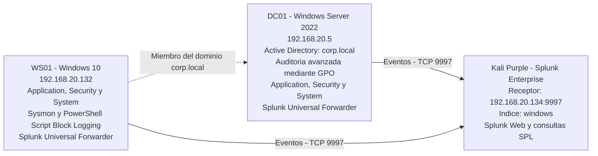

La línea discontinua representa la relación de dominio entre WS01 y DC01. Las flechas continuas representan el envío de eventos desde cada equipo a Splunk Enterprise; los registros de WS01 no se representan como si pasaran primero por DC01.

## 1. Instalación y configuración de Splunk Enterprise en Kali Purple

### 1.1. Objetivo y alcance del procedimiento

Se instaló **Splunk Enterprise 10.6.1.1** mediante el paquete `.deb` para Linux en **Kali Purple 2026.3**, para preparar el servidor centralizado de recopilación y análisis de eventos de seguridad.

El procedimiento comprendió la instalación del software, el acceso a Splunk Web, la habilitación del puerto receptor **TCP 9997** y la creación del índice **`windows`**, destinado a los eventos de DC01 y WS01. Todas las acciones de esta sección se realizaron en Kali Purple.

Las versiones indicadas corresponden al registro de implementación. La recepción efectiva de eventos de los equipos Windows se comprobará en sus respectivos procedimientos; habilitar el receptor y crear el índice todavía no demuestra esa recepción.

### 1.2. Descarga e instalación del paquete

Se accedió al [sitio oficial de descarga de Splunk Enterprise](https://www.splunk.com/en_us/download/splunk-enterprise.html). Para obtener el instalador, se completó el registro y la verificación mediante el código recibido por correo electrónico.

En la selección de plataforma se eligió **Linux** y se descargó el paquete **`.deb`**.

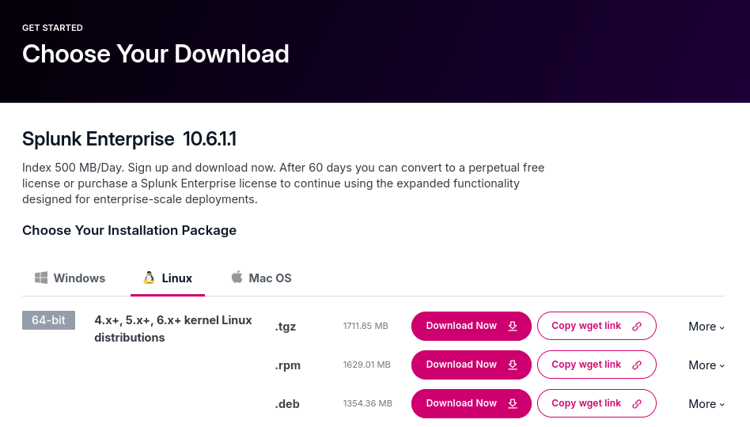

*La captura muestra la versión ofrecida en la página y los formatos de descarga para Linux. La comprobación de la instalación se realizó posteriormente desde la terminal.*

Desde la terminal de Kali Purple se accedió a la carpeta de descarga y se consultó el nombre del paquete:

```bash
cd Descargas
ls
```

A continuación, se instaló el paquete local con APT:

```bash
sudo apt install ./NOMBRE_DEL_ARCHIVO.deb
```

`NOMBRE_DEL_ARCHIVO.deb` representa el nombre real del instalador obtenido en el paso anterior y debe sustituirse antes de ejecutar el comando. El registro de implementación no conserva su nombre completo.

Para consultar la versión de Splunk se utilizó el siguiente comando, con el subcomando `version` en inglés:

```bash
sudo /opt/splunk/bin/splunk version
```

Durante la configuración inicial por CLI se revisaron los términos de licencia, avanzando con la barra espaciadora y confirmando su aceptación cuando se solicitó. No se dispone de una captura de la salida del comando de versión; **10.6.1.1** es la versión consignada en el registro de implementación.

### 1.3. Cuenta de servicio, inicio y acceso a Splunk Web

Se comprobó la existencia de la cuenta de sistema `splunk`:

```bash
getent passwd splunk
```

Después se asignó la propiedad del directorio de instalación al usuario y grupo `splunk`:

```bash
sudo chown -R splunk:splunk /opt/splunk
```

La cuenta `splunk` pertenece al sistema Linux y está destinada a la ejecución del software. Es distinta de las credenciales administrativas de Splunk Web y de la cuenta utilizada en el sitio de descarga.

El primer inicio quedó documentado mediante:

```bash
sudo /opt/splunk/bin/splunk start --accept-license
```

Durante la configuración inicial se definieron las credenciales de administración de la instancia. Posteriormente se consultó el estado mediante:

```bash
sudo -u splunk /opt/splunk/bin/splunk status
```

**Alcance de esta comprobación:** el comando `status` se ejecutó como usuario `splunk`, mientras que el inicio anterior se realizó con `sudo`, sin especificar ese usuario. La asignación de propiedad y la consulta de estado no bastan para confirmar la identidad del proceso iniciado. El registro disponible no incluye una comprobación del propietario del proceso ni un paso que documente la transición de cuenta.

Una vez iniciado Splunk, se accedió desde el navegador de Kali Purple a Splunk Web. La dirección local indicada en el registro del procedimiento es:

```text
http://localhost:8000
```

Se inició sesión con las credenciales administrativas creadas para la instancia.

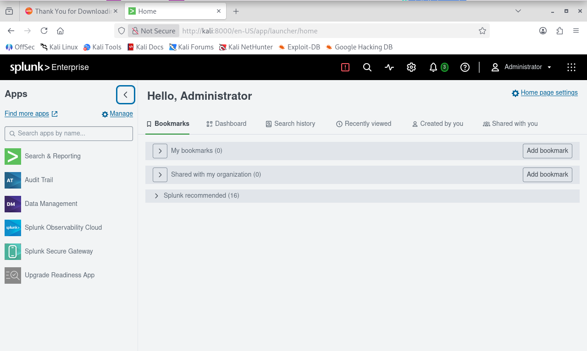

*La captura confirma el acceso a la pantalla principal de Splunk Web. En ella, el navegador muestra `http://kali:8000`, mientras que el registro del procedimiento indica `http://localhost:8000`; se conserva esta diferencia sin atribuir a la imagen una URL que no muestra.*

### 1.4. Configuración del puerto receptor TCP 9997

Se habilitó un puerto de recepción para los datos que enviarían los Splunk Universal Forwarders.

Desde Splunk Web se siguió esta secuencia:

1. Abrir **Settings → Forwarding and receiving**.
2. En **Receive data**, seleccionar **Configure receiving**.
3. Seleccionar **New Receiving Port**.
4. Introducir `9997` y guardar mediante **Save**.

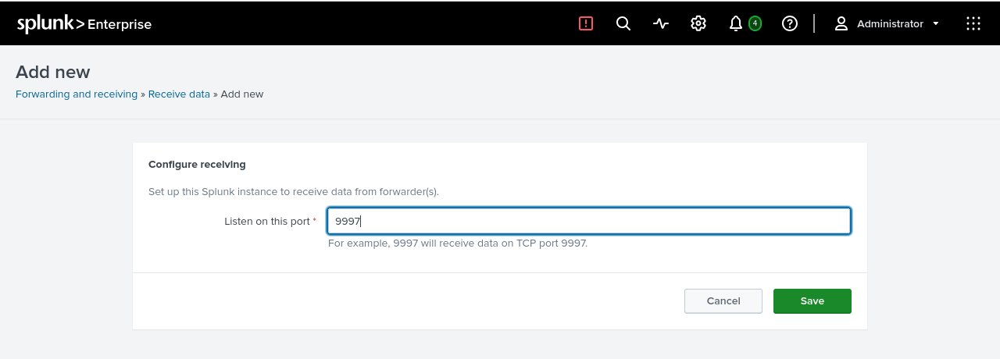

*El formulario muestra el valor introducido. La confirmación de guardado se observa en la siguiente captura.*

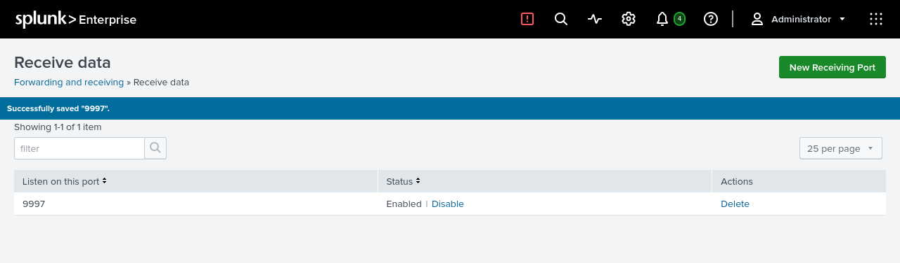

*La lista de recepción muestra el puerto `9997` con estado `Enabled` y el mensaje de guardado correcto.*

Además de verificar la configuración en la interfaz, se comprobó la escucha TCP desde la terminal de Kali Purple:

```bash
sudo ss -lntp | grep ':9997'
```

El comando permite revisar los sockets TCP en escucha y filtrar el puerto configurado. El registro de verificación confirma la escucha en **`0.0.0.0:9997`**. No se dispone de una captura de esta salida, por lo que no se reproduce una salida de terminal reconstruida.

La configuración habilitada en Splunk Web y la escucha comprobada en el sistema respaldan la disponibilidad del receptor. La conexión de un agente y la recepción de sus eventos requieren comprobaciones posteriores.

### 1.5. Creación y configuración del índice windows

Se creó el índice **`windows`** para centralizar los eventos procedentes de DC01 y WS01. Desde **Settings → Indexes** se seleccionó **New Index** y se aplicaron los siguientes valores:

| Campo | Configuración aplicada |
|---|---|
| Name | `windows`, en minúsculas |
| Index data type | `Events` |
| Home path | Vacío; ruta predeterminada |
| Cold path | Vacío; ruta predeterminada |
| Thawed path | Vacío; ruta predeterminada |
| Data integrity check | `Disable` |
| Max size of entire index | `1 GB` |
| Max size of hot/warm/cold bucket | `auto`, con la unidad `GB` seleccionada |
| Frozen path | Vacío |
| App | `Search & Reporting` |
| Tsidx retention policy | `Disable reduction` |
| Reduce tsidx files older than | Deshabilitado |

Después se guardó el índice. Los campos se documentan según el procedimiento registrado; la consulta siguiente comprueba específicamente el nombre, el límite de tamaño y el espacio ocupado.

Para verificarlo, se abrió **Apps → Search & Reporting** y se ejecutó en **New Search**:

```spl
| rest /services/data/indexes
| search title="windows"
| table title maxTotalDataSizeMB currentDBSizeMB
```

La consulta obtiene información de los índices, selecciona `windows` y presenta los campos de tamaño utilizados para la comprobación.

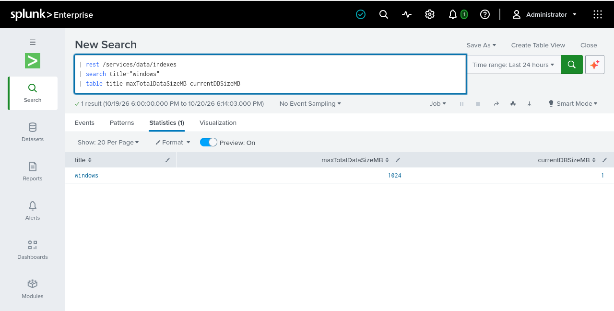

*La captura muestra el índice final `windows` y el límite `maxTotalDataSizeMB = 1024`, correspondiente al valor de 1 GB configurado.*

Resultado observado:

| title | maxTotalDataSizeMB | currentDBSizeMB |
|---|---:|---:|
| windows | 1024 | 1 |

`currentDBSizeMB` representa el tamaño ocupado por el índice en el momento de la consulta. El valor `1` es una observación de esa ejecución y puede variar; no es un valor fijo que deba reproducirse.

### 1.6. Ajuste por disponibilidad de espacio en disco

Durante las prácticas fue necesario ajustar el umbral mínimo de espacio libre utilizado por Splunk para permitir las búsquedas en esta máquina virtual:

```bash
sudo -u splunk /opt/splunk/bin/splunk set minfreemb 2000
```

El registro de implementación indica que se aplicó el ajuste y posteriormente se reinició Splunk. No conserva el comando utilizado para ese reinicio ni una captura del mensaje que motivó el cambio.

Este ajuste respondió a las limitaciones de almacenamiento del laboratorio. No constituye un requisito general de instalación ni una recomendación universal. Es un parámetro distinto del límite de **1 GB del índice `windows`**.

### 1.7. Resultado del procedimiento

Splunk Enterprise quedó instalado y operativo en Kali Purple, con acceso comprobado a Splunk Web, el puerto receptor **TCP 9997** habilitado y el índice **`windows`** configurado con un límite de **1024 MB**.

Las capturas respaldan el acceso web, la configuración habilitada del receptor y la consulta del índice final. Las comprobaciones por terminal se conservan según el registro del procedimiento, con las limitaciones de evidencia indicadas en cada paso.

Este resultado deja preparado el servidor para recibir los eventos de los equipos Windows. La recepción efectiva de esos registros no forma parte de la validación de este primer procedimiento.

## 2. Instalación y configuración de Splunk Universal Forwarder en DC01

### 2.1. Objetivo y alcance del procedimiento

Se instaló y configuró **Splunk Universal Forwarder en DC01**, el controlador de dominio Windows Server 2022, para recopilar los registros **Application, Security y System** y enviarlos a Splunk Enterprise en Kali Purple.

El servidor receptor utilizado fue **`192.168.20.134:9997`** y el índice de destino fue **`windows`**, creado en el procedimiento anterior. En DC01 se instaló el agente de recopilación; la instancia de Splunk Enterprise permaneció en Kali Purple.

La validación se realizó en tres niveles: estado del servicio en Windows, conectividad TCP hacia el receptor y recepción efectiva de eventos mediante búsquedas en Splunk Web.

### 2.2. Descarga e instalación en DC01

Desde DC01 se accedió al [sitio oficial de descarga de Splunk Universal Forwarder](https://www.splunk.com/en_us/download/universal-forwarder/thank-you-universalforwarder.html). Se utilizó la cuenta del sitio de Splunk para obtener el **instalador MSI para Windows x64**.

Se ejecutó el instalador y se completó el asistente con las siguientes opciones:

| Opción del asistente | Configuración seleccionada |
|---|---|
| Cuenta de ejecución del servicio | `Local System` |
| Windows Event Logs | Application, Security y System |
| Campos de certificados SSL | En blanco |
| Performance Monitor | Sin configuración adicional |
| Paths to monitor | Sin configuración adicional |
| Deployment Server | Sin configurar |
| Receiving Indexer: dirección | `192.168.20.134` |
| Receiving Indexer: puerto | `9997` |

La selección de Windows Event Logs definió los registros que se recopilarían desde DC01. El campo **Receiving Indexer** indicó el destino de envío, correspondiente al receptor configurado en Kali Purple.

Durante el asistente se crearon credenciales administrativas propias del Universal Forwarder. Estas credenciales son independientes de las utilizadas para acceder a **Splunk Web** y de la cuenta del sitio de descarga. La cuenta de ejecución del servicio seleccionada fue **Local System**.

Los campos de certificados SSL se dejaron vacíos durante la instalación. Esa selección, por sí sola, no permite concluir si la conexión utiliza TLS; no se documentó una comprobación específica del cifrado.

Una vez completado el asistente, se continuó con las verificaciones desde PowerShell en DC01. No se dispone de capturas del instalador; las opciones anteriores se conservan según el registro de implementación.

### 2.3. Verificación del servicio en Windows

En PowerShell de DC01 se consultó el estado del servicio:

```powershell
Get-Service SplunkForwarder
```

Resultado registrado:

```text
Status   Name
------   ----
Running  SplunkForwarder
```

El estado **`Running`** confirmó que el servicio estaba iniciado. Esta comprobación no demuestra por sí sola que el agente pueda conectarse al servidor ni que sus eventos estén siendo recibidos en Splunk.

### 2.4. Comprobación de conectividad con Kali Purple

Desde PowerShell en DC01 se comprobó la conexión hacia el puerto receptor:

```powershell
Test-NetConnection 192.168.20.134 -Port 9997
```

El resultado observado incluyó:

```text
TcpTestSucceeded : True
```

Este resultado confirmó la conectividad TCP desde DC01 hacia **`192.168.20.134:9997`**. La prueba verifica el acceso al puerto; la recepción de los registros se comprobó por separado mediante búsquedas en Splunk Enterprise.

Los resultados de servicio y conectividad están documentados en el registro de implementación. No se dispone de capturas de esas salidas de PowerShell.

### 2.5. Configuración de las entradas y del índice de destino

En DC01 se configuró el archivo `inputs.conf` ubicado en:

```text
C:\Program Files\SplunkUniversalForwarder\etc\system\local\inputs.conf
```

Se aplicaron las siguientes entradas:

```ini
[WinEventLog://Application]
index = windows

[WinEventLog://Security]
index = windows

[WinEventLog://System]
index = windows
```

Cada bloque identifica uno de los registros de eventos de Windows y asigna **`windows`** como índice de destino. Esta configuración dirige los eventos al índice existente en Splunk Enterprise; no crea un índice nuevo en DC01.

Después de guardar la configuración, se reinició el servicio y se comprobó nuevamente su estado desde PowerShell:

```powershell
Restart-Service SplunkForwarder
Get-Service SplunkForwarder
```

El registro del procedimiento confirma que el servicio quedó operativo. El contenido de `inputs.conf` está documentado en el registro de implementación; no hay una captura específica del archivo.

### 2.6. Verificación de recepción y prueba del registro Application

Desde Kali Purple se abrió **Splunk Web → Search & Reporting**. El registro de implementación indica la selección del intervalo **All time** y la ejecución de esta búsqueda:

```spl
index=windows host=DC01
| stats count by sourcetype
```

La búsqueda selecciona los eventos de DC01 almacenados en `windows` y los agrupa por `sourcetype`. El objetivo fue comprobar la recepción de los tres tipos completos:

- `WinEventLog:Application`
- `WinEventLog:Security`
- `WinEventLog:System`

Durante la primera comprobación no aparecían eventos de **Application**. Para verificar esa fuente mediante una actividad controlada, se ejecutó en DC01:

```powershell
eventcreate /L APPLICATION /T INFORMATION /ID 100 /SO SplunkLab /D "Prueba de ingesta de Application en Splunk"
```

El comando genera un evento informativo en el registro **Application**, con identificador **100**, origen **SplunkLab** y el mensaje de prueba indicado. Posteriormente se confirmó la recepción de eventos Application en el índice `windows`.

No se documentó la causa de la ausencia inicial de resultados, por lo que no se atribuye a un fallo de Splunk Universal Forwarder. La generación del evento permitió comprobar la ingesta de esa fuente.

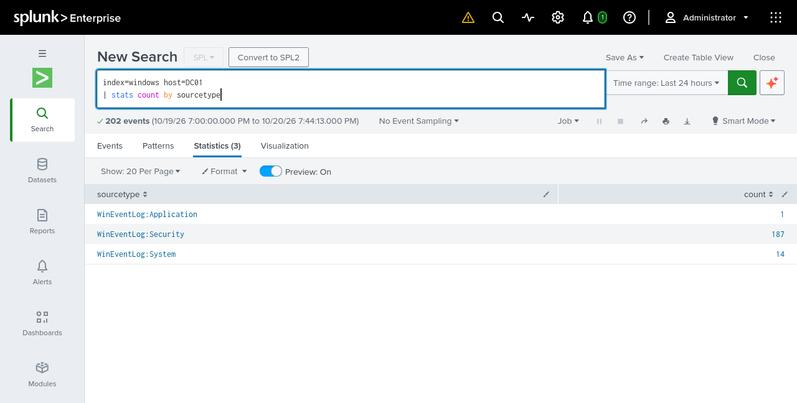

*La captura muestra los tres sourcetypes recibidos desde DC01, con un total de 202 eventos en la ventana consultada. Respalda la recepción de los tres registros, pero no muestra el detalle del Event ID 100, el estado del servicio ni el contenido de `inputs.conf`.*

| Sourcetype | Eventos observados en la captura |
|---|---:|
| `WinEventLog:Application` | 1 |
| `WinEventLog:Security` | 187 |
| `WinEventLog:System` | 14 |
| **Total** | **202** |

**Intervalo temporal de la evidencia:** el registro escrito indica **All time**, mientras que la captura muestra **Last 24 hours**. Se conserva el rango del procedimiento y se identifica por separado el rango visible en la imagen, sin asumir que ambos corresponden a la misma ejecución. Los recuentos anteriores pertenecen exclusivamente a la captura y pueden variar con el intervalo y los eventos recibidos.

La prueba con `eventcreate` se sustenta en el registro escrito; la imagen aporta el recuento agrupado de Application.

### 2.7. Resultado del procedimiento

Splunk Universal Forwarder quedó instalado y operativo en DC01, con conectividad TCP hacia el receptor de Kali Purple y las entradas de **Application, Security y System** dirigidas al índice **`windows`**.

Las verificaciones distinguieron el servicio iniciado en Windows, la conectividad al puerto **9997** y la recepción efectiva de los tres registros en Splunk. Esta última quedó respaldada por la búsqueda y la captura de eventos agrupados por sourcetype.

## 3. Configuración de auditoría avanzada de Active Directory en DC01

### 3.1. Objetivo y alcance del procedimiento

Se configuró la auditoría avanzada en **DC01**, controlador del dominio **`corp.local`** con **Windows Server 2022 Standard Evaluation**, mediante la GPO **`SOC - Advanced Audit Policy`**.

El objetivo fue habilitar la generación de eventos de seguridad relevantes para el monitoreo del dominio. Los registros **Security** se recopilan mediante el Universal Forwarder y se envían al índice **`windows`** de Splunk Enterprise, según el procedimiento anterior. La configuración de auditoría determina qué actividad registra Windows; no crea alertas ni reglas de detección en Splunk.

Se definieron los siguientes eventos de interés para futuras detecciones:

| Event ID | Actividad | Subcategoría de auditoría |
|---|---|---|
| 4625 | Inicio de sesión fallido | Audit Logon |
| 4720 | Creación de una cuenta de usuario | Audit User Account Management |
| 4728 | Incorporación de un miembro a un grupo global de seguridad | Audit Security Group Management |
| 4732 | Incorporación de un miembro a un grupo local de seguridad | Audit Security Group Management |
| 4771 | Error de preautenticación Kerberos | Audit Kerberos Authentication Service |
| 4776 | Validación de credenciales mediante NTLM | Audit Credential Validation |

Esta tabla define actividades de interés, no una lista de resultados obtenidos. No se documentó en esta etapa la generación de los eventos **4720, 4728 y 4732**. Un intento fallido originado en WS01 tampoco implica necesariamente un **4625 en DC01**: su ubicación depende del tipo de autenticación y del sistema que procesa el inicio de sesión.

### 3.2. Creación y vinculación de la GPO

En **DC01** se abrió **Ejecutar** mediante **Win + R** y se inició Group Policy Management con:

```text
gpmc.msc
```

En la consola se recorrió **Forest: corp.local → Domains → corp.local → Domain Controllers**. Sobre la unidad organizativa **Domain Controllers** se hizo clic derecho y se seleccionó **Create a GPO in this domain, and Link it here...**. Se asignó el nombre **`SOC - Advanced Audit Policy`** y se confirmó la creación.

Esta operación creó la política en el dominio y agregó su vínculo a la OU. El ámbito documentado son los controladores de dominio de **Domain Controllers**; este vínculo no configura automáticamente la auditoría local de WS01.

-2026-10-20-19-58-03.png>)

*La captura muestra la GPO y su vínculo a Domain Controllers con «Vínculo habilitado: Sí». Respalda la vinculación, pero no demuestra que sus opciones ya se hayan aplicado en DC01.*

Para configurar la política, se hizo clic derecho sobre **SOC - Advanced Audit Policy → Editar**. En Group Policy Management Editor se siguió esta ruta:

```text
Configuración del equipo
→ Directivas
→ Configuración de Windows
→ Configuración de seguridad
→ Configuración de directiva de auditoría avanzada
→ Directivas de auditoría
```

La creación y vinculación establecieron la política y su ámbito. Las opciones de auditoría se definieron después dentro de este editor.

### 3.3. Configuración de las seis subcategorías

Dentro de **Directivas de auditoría** se configuraron las siguientes seis subcategorías. Los nombres en español corresponden a la interfaz documentada; se incluye su equivalencia en inglés para facilitar su identificación.

| Categoría | Subcategoría en la interfaz / equivalencia | Configuración |
|---|---|---|
| Inicio y cierre de sesión / Logon/Logoff | Auditar inicio de sesión / Audit Logon | Success and Failure |
| Administración de cuentas / Account Management | Auditar administración de cuentas de usuario / Audit User Account Management | Success and Failure |
| Administración de cuentas / Account Management | Auditar administración de grupos de seguridad / Audit Security Group Management | Success and Failure |
| Inicio de sesión de cuentas / Account Logon | Auditar servicio de autenticación Kerberos / Audit Kerberos Authentication Service | Failure |
| Inicio de sesión de cuentas / Account Logon | Auditar operaciones de vales de servicio Kerberos / Audit Kerberos Service Ticket Operations | Failure |
| Inicio de sesión de cuentas / Account Logon | Auditar validación de credenciales / Audit Credential Validation | Failure |

Para cada subcategoría se abrió su configuración con doble clic y se marcó **Configurar los siguientes eventos de auditoría**. En **Audit Logon**, **Audit User Account Management** y **Audit Security Group Management** se seleccionaron **Correcto y Error**; en las tres subcategorías de **Account Logon** se seleccionó únicamente **Error**. Cada cambio se guardó mediante **Aplicar → Aceptar**. La lista del editor presenta estos estados como **Aciertos y errores** o **Errores**, respectivamente.

Las opciones cubren actividades diferentes:

- **Audit Logon:** intentos de inicio de sesión, correctos y fallidos, procesados por el equipo. Se distingue de la autenticación Kerberos que realiza el controlador de dominio.
- **Audit User Account Management:** operaciones de administración de cuentas de usuario, como su creación.
- **Audit Security Group Management:** operaciones de administración de grupos de seguridad, como cambios de miembros.
- **Audit Kerberos Authentication Service:** fallos en la autenticación Kerberos, incluidos los errores de preautenticación de interés para el evento 4771.
- **Audit Kerberos Service Ticket Operations:** fallos en operaciones de vales de servicio Kerberos.
- **Audit Credential Validation:** fallos de validación de credenciales mediante NTLM, relacionados con el evento 4776.

**Guía visual: ubicación de Audit Logon**

-2026-10-20-20-04-45.png>)

*La captura permite localizar **Auditar inicio de sesión (Audit Logon)** dentro de **Inicio y cierre de sesión**. Fue tomada antes de aplicar la configuración, por lo que muestra «No configurada». El valor final documentado es **Success and Failure (Aciertos y errores)**; esta imagen sirve como guía visual, no como evidencia del estado final.*

**Guía visual: ubicación de las opciones de administración de cuentas**

-2026-10-20-20-09-01.png>)

*La captura permite localizar **Audit User Account Management** y **Audit Security Group Management** en **Administración de cuentas**. Muestra un estado intermedio: la auditoría de cuentas de usuario ya figura con «Aciertos y errores», mientras que la de grupos de seguridad todavía aparece como «No configurada». Al completar el procedimiento, ambas subcategorías quedaron configuradas con **Success and Failure (Aciertos y errores)**. La imagen orienta la navegación y no demuestra el estado final de ambas opciones.*

La selección de **Failure** para Kerberos y validación de credenciales respondió al interés inicial por los intentos fallidos y a las limitaciones de almacenamiento de Kali Purple. Reduce el volumen frente a habilitar también los aciertos en esas subcategorías, pero no ofrece visibilidad completa de las autenticaciones exitosas. Es una decisión de alcance del laboratorio, no una recomendación universal para entornos empresariales.

-2026-10-20-20-15-11.png>)

*El editor muestra «Errores» para validación de credenciales, servicio de autenticación Kerberos y operaciones de vales de servicio Kerberos. Esta captura respalda esas tres opciones configuradas en la GPO; no muestra las otras tres ni comprueba la política efectiva de DC01.*

La configuración completa de la tabla se sustenta en el registro de implementación. Las capturas de estados previos e intermedios se utilizan como guías visuales, con los límites indicados en sus descripciones.

### 3.4. Aplicación y comprobación de la política efectiva

Después de guardar los cambios, se ejecutó en **DC01**:

```powershell
gpupdate /force
```

Este comando actualiza las directivas de grupo del equipo. A continuación, se consultó la configuración de auditoría efectiva:

```powershell
auditpol /get /category:*
```

La comprobación consistió en revisar las seis subcategorías y contrastar sus opciones con la tabla anterior: **Success and Failure** para inicio de sesión, administración de cuentas de usuario y administración de grupos de seguridad; **Failure** para las tres subcategorías de autenticación indicadas.

El registro de implementación indica que, durante la verificación final, se confirmó la configuración correcta de las seis subcategorías mediante `auditpol`. No se dispone de una captura de esa salida; el resultado se sustenta en el registro escrito.

Se distinguen así cuatro comprobaciones: la GPO **creada** existe en el dominio; el **vínculo** establece su ámbito; las opciones guardadas en el **editor** definen lo solicitado; y **`auditpol` en DC01** permite revisar la configuración efectiva después de actualizar las directivas. Una imagen del editor no sustituye esta última comprobación.

### 3.5. Recepción de eventos Security en Splunk

Desde **Kali Purple**, en **Splunk Web → Search & Reporting**, se ejecutó:

```spl
index=windows host=DC01 sourcetype="WinEventLog:Security"
| stats count by EventCode
| sort - count
```

Los filtros seleccionan los registros Security de DC01 en el índice `windows`. **`stats count by EventCode`** agrupa los eventos por identificador y **`sort - count`** ordena los recuentos de mayor a menor. La búsqueda permite revisar qué tipos de eventos se están recibiendo; no presenta el detalle de cada autenticación ni demuestra por sí sola que las seis opciones de auditoría estén aplicadas.

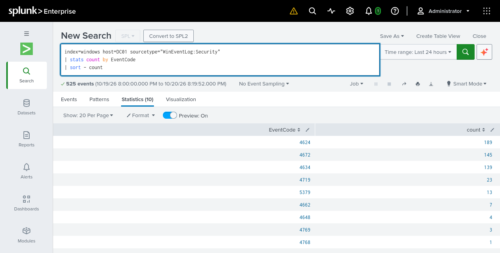

*La captura muestra el rango «Last 24 hours», 525 eventos y 10 grupos estadísticos, aunque no todas las filas quedan visibles. Entre las filas legibles aparecen 4624 con 189 eventos y 4648 con 4 eventos.*

El registro escrito no especifica el intervalo de esta primera búsqueda; **Last 24 hours** corresponde al selector visible en la captura. Los recuentos describen esa ejecución y no son valores fijos que deban reproducirse. La presencia de **4624 y 4648**, también documentada en el registro escrito, respalda la recepción de eventos Security. No acredita todos los escenarios de la tabla de eventos de interés ni permite atribuir cada registro a los cambios de esta GPO.

### 3.6. Prueba controlada de autenticación y revisión de resultados

En **WS01**, la estación de trabajo del empleado, se abrió PowerShell y se ejecutó:

```powershell
runas /user:corp\empleado1 cmd
```

Cuando se solicitó la contraseña, se introdujo deliberadamente una incorrecta para provocar un intento de autenticación fallido. La acción se realizó en WS01; la revisión posterior se centró en los eventos Security que **DC01** había enviado a Splunk.

Desde **Search & Reporting** en Kali Purple, el procedimiento registra la selección de **Last 15 minutes** y la ejecución de:

```spl
index=windows host=DC01 sourcetype="WinEventLog:Security" (EventCode=4771 OR EventCode=4776 OR EventCode=4625)
| table _time EventCode Account_Name Source_Network_Address Failure_Reason
| sort - _time
```

La consulta filtra los tres identificadores de interés, presenta la marca temporal y los campos indicados, y ordena los resultados del más reciente al más antiguo. Los campos **`Account_Name`**, **`Source_Network_Address`** y **`Failure_Reason`** pueden no estar presentes o no aparecer con esos nombres en todos los eventos.

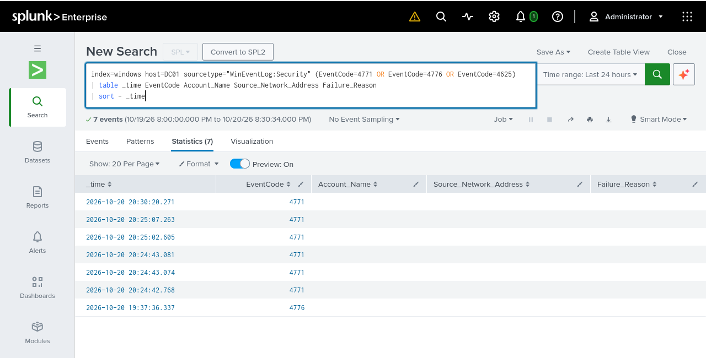

*La captura muestra siete registros: seis con EventCode 4771 y uno con EventCode 4776. Las columnas Account_Name, Source_Network_Address y Failure_Reason aparecen vacías. No se observa un evento 4625 en estos resultados.*

**Diferencia de intervalo:** el registro escrito documenta **Last 15 minutes**, pero el selector de la imagen muestra **Last 24 hours**. Los siete registros pertenecen a la ejecución capturada; no se presentan como el resultado comprobado de la ventana de 15 minutos del procedimiento.

Los eventos **4771** representan errores de preautenticación Kerberos. El evento **4776** corresponde a una validación de credenciales mediante NTLM; el identificador por sí solo no determina su resultado y la tabla capturada no muestra un estado que permita calificar ese registro individual.

Los resultados confirman la presencia de esos identificadores en DC01 durante la ventana consultada, pero no permiten atribuirlos inequívocamente a la ejecución documentada de `runas`. En particular, el registro **4776** tiene una marca temporal anterior a los seis **4771** visibles y faltan valores de cuenta y origen para establecer una correlación concluyente. La prueba con contraseña incorrecta está documentada; no se afirma que todos los eventos observados procedan de esa única acción.

La ausencia de **4625** en esta tabla tampoco demuestra un fallo de auditoría: no necesariamente debe registrarse en DC01 cuando el intento se origina en WS01.

### 3.7. Resultado del procedimiento

Según el registro de implementación, la GPO **SOC - Advanced Audit Policy** quedó creada, vinculada a **Domain Controllers** y aplicada en **DC01**, con las seis subcategorías previstas comprobadas mediante **`auditpol`**. Las capturas respaldan el vínculo, las tres opciones de Account Logon configuradas como **Errores** y la recepción de eventos **Security** en Splunk; la comprobación de la política efectiva se sustenta en el registro escrito.

Se documentó la prueba controlada desde WS01 y se observaron eventos **4771 y 4776** en la búsqueda de DC01, con las limitaciones de intervalo y correlación indicadas. Las pruebas de creación de usuarios y modificación de grupos, así como las detecciones correspondientes, quedan para etapas posteriores.


## 4. Instalación y configuración de Splunk Universal Forwarder en WS01

### 4.1. Objetivo y alcance del procedimiento

Se instaló **Splunk Universal Forwarder 10.6.1.1 para Windows x64** en **WS01**, una estación de trabajo con **Windows 10** unida al dominio **`corp.local`**, para recopilar los registros **Application, Security y System** y enviarlos a Splunk Enterprise.

En este procedimiento, **WS01** es el equipo cliente y origen de los eventos; **DC01** mantiene su función de controlador de dominio; y **Kali Purple** aloja el servidor central de Splunk Enterprise. El destino de envío utilizado fue **`192.168.20.134:9997`**, con el índice **`windows`** creado previamente en Kali Purple.

La versión de Splunk Universal Forwarder y las opciones de instalación se conservan según el registro de implementación. La validación comprendió el estado del servicio, la configuración de las entradas y la recepción de eventos mediante búsquedas en Splunk.

### 4.2. Descarga e instalación en WS01

Desde WS01 se accedió al [sitio oficial de descarga de Splunk Universal Forwarder](https://www.splunk.com/en_us/download/universal-forwarder.html), se inició sesión en la cuenta del sitio de Splunk y se descargó el instalador para **Windows x64**.

Al ejecutar el instalador, se aceptó **Check this box to accept the License Agreement**, se mantuvo **An on-premises Splunk Enterprise instance** y se seleccionó **Customize Options** para definir las opciones del agente:

| Opción del asistente | Configuración seleccionada |
|---|---|
| License Agreement | Aceptado |
| Splunk Enterprise instance | On-premises |
| Installation options | Customize Options |
| SSL certificate fields | En blanco |
| Service account | Local System |
| Windows Event Logs | Application, Security y System |
| Active Directory Monitoring | Sin seleccionar |
| Paths to monitor | Sin configurar |
| Deployment Server | Sin configurar |
| Receiving Indexer: Hostname or IP | `192.168.20.134` |
| Receiving Indexer: Port | `9997` |

La cuenta **Local System** se seleccionó para ejecutar el servicio. En **Windows Event Logs** se eligieron los tres registros que se recopilarían desde WS01. **Receiving Indexer** indicó el servidor de Splunk Enterprise en Kali Purple y su puerto receptor TCP **9997**. La asignación al índice `windows` se completó después en `inputs.conf`.

Los campos de certificados SSL se dejaron vacíos. Esa selección no permite determinar por sí sola si la conexión utiliza TLS; el material disponible no registra una comprobación específica del cifrado.

No se dispone de capturas del asistente de WS01. Las opciones anteriores están respaldadas por el registro escrito.

### 4.3. Verificación del servicio

Después de completar la instalación, se ejecutó en PowerShell de **WS01**:

```powershell
Get-Service SplunkForwarder
```

El registro de implementación confirma que el servicio se encontraba en estado **`Running`**. Este resultado demuestra que el servicio estaba iniciado; no confirma por sí solo la conectividad con el receptor ni la recepción de eventos.

No se registró la ejecución de **`Test-NetConnection`** ni el resultado de una prueba TCP independiente desde WS01. La recepción efectiva se verificó posteriormente en Splunk, mediante las búsquedas documentadas a continuación.

### 4.4. Configuración de los registros de Windows

En **WS01** se abrió PowerShell como administrador y se editó el archivo local de entradas con:

```powershell
notepad "C:\Program Files\SplunkUniversalForwarder\etc\system\local\inputs.conf"
```

En `inputs.conf` se agregaron las siguientes entradas para dirigir Application, Security y System al índice `windows`:

```ini
[WinEventLog://Application]
index = windows

[WinEventLog://Security]
index = windows

[WinEventLog://System]
index = windows
```

Cada bloque asigna uno de los registros de eventos de WS01 al índice **`windows`** del servidor Splunk Enterprise. Esta configuración no crea el índice: utiliza el que ya existe en Kali Purple, donde también se reciben los eventos de DC01. El campo `host` permite distinguir el equipo de origen en las búsquedas.

Al guardar desde el Bloc de notas, se seleccionó el tipo **Todos los archivos** para evitar que se agregara automáticamente la extensión `.txt`. El nombre final utilizado fue **`inputs.conf`**, no `inputs.conf.txt`.

Después de guardar, se reinició el servicio y se comprobó nuevamente su estado:

```powershell
Restart-Service SplunkForwarder
Get-Service SplunkForwarder
```

El resultado registrado fue **`Running`**. A continuación, se inspeccionó la configuración efectiva del Forwarder con el comando documentado:

```powershell
& "C:\Program Files\SplunkUniversalForwarder\bin\splunk.exe" btool inputs list --debug
```

Se verificó que las entradas de **Application, Security y System** tuvieran estos valores:

```ini
index = windows
disabled = 0
```

Estos valores son los registrados en la comprobación; no representan una transcripción completa de la salida de `btool`. En particular, **`disabled = 0`** se observó en la configuración efectiva y no se añade al contenido de `inputs.conf` reproducido arriba, que solo contiene las asignaciones documentadas.

**`btool`** permite inspeccionar la configuración resultante de combinar los archivos de configuración de Splunk. Así se distinguió lo escrito en el archivo local de lo comprobado para las tres entradas habilitadas. Esta revisión no demuestra por sí sola que los eventos lleguen al servidor; esa validación se realizó mediante búsquedas en Splunk Enterprise.

No se dispone de capturas del archivo, del estado del servicio ni de la salida de `btool`; estos pasos se documentan a partir del registro de implementación.

### 4.5. Comprobación inicial y prueba controlada de Application

Desde **Kali Purple → Splunk Web → Search & Reporting** se ejecutó:

```spl
index=windows host=WS01
| stats count by sourcetype
```

La consulta selecciona los eventos de **WS01** en el índice **`windows`** y los agrupa por `sourcetype`, para identificar qué tipos de registros se están recibiendo.

Durante las primeras verificaciones se observaron algunos eventos en el índice **`main`**, mientras que todavía no aparecían todas las fuentes en **`windows`**. Se conserva esta observación del proceso de configuración sin atribuirle una causa no documentada ni afirmar que los eventos históricos se trasladaron automáticamente entre índices.

Para validar la ingesta de un evento nuevo, se ejecutó en **PowerShell como administrador en WS01**:

```powershell
eventcreate /L APPLICATION /T INFORMATION /ID 100 /SO SplunkLab /D "Prueba de ingesta de Application desde WS01"
```

El comando generó un evento informativo en el registro **Application**, con **ID 100**, origen **SplunkLab** y un mensaje específico de WS01. Esta prueba está documentada para WS01 y es independiente de la realizada anteriormente en DC01.

Posteriormente se buscó en Splunk:

```spl
index=windows host=WS01 source="WinEventLog:Application" "Prueba de ingesta de Application desde WS01"
```

La búsqueda combina el índice, el host, la fuente Application y el texto de prueba para localizar el evento generado. El resultado registrado fue la recepción correcta del **evento informativo ID 100 de WS01 en `windows`**.

No se dispone de una captura del detalle de ese evento. Su generación y recepción se conservan según el registro escrito, sin atribuir esa comprobación a imágenes de otros eventos.

### 4.6. Verificación de recepción y evidencia complementaria

Para comprobar específicamente la recepción de **Security** se realizó la siguiente búsqueda en todos los índices:

```spl
index=* host=WS01 (source="WinEventLog:Security" OR sourcetype="WinEventLog:Security")
| stats count by index source sourcetype
```

La consulta selecciona los eventos Security de WS01 por `source` o `sourcetype` y los agrupa por índice, fuente y tipo. El resultado registrado confirmó su llegada al índice **`windows`**. Esta búsqueda está limitada a Security y no constituye una comprobación de Application ni de System.

El registro de implementación confirma la recepción de las tres fuentes:

| Fuente | Sourcetype | Resultado registrado |
|---|---|---|
| Application | `WinEventLog:Application` | Recepción confirmada, incluida la prueba controlada ID 100 |
| Security | `WinEventLog:Security` | Recepción confirmada en `windows` mediante la búsqueda específica |
| System | `WinEventLog:System` | Recepción confirmada según el registro del procedimiento |

**Rangos temporales:** no se registraron los intervalos seleccionados para estas tres búsquedas ni sus recuentos. Las consultas se presentan tal como se ejecutaron.

Como evidencia complementaria se incorpora una captura **posterior a la instalación**, centrada en los eventos Security de WS01:

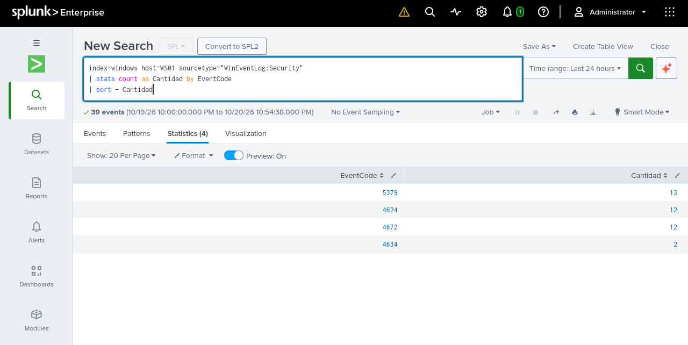

*La captura muestra los filtros `index=windows host=WS01 sourcetype="WinEventLog:Security"`, el rango **Last 24 hours** y 39 eventos agrupados por EventCode: 5379 (13), 4624 (12), 4672 (12) y 4634 (2). Respalda la recepción de Security desde WS01 en ese momento posterior.*

La imagen utiliza una agrupación por **EventCode**, distinta de las consultas originales anteriores. No se presenta como una captura de su ejecución ni como evidencia del asistente, del contenido de `inputs.conf`, del servicio o del evento Application ID 100. El rango de 24 horas y los recuentos corresponden únicamente a esta verificación posterior.

### 4.7. Resultado del procedimiento

Según el registro de implementación, **Splunk Universal Forwarder 10.6.1.1** quedó instalado y operativo en **WS01**, con las entradas de **Application, Security y System** habilitadas y dirigidas al índice **`windows`** de Splunk Enterprise en Kali Purple.

Se comprobó el servicio en **Running**, se revisó la configuración efectiva mediante **`btool`** y se confirmó la recepción de las tres fuentes mediante búsquedas en Splunk, incluida una prueba controlada de **Application ID 100**. La captura seleccionada aporta evidencia posterior de Security; las demás verificaciones se sustentan en el registro escrito con las limitaciones indicadas.

Esta configuración deja preparada la recopilación básica del equipo para incorporar posteriormente Sysmon y PowerShell Script Block Logging en sus procedimientos correspondientes.


## 5. Instalación y configuración de Sysmon y PowerShell Script Block Logging en WS01

### 5.1. Objetivo y alcance del procedimiento

Se amplió la visibilidad de seguridad de **WS01**, equipo con **Windows 10** unido al dominio **`corp.local`**, mediante **Sysmon de Microsoft Sysinternals** y **PowerShell Script Block Logging**.

Sysmon proporciona telemetría detallada de actividad del sistema, como creación de procesos y determinadas actividades de red, según las reglas del archivo de configuración aplicado. Script Block Logging registra contenido de bloques de scripts procesados por Windows PowerShell cuando se generan los eventos correspondientes; no implica que cada comando produzca necesariamente un evento independiente.

Ambas fuentes se incorporaron a **Splunk Universal Forwarder 10.6.1.1** para enviar sus registros al índice **`windows`** de Splunk Enterprise en **Kali Purple**. Se distinguieron tres niveles de comprobación: configuración habilitada, generación local de eventos y recepción en Splunk. La disponibilidad de esta telemetría no equivale a haber implementado reglas de detección o alertas automáticas.

### 5.2. Descarga, instalación y comprobación local de Sysmon

Desde la [página oficial de Sysmon en Microsoft Sysinternals](https://learn.microsoft.com/en-us/sysinternals/downloads/sysmon) se seleccionó **Download Sysmon**, se guardó **Sysmon.zip** en Descargas y se extrajo su contenido.

En PowerShell como administrador de **WS01** se preparó el directorio:

```powershell
New-Item -ItemType Directory -Path "C:\Tools\Sysmon" -Force
```

Se copiaron los archivos extraídos a **`C:\Tools\Sysmon`**. Para obtener la configuración se accedió desde la PC principal al repositorio [SwiftOnSecurity/sysmon-config](https://github.com/SwiftOnSecurity/sysmon-config), se abrió **`sysmonconfig-export.xml`** y se seleccionó **Raw**. Se copió su contenido, se pegó en el Bloc de notas de WS01 y se guardó en la carpeta de Sysmon con ese nombre y el tipo **Todos los archivos**.

Se comprobó la existencia del archivo:

```powershell
Test-Path "C:\Tools\Sysmon\sysmonconfig-export.xml"
```

Resultado registrado:

```text
True
```

Esta comprobación confirma la existencia del archivo; no valida individualmente sus reglas. A continuación, se instaló Sysmon con la configuración XML:

```powershell
cd C:\Tools\Sysmon
.\Sysmon64.exe -accepteula -i .\sysmonconfig-export.xml
```

- **`-accepteula`:** acepta la licencia.
- **`-i`:** instala Sysmon como servicio y controlador.
- **`.\sysmonconfig-export.xml`:** indica el archivo de configuración que se aplica durante la instalación.

El XML define las reglas de monitoreo utilizadas. No se afirma que se habilitaran todos los eventos posibles ni que cada regla se auditara individualmente. El registro no conserva una versión comprobada de Sysmon ni una revisión específica del XML, por lo que no se asignan esos datos.

Desde el mismo directorio se realizaron las verificaciones:

```powershell
Get-Service Sysmon64
.\Sysmon64.exe -c
```

El servicio **Sysmon64** se confirmó en **Running** y la consulta de configuración con **`-c`** se ejecutó sin errores. Después se revisó el canal local de eventos:

```powershell
Get-WinEvent -LogName "Microsoft-Windows-Sysmon/Operational" -MaxEvents 15 |
Select-Object TimeCreated, Id, ProviderName |
Format-Table -AutoSize
```

Según el registro del procedimiento, se observaron eventos del proveedor **Microsoft-Windows-Sysmon**, incluidos:

| Event ID de Sysmon | Actividad observada |
|---|---|
| 1 | Process Create: creación de procesos |
| 22 | DNS Query: consultas DNS |

Esta consulta comprobó la generación local antes de validar el envío a Splunk. Los registros muestran actividad del equipo y no constituyen por sí solos evidencia de un ataque. No se dispone de capturas de estas salidas locales.

### 5.3. Incorporación de Sysmon al Universal Forwarder

En PowerShell como administrador de **WS01** se abrió:

```powershell
notepad "C:\Program Files\SplunkUniversalForwarder\etc\system\local\inputs.conf"
```

Al final del archivo se añadió esta entrada, conservando las de **Application, Security y System** documentadas en la sección 4:

```ini
[WinEventLog://Microsoft-Windows-Sysmon/Operational]
disabled = 0
index = windows
renderXml = true
```

| Elemento | Función |
|---|---|
| `WinEventLog://Microsoft-Windows-Sysmon/Operational` | Identifica el canal de Sysmon |
| `disabled = 0` | Habilita la recopilación de la entrada |
| `index = windows` | Dirige los eventos al índice existente |
| `renderXml = true` | Solicita la representación XML de los eventos recopilados |

Para aplicar el cambio se reinició el Forwarder y se consultó su estado:

```powershell
Restart-Service SplunkForwarder
Get-Service SplunkForwarder
```

El resultado registrado fue **Running**. Este estado confirma el servicio iniciado, pero la recepción del nuevo canal se comprobó por separado.

### 5.4. Verificación de eventos Sysmon en Splunk

Las primeras búsquedas por **source** y posteriormente por **EventCode** no devolvieron los resultados esperados. El registro de implementación no conserva su texto completo, por lo que no se reconstruyen consultas.

Para revisar la entrada efectiva en WS01 se ejecutó:

```powershell
& "C:\Program Files\SplunkUniversalForwarder\bin\splunk.exe" btool inputs list "WinEventLog://Microsoft-Windows-Sysmon/Operational" --debug
```

Se confirmó que el Forwarder reconocía la entrada con **`disabled = 0`**, **`index = windows`** y **`renderXml = true`**. Esta comprobación de configuración no demuestra por sí sola la ingesta.

También se revisó **`splunkd.log`**, donde se registró el inicio del componente de recopilación:

```text
New scheduled exec process:
"C:\Program Files\SplunkUniversalForwarder\bin\splunk-winevtlog.exe"
```

No se identificaron errores en el fragmento revisado. Esto no garantiza la ausencia de errores en todo el sistema. No se conserva el comando de lectura del registro ni una captura de este fragmento.

Para generar actividad nueva se ejecutó en **WS01**:

```powershell
Start-Process notepad.exe
```

Después, desde Splunk Web en **Kali Purple**, se buscó:

```spl
index=* "Microsoft-Windows-Sysmon"
```

Se identificó un evento XML con proveedor **Microsoft-Windows-Sysmon**, equipo **WS01.corp.local**, **Event ID 1** y proceso **`C:\Windows\System32\notepad.exe`**.

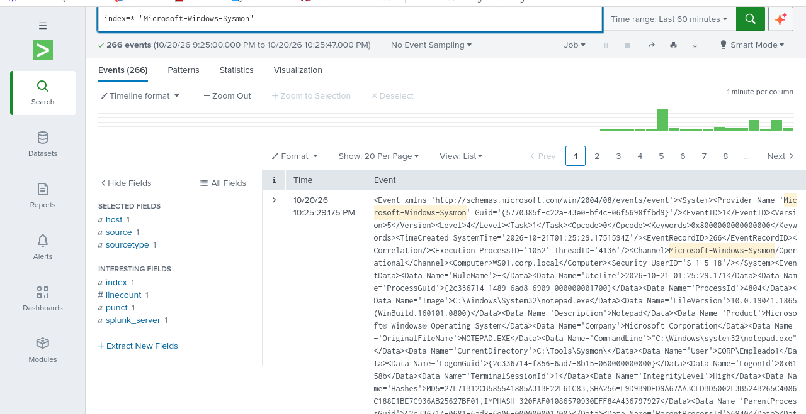

*La captura muestra un evento de creación de proceso relacionado con Notepad y los campos XML que permiten identificar el equipo y el ejecutable. El selector muestra **Last 60 minutes** y la búsqueda devuelve **266 eventos**. Ese total pertenece a esta ejecución, no exclusivamente al proceso Notepad ni a una cantidad permanente.*

El evento **1** documenta creación de procesos; no es un evento de conexión de red. No se presenta un **Sysmon ID 3** como observado porque no se dispone de evidencia específica.

Los eventos se recopilaron con el sourcetype completo **`XmlWinEventLog:Microsoft-Windows-Sysmon/Operational`**, según el registro de implementación. En el XML se pueden inspeccionar campos como **EventID**, **Computer**, **Image** y **CommandLine**. El identificador contenido en **`<EventID>`** debe distinguirse del campo **EventCode** disponible en una búsqueda de Splunk: las consultas iniciales no funcionaron como se esperaba, pero eso no implica que EventCode nunca pueda funcionar con eventos XML.

Para extraer el identificador del XML y agrupar los resultados se utilizó:

```spl
index=* "Microsoft-Windows-Sysmon"
| rex field=_raw "<EventID>(?<SysmonEventID>[0-9]+)</EventID>"
| stats count by SysmonEventID
| sort - count
```

**`rex`** extrae los dígitos de la etiqueta **`<EventID>`** desde **`_raw`** y los coloca en **SysmonEventID**. La consulta cuenta los eventos por ese campo y ordena los recuentos de mayor a menor.

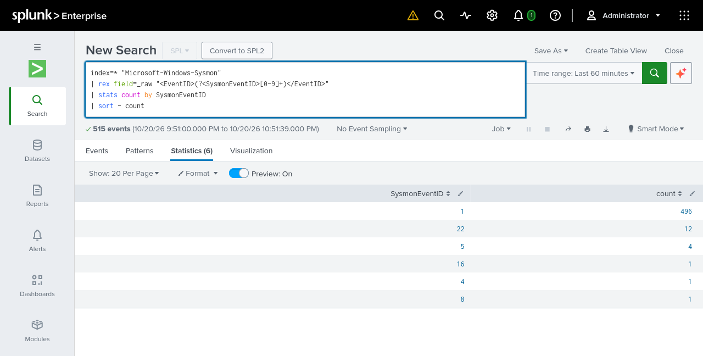

*La captura muestra **Last 60 minutes**, 515 eventos y seis identificadores; entre ellos, **1 con 496 eventos** y **22 con 12**. Corresponde a una ejecución posterior a la captura de 266 eventos, con otra ventana temporal.*

La consulta utiliza **`index=*`** y no filtra por **host**. Por tanto, la tabla no permite atribuir todos sus recuentos exclusivamente a WS01 ni demuestra por sí sola el índice de destino. El origen WS01 del evento individual de Notepad se identifica en su XML; los eventos locales 1 y 22 de WS01 están registrados en la comprobación anterior.

### 5.5. Configuración de PowerShell Script Block Logging

En **PowerShell como administrador de WS01** se creó la clave de política:

```powershell
New-Item -Path "HKLM:\SOFTWARE\Policies\Microsoft\Windows\PowerShell\ScriptBlockLogging" -Force
```

Después se configuró **EnableScriptBlockLogging** como **DWord** con valor **1**:

```powershell
New-ItemProperty `
  -Path "HKLM:\SOFTWARE\Policies\Microsoft\Windows\PowerShell\ScriptBlockLogging" `
  -Name "EnableScriptBlockLogging" `
  -Value 1 `
  -PropertyType DWord `
  -Force
```

Se comprobó el valor con:

```powershell
Get-ItemProperty "HKLM:\SOFTWARE\Policies\Microsoft\Windows\PowerShell\ScriptBlockLogging"
```

Resultado registrado:

```text
EnableScriptBlockLogging : 1
```

Este valor confirmó la habilitación de **Script Block Logging**. El evento principal utilizado para comprobar el registro de contenido fue **4104**, en **Microsoft-Windows-PowerShell/Operational**. La comprobación de la política no demuestra todavía que se haya generado o recibido un evento, ni garantiza registrar absolutamente toda la actividad de PowerShell.

### 5.6. Incorporación del canal PowerShell al Forwarder

En WS01 se abrió nuevamente el archivo:

```powershell
notepad "C:\Program Files\SplunkUniversalForwarder\etc\system\local\inputs.conf"
```

Se agregó al final:

```ini
[WinEventLog://Microsoft-Windows-PowerShell/Operational]
disabled = 0
index = windows
renderXml = true
```

La entrada selecciona el canal operativo de PowerShell, habilita su recopilación, establece **`windows`** como índice de destino y solicita representación XML. Se añadió junto a las entradas existentes de **Application, Security, System y Sysmon**, sin sustituirlas.

Se reinició el Forwarder y se comprobó su estado:

```powershell
Restart-Service SplunkForwarder
Get-Service SplunkForwarder
```

El registro de implementación confirma que el servicio continuó en **Running**. No se dispone de una captura de estas acciones ni se documentó para PowerShell una comprobación específica con `btool` equivalente a la realizada para Sysmon.

### 5.7. Prueba y verificación de eventos PowerShell

En **WS01** se ejecutó la prueba:

```powershell
$mensaje = "SOC-LAB-POWERSHELL-4104"
Write-Output $mensaje
```

La búsqueda inicial del marcador en Splunk fue:

```spl
index=* "SOC-LAB-POWERSHELL-4104"
```

**La búsqueda no devolvió resultados.** El registro no determina la causa ni confirma que el marcador se encontrara posteriormente. No se asigna a esa búsqueda un intervalo temporal que el registro escrito no conserva.

Para comprobar la generación local se ejecutó:

```powershell
Get-WinEvent -FilterHashtable @{
    LogName = 'Microsoft-Windows-PowerShell/Operational'
    Id = 4104
} -MaxEvents 5 |
Select-Object TimeCreated, Id, ProviderName, Message |
Format-List
```

Windows devolvió eventos **4104** del proveedor **Microsoft-Windows-PowerShell**. Entre los contenidos observados figuraba **Get-ItemProperty** sobre la clave de Script Block Logging, utilizado para verificar la configuración. Esto confirmó el registro local de otros bloques de código; no confirmó el contenido del marcador de prueba.

Desde Splunk Web en Kali Purple se ejecutó después:

```spl
index=* "Microsoft-Windows-PowerShell"
```

La búsqueda devolvió **206 eventos** en la ventana consultada. Al inspeccionar los resultados se confirmó un evento 4104 con los siguientes datos, según el registro del procedimiento:

| Campo | Valor registrado |
|---|---|
| host | `WS01` |
| index | `windows` |
| source | `WinEventLog:Microsoft-Windows-PowerShell/Operational` |
| sourcetype | `XmlWinEventLog:Microsoft-Windows-PowerShell/Operational` |
| Event ID en XML | `4104` |
| Provider | `Microsoft-Windows-PowerShell` |

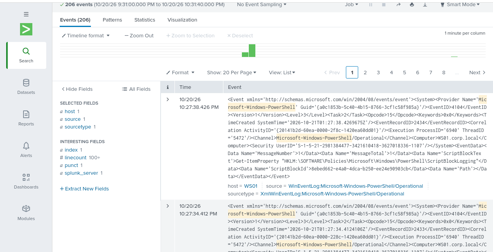

*La captura muestra **host=WS01**, el source y sourcetype completos y un evento XML **4104** cuyo **ScriptBlockText** contiene la consulta **Get-ItemProperty** de la clave de Script Block Logging. No muestra el marcador SOC-LAB-POWERSHELL-4104.*

En la parte visible de la imagen aparecen **206 eventos** y un intervalo del **20/10/2026, 21:31:00 a 22:31:40**. La barra de búsqueda y su selector temporal quedaron fuera del recorte. El valor **index=windows** se conserva según el registro escrito; la imagen no despliega ese valor. El total 206 corresponde a la búsqueda general del proveedor y no debe interpretarse como 206 eventos necesariamente de ID 4104.

La recepción de estos eventos 4104 confirmó la integración del canal PowerShell con Splunk Universal Forwarder. El contenido comprobado corresponde a **Get-ItemProperty**.

La siguiente consulta de apoyo se propuso **para futuras verificaciones**. No se registró su ejecución ni un resultado comprobado en esta etapa:

```spl
index=windows host=WS01 "Microsoft-Windows-PowerShell"
| rex field=_raw "<EventID>(?<PowerShellEventID>[0-9]+)</EventID>"
| search PowerShellEventID=4104
| table _time host source PowerShellEventID _raw
```

A diferencia de la búsqueda general, esta consulta limita el índice y el host, extrae el identificador del XML, selecciona **4104** y permite revisar el contenido original en **`_raw`**.

### 5.8. Resultado del procedimiento

Sysmon y PowerShell Script Block Logging quedaron operativos en **WS01** según las verificaciones documentadas. Se añadieron sus canales al Universal Forwarder conservando las fuentes anteriores y se recibieron eventos de ambas herramientas en Splunk Enterprise.

La telemetría comprobada incluye **creación de procesos (Sysmon 1)**, **consultas DNS (Sysmon 22)** y **bloques de código PowerShell (4104)**. La evidencia individual de Notepad identifica WS01; los recuentos de la búsqueda general de Sysmon no tienen filtro por host. Para PowerShell se confirmó contenido de otros bloques, pero no se localizó el marcador de la prueba.

Las capturas respaldan resultados recibidos en Splunk. La instalación, las consultas de servicio, el Registro de Windows, las entradas del Forwarder y las verificaciones locales se sustentan en el registro de implementación, sin capturas específicas de esas acciones. Estas comprobaciones establecen una base de telemetría y no acreditan detecciones automáticas ni escenarios de ataque.


## 6. Verificación final de la implementación

Se realizaron seis pruebas para comprobar que la infraestructura de recopilación seguía operativa después de los procedimientos anteriores. Todas las búsquedas se ejecutaron desde **Splunk Web en Kali Purple**, sobre el índice **`windows`**. La comprobación de auditoría mediante **`auditpol`** se realizó directamente en **DC01**.

El servidor central es Splunk Enterprise en Kali Purple; los equipos Windows monitoreados son **DC01**, controlador del dominio `corp.local` con Windows Server 2022, y **WS01**, estación de trabajo con Windows 10. Esta sección documenta resultados de verificación, sin repetir su instalación.

### 6.1. Prueba 1: recepción de eventos desde DC01 y WS01

En **Splunk Web de Kali Purple** se seleccionó **Last 60 minutes** y se ejecutó:

```spl
index=windows
| stats count as eventos latest(_time) as ultimo_evento by host
| convert ctime(ultimo_evento)
| sort host
```

La consulta agrupa los eventos de `windows` por **host**, cuenta los registros de cada equipo y obtiene la marca temporal más reciente mediante **`latest(_time)`**. **`convert ctime`** presenta esa marca como fecha y hora legibles, y **`sort host`** ordena los equipos.

El resultado registrado fue la presencia de **DC01 y WS01**, ambos con eventos recibidos dentro del intervalo seleccionado.

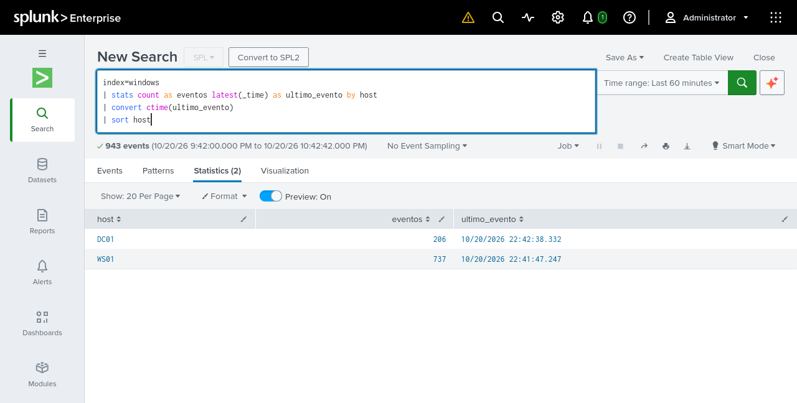

*La captura confirma los dos hosts y muestra eventos recientes: el último de DC01 figura a las 22:42:38.332 y el de WS01 a las 22:41:47.247 del 20/10/2026. Los recuentos visibles corresponden exclusivamente a esa ejecución.*

La columna **ultimo_evento** permite comprobar la actualidad de los registros según su marca temporal. No mide por sí sola la latencia de ingesta. La presencia de ambos hosts respalda la recepción desde los dos equipos, pero no demuestra que todas sus fuentes estén configuradas correctamente o que no existan interrupciones fuera de esa ventana.

**Estado: verificado.** El registro de implementación consigna esta prueba como aprobada.

### 6.2. Prueba 2: eventos Security y auditoría avanzada de DC01

Desde **Splunk Web de Kali Purple**, con **Last 24 hours**, se ejecutó:

```spl
index=windows host=DC01 sourcetype="WinEventLog:Security"
| stats count as Cantidad by EventCode
| sort - Cantidad
```

Los filtros limitan los resultados al registro **Security de DC01** en `windows`. La consulta agrupa por **EventCode** y ordena los recuentos de mayor a menor.

El registro escrito confirma la presencia de:

| Event ID | Actividad |
|---|---|
| 4624 | Inicio de sesión exitoso |
| 4648 | Intento de inicio de sesión utilizando credenciales explícitas |

Estos identificadores demuestran recepción de eventos Security, pero no prueban por sí solos que todas las subcategorías de auditoría estén configuradas correctamente. El registro escrito indica que no aparecieron otros identificadores esperados en esta consulta; su ausencia no se interpreta como un fallo si no se documentaron actividades que necesariamente debieran generarlos.

Como comprobación complementaria, en **PowerShell como administrador de DC01** se ejecutó:

```powershell
auditpol /get /category:*
```

Se contrastó la política efectiva con las seis subcategorías configuradas mediante **SOC - Advanced Audit Policy**:

| Subcategoría | Configuración efectiva registrada |
|---|---|
| Inicio de sesión | Aciertos y errores |
| Administración de cuentas de usuario | Aciertos y errores |
| Administración de grupos de seguridad | Aciertos y errores |
| Servicio de autenticación Kerberos | Errores |
| Operaciones de vales de servicio Kerberos | Errores |
| Validación de credenciales | Errores |

Todas coincidieron con lo previsto. La consulta SPL comprobó la recepción; **auditpol** comprobó la configuración efectiva en DC01. Ninguna de estas tablas atribuye por sí sola un evento a una actividad concreta. En particular, no se atribuyen eventos **4771 o 4776** al intento de autenticación de la sección 3 como parte de esta prueba.

No se dispone de una captura específica de esta ejecución final de Security ni de la salida de **auditpol**. Sus resultados se sustentan en el registro escrito; las capturas de consultas anteriores no acreditan esta ejecución.

**Estado: verificado según el registro escrito; sin captura específica.**

### 6.3. Prueba 3: eventos Security de WS01

En **Splunk Web de Kali Purple** se seleccionó **Last 24 hours** y se ejecutó:

```spl
index=windows host=WS01 sourcetype="WinEventLog:Security"
| stats count as Cantidad by EventCode
| sort - Cantidad
```

La búsqueda selecciona **Security de WS01**, agrupa los eventos por **EventCode** y ordena sus cantidades. Se obtuvieron **39 eventos**:

| Event ID | Cantidad | Actividad |
|---|---:|---|
| 5379 | 13 | Lectura de credenciales desde Credential Manager |
| 4624 | 12 | Inicio de sesión exitoso |
| 4672 | 12 | Privilegios especiales asignados a una sesión |
| 4634 | 2 | Cierre de sesión |
| **Total** | **39** | |

La evidencia es [KaliPurple-2026-10-20-22-54-43.png](../Image/Fase1/KaliPurple-2026-10-20-22-54-43.png), ya incorporada en la **sección 4.6** como comprobación posterior a la instalación. Se referencia aquí la misma imagen para evitar duplicarla visualmente. Su consulta, selector **Last 24 hours** y recuentos coinciden con esta prueba.

El resultado confirma recepción de Security desde WS01 en `windows` durante esa ejecución. No verifica todas las fuentes del equipo, la totalidad de sus opciones de auditoría ni una actividad maliciosa: los identificadores observados describen actividad registrada por Windows.

**Estado: verificado.**

### 6.4. Prueba 4: eventos Sysmon de WS01

Desde **Splunk Web de Kali Purple**, con **Last 24 hours**, se ejecutó:

```spl
index=windows host=WS01 "Microsoft-Windows-Sysmon"
| rex field=_raw "<EventID>(?<SysmonEventID>[0-9]+)</EventID>"
| stats count as Cantidad by SysmonEventID
| sort - Cantidad
```

La consulta limita el índice a **windows**, el host a **WS01** y busca el texto del proveedor Sysmon. **rex** extrae el identificador de la etiqueta XML **`<EventID>`** en el campo **SysmonEventID**. Después se cuentan los eventos por ese identificador y se ordenan de mayor a menor.

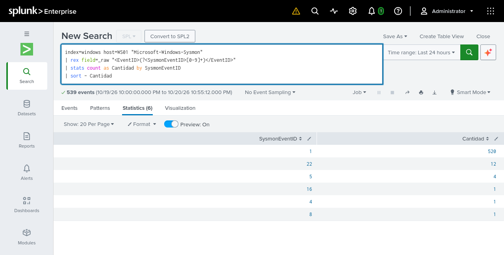

*La captura muestra los filtros específicos de WS01 y windows, la extracción XML y los seis grupos resultantes. Respalda los recuentos de esta ejecución, no una actividad única.*

| Sysmon Event ID | Cantidad | Actividad |
|---|---:|---|
| 1 | 520 | Process Create: creación de procesos |
| 22 | 12 | DNS Query: consultas DNS |
| 5 | 4 | Process Terminate: finalización de procesos |
| 16 | 1 | Sysmon Configuration Change: cambio de configuración |
| 4 | 1 | Sysmon Service State Changed: cambio de estado del servicio |
| 8 | 1 | CreateRemoteThread: creación de un hilo remoto en otro proceso |
| **Total** | **539** | |

Esta prueba verifica un conjunto de eventos Sysmon de WS01. Se distingue de la identificación individual del proceso **Notepad, Event ID 1**, documentada en la sección 5, y de la búsqueda general sin filtro por host utilizada allí.

Los **539 eventos** incluyen seis tipos de actividad. La presencia de **Event ID 8** puede ser relevante para una investigación, pero no demuestra por sí sola un ataque ni una inyección maliciosa. La tabla tampoco acredita cobertura de todos los eventos posibles de Sysmon.

**Estado: verificado.**

### 6.5. Prueba 5: eventos PowerShell de WS01

En **Splunk Web de Kali Purple**, con **Last 24 hours**, se ejecutó:

```spl
index=windows host=WS01 "Microsoft-Windows-PowerShell"
| rex field=_raw "<EventID>(?<PowerShellEventID>[0-9]+)</EventID>"
| stats count as Cantidad by PowerShellEventID
| sort - Cantidad
```

Los filtros seleccionan los eventos de **WS01** en **windows** que contienen el texto del proveedor PowerShell. **rex** extrae el identificador desde el XML en **PowerShellEventID** y la consulta agrupa por ese campo.

La búsqueda tardó inicialmente en mostrar resultados y parecía no haber encontrado eventos, pero terminó correctamente. **No fue necesario modificar inputs.conf ni reiniciar Universal Forwarder.** El retraso no se presenta como un fallo del agente.

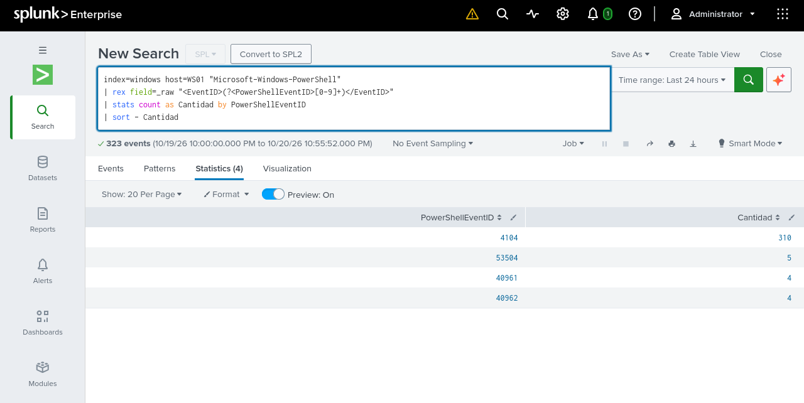

*La captura muestra cuatro identificadores del canal operativo y un total de 323 eventos. El grupo 4104 contiene 310; los demás registros no se atribuyen automáticamente a Script Block Logging.*

| PowerShell Event ID | Cantidad |
|---|---:|
| 4104 | 310 |
| 53504 | 5 |
| 40961 | 4 |
| 40962 | 4 |
| **Total** | **323** |

El **Event ID 4104** fue el indicador principal para comprobar la recepción de bloques de código PowerShell. Esta prueba confirma su presencia y recuento, pero no inspecciona el contenido individual de cada bloque. Los **323 eventos** son el total del conjunto consultado, no 323 eventos 4104.

La búsqueda no demuestra la recuperación del marcador **SOC-LAB-POWERSHELL-4104**, que no pudo localizarse en la sección 5. Esa limitación permanece vigente.

**Estado: verificado para la recepción del canal y los eventos 4104; marcador específico no verificado.**

### 6.6. Prueba 6: inventario global de fuentes

Desde **Splunk Web de Kali Purple**, con **Last 24 hours**, se ejecutó:

```spl
index=windows (host=DC01 OR host=WS01)
| stats count as Eventos latest(_time) as UltimoEvento by host source sourcetype
| convert ctime(UltimoEvento)
| sort host source
```

La búsqueda limita los resultados a **windows** y a los dos hosts. Agrupa por la combinación **host, source y sourcetype**, cuenta los eventos de cada grupo y muestra la marca temporal más reciente en **UltimoEvento**.

- **host:** identifica el equipo de origen.
- **source:** identifica la fuente o canal del registro.
- **sourcetype:** identifica el tipo de datos con el que Splunk representa los eventos.
- **Eventos:** es el número de registros de cada grupo dentro del intervalo.

Se identificaron **ocho combinaciones de fuente y equipo**, agrupadas mediante esos campos, con **2056 eventos**. No son ocho equipos ni ocho valores distintos de source: Application, Security y System aparecen una vez para DC01 y otra para WS01.

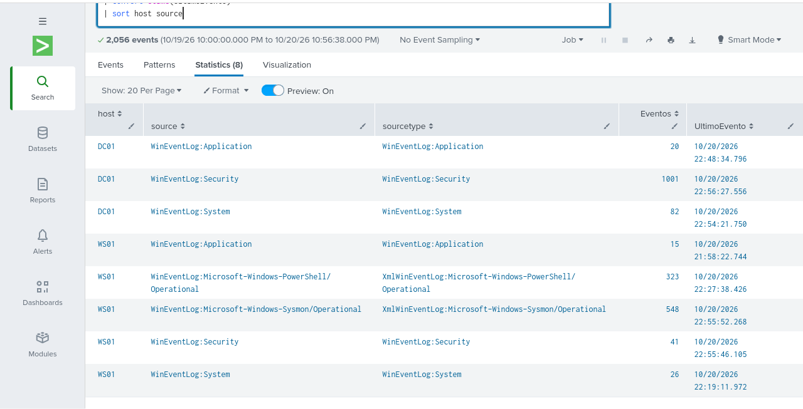

*La captura muestra ocho filas con sus fuentes, sourcetypes, recuentos y últimas marcas temporales, además del total de 2056 eventos. La parte superior de la consulta y el selector quedaron fuera del recorte; la consulta completa y la selección Last 24 hours se conservan según el registro de implementación.*

| Host | Source | Eventos |
|---|---|---:|
| DC01 | `WinEventLog:Application` | 20 |
| DC01 | `WinEventLog:Security` | 1001 |
| DC01 | `WinEventLog:System` | 82 |
| WS01 | `WinEventLog:Application` | 15 |
| WS01 | `WinEventLog:Microsoft-Windows-PowerShell/Operational` | 323 |
| WS01 | `WinEventLog:Microsoft-Windows-Sysmon/Operational` | 548 |
| WS01 | `WinEventLog:Security` | 41 |
| WS01 | `WinEventLog:System` | 26 |
| **Total** | **8 combinaciones de fuente y equipo** | **2056** |

Para los registros convencionales, los sourcetypes observados fueron **WinEventLog:Application**, **WinEventLog:Security** y **WinEventLog:System**. Para los canales adicionales de WS01 fueron:

| Canal | Sourcetype observado |
|---|---|
| Sysmon | `XmlWinEventLog:Microsoft-Windows-Sysmon/Operational` |
| PowerShell | `XmlWinEventLog:Microsoft-Windows-PowerShell/Operational` |

Estos dos sourcetypes corresponden a los canales configurados con **renderXml = true**. Se distinguen del campo **source**, que conserva el prefijo **WinEventLog:** en ambas filas.

El inventario se obtuvo después de las consultas individuales: muestra **548 eventos Sysmon**, frente a **539** en la prueba 4, y **41 eventos Security de WS01**, frente a **39** en la prueba 3. Según el registro de implementación, continuaron ingresando eventos entre ejecuciones; cada recuento corresponde a su propia búsqueda.

Los resultados representan una observación temporal de las fuentes recibidas. Confirman las tres fuentes Windows de cada equipo y los dos canales adicionales de WS01, pero no constituyen una medida de cobertura completa ni garantizan ausencia de pérdidas.

**Estado: verificado.**

### 6.7. Síntesis de resultados

| Prueba | Equipo o fuente | Resultado observado | Estado y alcance |
|---|---|---|---|
| 1. Recepción reciente | DC01 y WS01 | Ambos hosts con eventos en Last 60 minutes | Verificado; no valida todas las fuentes por separado |
| 2. Security y auditoría avanzada | DC01 | Eventos 4624 y 4648 en Last 24 hours; seis subcategorías efectivas conforme a lo previsto | Verificado según el registro escrito; sin captura específica de esta prueba |
| 3. Security | WS01 | 39 eventos en Last 24 hours | Verificado mediante la captura ya incluida en 4.6 |
| 4. Sysmon | WS01 | 539 eventos, distribuidos en seis identificadores, en Last 24 hours | Verificado; no implica detección de ataques |
| 5. PowerShell Operational | WS01 | 323 eventos, incluidos 310 de ID 4104, en Last 24 hours | Verificado; no acredita recuperación del marcador de prueba |
| 6. Inventario global | DC01 y WS01 | 8 combinaciones de fuente y equipo; 2056 eventos en Last 24 hours | Verificado para la ejecución capturada |

El registro de implementación consigna **6 pruebas aprobadas sobre 6 realizadas**. Este resultado corresponde al alcance de las comprobaciones de recopilación, configuración e ingesta descritas; no es un porcentaje de cobertura de amenazas.

### 6.8. Resultado de la Fase 1

Se completó la implementación inicial de la infraestructura de monitoreo: **Splunk Enterprise centralizado en Kali Purple**, **Universal Forwarder en DC01 y WS01**, **auditoría avanzada de Active Directory**, recopilación de registros Windows y telemetría de **Sysmon** y **PowerShell Script Block Logging**.

Las búsquedas SPL confirmaron la recepción de eventos de ambos equipos y de las ocho combinaciones de fuente y equipo previstas. La configuración efectiva de auditoría de DC01 se comprobó por separado mediante **auditpol**, según el registro escrito.

Estas pruebas validan la infraestructura de recopilación y consulta. No acreditan reglas de correlación, alertas automáticas, detección automática de ataques ni procedimientos completos de respuesta a incidentes.


## Cierre general de la Fase 1

La Fase 1 deja implementada una infraestructura de recopilación con **Splunk Enterprise en Kali Purple** y **Splunk Universal Forwarder en DC01 y WS01**. Se centralizaron Application, Security y System de ambos equipos, junto con los canales Sysmon y PowerShell Operational de WS01: ocho combinaciones de fuente y equipo.

Las seis pruebas finales respaldan la recepción desde ambos hosts, la disponibilidad de Security, Sysmon y PowerShell, y la configuración efectiva de las seis subcategorías de auditoría de DC01 según el registro escrito. El inventario final contabilizó **2056 eventos en la ventana Last 24 hours**. Es un resultado de esa ejecución, no una cantidad permanente ni una medida de cobertura de amenazas.

La implementación demuestra práctica en administración de auditoría mediante GPO, configuración de agentes de recopilación, integración de eventos XML, consultas SPL y contraste entre configuración local y datos recibidos. También documenta los límites de la evidencia: algunas verificaciones carecen de captura, los recuentos dependen de la ventana y del momento de consulta, la atribución de eventos a la prueba de autenticación no fue concluyente y el marcador PowerShell no pudo localizarse.

Esta base permite continuar posteriormente con el análisis de la telemetría y la evaluación de detecciones. La fase completada no demuestra reglas de correlación, alertas automáticas, pruebas de ataques ni procedimientos de respuesta a incidentes.


---

[⬅️ Volver al README principal](../README.md)

[⬆️ Volver al inicio del documento](#fase-1--implementación-de-infraestructura-y-centralización-de-eventos)
