[⬅️ Volver al README principal](../README.md)

# Fase 2 — Detección y correlación de eventos de seguridad

## Introducción

La Fase 2 de **Active Directory Security Monitoring & Threat Detection with Splunk** utiliza la infraestructura de recopilación implementada en la [Fase 1](Fase1.md) para analizar simulaciones controladas, desarrollar consultas SPL y validar alertas programadas en Splunk Enterprise.

Su alcance comprende seis pruebas: autenticaciones fallidas, cambios en cuentas y grupos de Active Directory, reconocimiento local, ejecución de PowerShell mediante comandos codificados, creación de tareas programadas y un escenario de correlación de eventos. Los resultados se documentan con sus ventanas temporales, las evidencias disponibles y las limitaciones de cada detección. Las simulaciones no representan intrusiones reales ni acreditan una cobertura completa de amenazas.

Este documento reúne las seis pruebas de la etapa práctica final del laboratorio. Cada sección presenta el procedimiento realizado, las búsquedas y alertas implementadas, los resultados observados y sus limitaciones. El escenario final integra tres fuentes de telemetría mediante una correlación temporal por equipo.

| Prueba | Objetivo | Fuente y eventos | Detección implementada |
| --- | --- | --- | --- |
| 1. Autenticaciones fallidas de Active Directory | Identificar fallos repetidos de autenticación Kerberos. | Windows Security de DC01: 4771 con código de error `0x18`. | Tres o más fallos por usuario e IP en bloques de cinco minutos; búsqueda de diez minutos ejecutada cada minuto. |
| 2. Cambios en cuentas y grupos de Active Directory | Observar la creación de cuentas y grupos y los cambios de miembros. | Windows Security de DC01: 4720, 4727 y 4728. | Alerta sobre 4728 para incorporaciones a `SOC-Lab-Security`; 4720 y 4727 se verificaron como contexto. |
| 3. Reconocimiento mediante PowerShell | Identificar contenido compatible con enumeración local. | PowerShell 4104; Sysmon ID 1 como evidencia complementaria de procesos. | Coincidencias textuales con `Get-LocalUser`, `Get-LocalGroup` o `Get-NetIPConfiguration` en eventos 4104. |
| 4. Ejecución de comandos PowerShell codificados | Identificar eventos de creación de procesos que contienen `EncodedCommand`. | Sysmon ID 1; PowerShell 4104 como evidencia complementaria del contenido. | Coincidencia con `EncodedCommand` en `_raw` de Sysmon ID 1, sin exigir un ejecutable ni un campo `CommandLine` específicos. |
| 5. Creación de tareas programadas | Detectar el registro de tareas como posible mecanismo de persistencia. | Windows Security: 4698, verificado en WS01. | Recuento de creaciones por host; no comprueba la ejecución efectiva de la tarea ni su carácter malicioso. |
| 6. Correlación temporal de múltiples actividades | Identificar la coexistencia de las tres categorías en WS01. | PowerShell 4104, Sysmon ID 1 y Windows Security 4698. | Marcadores de reconocimiento y tarea, y texto `EncodedCommand`, agrupados por host sobre los últimos 15 minutos, cada cinco minutos; sin demostrar causalidad. |

## Índice

- [Introducción](#introducción)
- [1. Detección de autenticaciones fallidas en Active Directory](#1-detección-de-autenticaciones-fallidas-en-active-directory)
- [2. Detección de cambios en cuentas y grupos de Active Directory](#2-detección-de-cambios-en-cuentas-y-grupos-de-active-directory)
- [3. Detección de reconocimiento mediante PowerShell y Sysmon](#3-detección-de-reconocimiento-mediante-powershell-y-sysmon)
- [4. Detección de ejecución de PowerShell con comandos codificados](#4-detección-de-ejecución-de-powershell-con-comandos-codificados)
- [5. Detección de persistencia mediante tareas programadas](#5-detección-de-persistencia-mediante-tareas-programadas)
- [6. Correlación de un escenario de múltiples etapas](#6-correlación-de-un-escenario-de-múltiples-etapas)
- [Conclusión general de la Fase 2](#conclusión-general-de-la-fase-2)

## 1. Detección de autenticaciones fallidas en Active Directory

Se simularon múltiples intentos de autenticación fallidos contra una cuenta del dominio **corp.local**, se analizaron los eventos Kerberos recibidos en Splunk Enterprise y se configuró una alerta programada para identificar el comportamiento.

La comprobación distingue tres resultados: el rechazo de credenciales en WS01, la recepción y análisis de eventos de DC01 en Splunk y la activación de la búsqueda programada. La instalación de los agentes y la configuración inicial de auditoría se conservan en Fase 1 y no se repiten aquí.

### 1.1. Entorno utilizado

| Máquina     | Sistema operativo   | Dirección IP     | Función                                               |
| ----------- | ------------------- | ---------------- | ----------------------------------------------------- |
| DC01        | Windows Server 2022 | `192.168.20.5`   | Controlador de dominio y registro de eventos Kerberos |
| WS01        | Windows 10          | `192.168.20.132` | Equipo de origen de los intentos fallidos  |
| Kali Purple | Kali Purple 2026.3  | `192.168.20.134` | Servidor Splunk Enterprise 10.6.1.1                   |

Los eventos se enviaron a Splunk mediante los Universal Forwarders configurados durante la Fase 1, utilizando el puerto TCP 9997 y el índice `windows`.

### 1.2. Creación de la cuenta de prueba en Active Directory

En **DC01** se abrió PowerShell como administrador y se importó el módulo de Active Directory:

```powershell
Import-Module ActiveDirectory
```

Se creó una cuenta exclusiva para la simulación:

```powershell
New-ADUser `
  -Name "SOC Lab Test" `
  -SamAccountName "soc.lab.test" `
  -UserPrincipalName "soc.lab.test@corp.local" `
  -Enabled $true `
  -AccountPassword (Read-Host "Contraseña inicial de laboratorio" -AsSecureString) `
  -PasswordNeverExpires $true `
  -ChangePasswordAtLogon $false
```

La contraseña se introdujo de forma interactiva y no quedó expuesta en la terminal.

**Verificación de la cuenta**

Se ejecutó:

```powershell
Get-ADUser soc.lab.test -Properties Enabled,LockedOut |
Select-Object SamAccountName,Enabled,LockedOut
```

Resultado:

```text
SamAccountName Enabled LockedOut
-------------- ------- ---------
soc.lab.test      True     False
```

El resultado registrado confirmó que la cuenta existía, estaba habilitada y no se encontraba bloqueada. La creación y la comprobación de la cuenta se sustentan en el registro escrito; no se dispone de una captura específica de estos pasos.

### 1.3. Comprobación de la política de bloqueo

En **DC01** se ejecutó:

```powershell
Get-ADDefaultDomainPasswordPolicy |
Select-Object LockoutThreshold,LockoutDuration,LockoutObservationWindow
```

Resultado:

```text
LockoutThreshold LockoutDuration LockoutObservationWindow
---------------- --------------- ------------------------
               0 00:01:00        00:01:00
```

El valor `LockoutThreshold = 0` indica que la política predeterminada del dominio no bloquea automáticamente las cuentas por cantidad de intentos fallidos.

Esta consulta se utilizó para planificar tres intentos controlados. No se modificó la política del dominio. La salida se conserva según el registro de implementación, sin una captura específica.

### 1.4. Primera simulación de autenticaciones fallidas

En **WS01** se abrió PowerShell con permisos administrativos.

**Registro de la hora inicial**

Se ejecutó:

```powershell
Get-Date -Format "yyyy-MM-dd HH:mm:ss"
```

Resultado:

```text
2026-10-20 23:15:30
```

**Ejecución de los intentos**

Se utilizó:

```powershell
runas /user:corp\soc.lab.test cmd
```

Cuando Windows solicitó la contraseña, se introdujo deliberadamente una incorrecta.

Se repitió el procedimiento tres veces.

En los tres intentos apareció el siguiente error:

```text
ERROR RUNAS: no se puede ejecutar - cmd
1326: El nombre de usuario o la contraseña no son correctos.
```

El error `1326` confirmó que Windows rechazó las credenciales proporcionadas.

**Registro de la hora final**

Se ejecutó nuevamente:

```powershell
Get-Date -Format "yyyy-MM-dd HH:mm:ss"
```

Resultado:

```text
2026-10-20 23:16:12
```

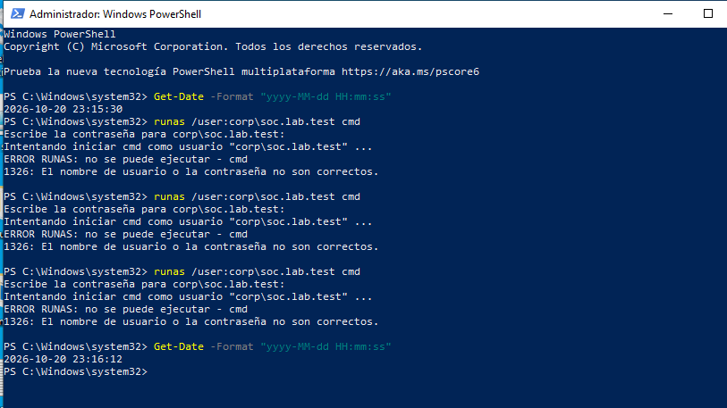

*La consola muestra los tres intentos con la cuenta soc.lab.test, los rechazos de credenciales y las consultas Get-Date. No muestra los eventos registrados en DC01.*

### 1.5. Identificación inicial de eventos en Splunk

En **Kali Purple** se accedió a Splunk Web:

```text
http://kali:8000
```

Se abrió **Search & Reporting** y se ejecutó la siguiente consulta. La captura de esta comprobación muestra **Last 15 minutes**:

```spl
index=windows (host=DC01 OR host=WS01)
(EventCode=4625 OR EventCode=4771 OR EventCode=4776)
| stats count by host EventCode
| sort host EventCode
```

Resultado:

| Host | EventCode | count |
| ---- | --------- | ----- |
| DC01 | 4771      | 3     |

Splunk encontró tres eventos 4771, correspondientes a fallos de preautenticación Kerberos registrados por el controlador de dominio.

No se observaron eventos 4625 ni 4776 en el resultado de esa búsqueda.

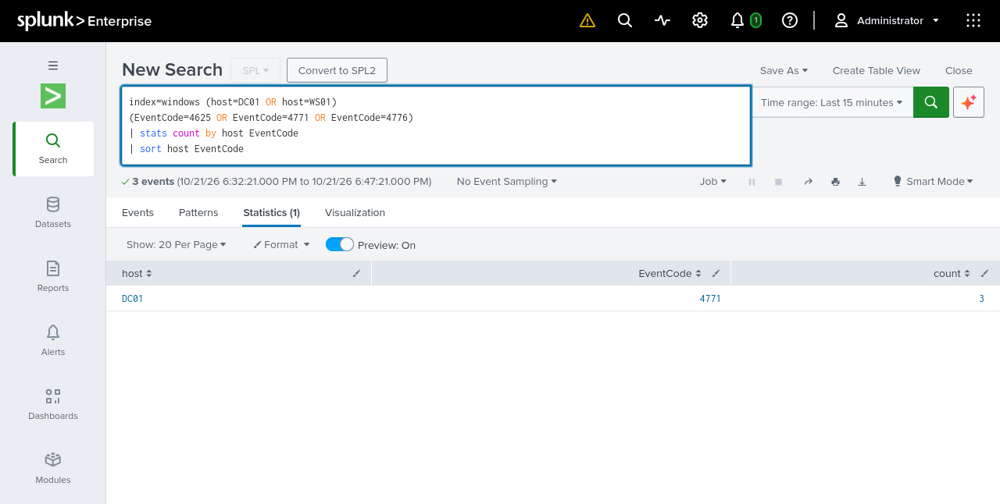

*La búsqueda incluye DC01 y WS01 y los identificadores 4625, 4771 y 4776. El resultado contiene únicamente tres eventos 4771 de DC01; no acredita todos los tipos posibles de autenticación.*

### 1.6. Inspección de los eventos Kerberos

Para examinar los eventos se ejecutó:

```spl
index=windows host=DC01 sourcetype="WinEventLog:Security" EventCode=4771
| table _time host EventCode Account_Name Client_Address Failure_Code _raw
| sort _time
```

Los campos `Account_Name`, `Client_Address` y `Failure_Code` aparecieron vacíos.

Al revisar `_raw` se identificó información dentro del mensaje del evento, redactado en español.

Entre los datos visibles estaban:

```text
Nombre de cuenta: soc.lab.test
Nombre de servicio: krbtgt/corp
Dirección de cliente: ::ffff:192.168.20.132
```

Estos datos permitieron asociar el evento con la cuenta utilizada y la dirección IP de WS01.

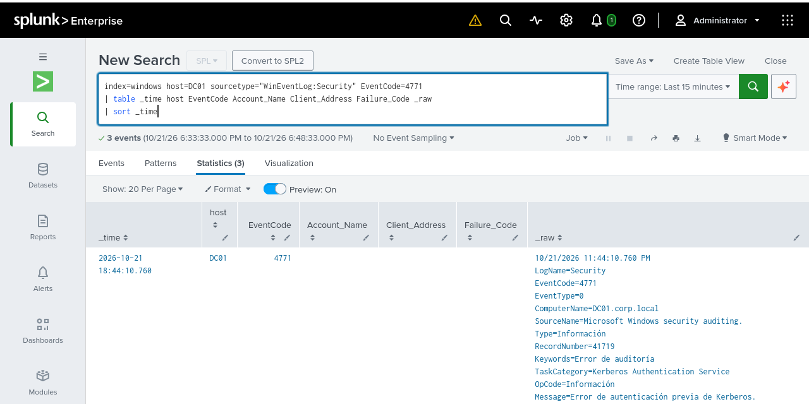

*La captura muestra las columnas sin valores y el contenido original del evento. La extracción posterior utiliza las etiquetas del mensaje en español.*

### 1.7. Extracción de usuario e IP mediante SPL

Como los campos consultados no mostraban valores, se utilizó `rex` para extraer la cuenta y la dirección de cliente desde `_raw`.

Consulta:

```spl
index=windows host=DC01 sourcetype="WinEventLog:Security" EventCode=4771 "soc.lab.test"
| rex field=_raw "Nombre de cuenta:\s+(?<Usuario>[^\r\n]+)"
| rex field=_raw "Dirección de cliente:\s+(?<IP_Origen>[^\r\n]+)"
| table _time host EventCode Usuario IP_Origen
| sort _time
```

**Resultado obtenido**

| Hora         | Host | EventCode | Usuario      | IP_Origen               |
| ------------ | ---- | --------- | ------------ | ----------------------- |
| 18:44:10.760 | DC01 | 4771      | soc.lab.test | `::ffff:192.168.20.132` |
| 18:44:22.348 | DC01 | 4771      | soc.lab.test | `::ffff:192.168.20.132` |
| 18:44:27.960 | DC01 | 4771      | soc.lab.test | `::ffff:192.168.20.132` |

Los tres eventos se registraron en aproximadamente 17,2 segundos.

La dirección `::ffff:192.168.20.132` representa la dirección IPv4 de WS01 en formato IPv4 mapeado en IPv6.

La consulta permitió comprobar la asociación de los eventos con la cuenta de dominio y la dirección IP de origen.

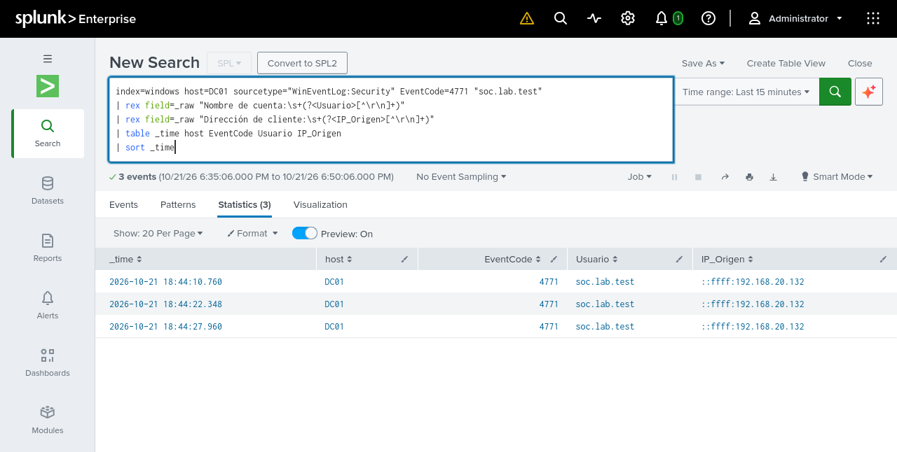

*La tabla muestra las marcas temporales del 21/10/2026, la cuenta y la IP extraídas. El selector indica Last 15 minutes.*

### 1.8. Primera consulta de detección

Se construyó una consulta SPL para detectar tres o más eventos 4771 asociados a una misma cuenta e IP dentro de un bloque de cinco minutos.

```spl
index=windows host=DC01 sourcetype="WinEventLog:Security" EventCode=4771
| rex field=_raw "Nombre de cuenta:\s+(?<Usuario>[^\r\n]+)"
| rex field=_raw "Dirección de cliente:\s+(?<IP_Origen>[^\r\n]+)"
| where isnotnull(Usuario) AND isnotnull(IP_Origen)
| bin _time span=5m
| stats count as IntentosFallidos by _time Usuario IP_Origen
| where IntentosFallidos>=3
| sort - IntentosFallidos
```

**Resultado**

| \_time              | Usuario      | IP_Origen               | IntentosFallidos |
| ------------------- | ------------ | ----------------------- | ---------------- |
| 2026-10-21 18:40:00 | soc.lab.test | `::ffff:192.168.20.132` | 3                |

La consulta identificó la agrupación de los tres eventos. `rex` obtiene los campos desde el mensaje; `where` exige que estén presentes; `stats` cuenta por bloque, cuenta e IP y el último filtro conserva agrupaciones con al menos tres fallos.

Limitación: `bin _time span=5m` agrupa los eventos en bloques temporales fijos. No implementa una ventana deslizante exacta de cinco minutos.

### 1.9. Verificación del código de error Kerberos

Antes de crear la alerta definitiva, se revisó el código de error de los eventos para precisar el tipo de fallo.

Se ejecutó:

```spl
index=windows host=DC01 sourcetype="WinEventLog:Security" EventCode=4771 "soc.lab.test"
| rex field=_raw "Código de error:\s+(?<CodigoError>[^\r\n]+)"
| table _time EventCode CodigoError
| sort _time
```

Resultado:

| Hora         | EventCode | CodigoError |
| ------------ | --------- | ----------- |
| 18:44:10.760 | 4771      | `0x18`      |
| 18:44:22.348 | 4771      | `0x18`      |
| 18:44:27.960 | 4771      | `0x18`      |

El código Kerberos `0x18` corresponde a `KDC_ERR_PREAUTH_FAILED`, consistente en este escenario con una contraseña incorrecta.

Los tres eventos presentaron el código de error seleccionado para la detección.

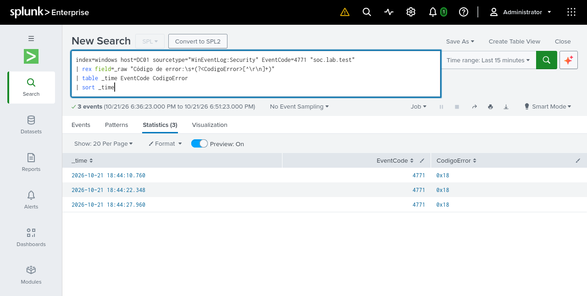

*Los tres registros muestran el código 0x18 en Last 15 minutes. Esta comprobación añade precisión al filtro de detección.*

### 1.10. Consulta SPL definitiva

Se incorporó el filtro `CodigoError="0x18"` a la detección.

La consulta final utilizada fue:

```spl
index=windows host=DC01 sourcetype="WinEventLog:Security" EventCode=4771
| rex field=_raw "Nombre de cuenta:\s+(?<Usuario>[^\r\n]+)"
| rex field=_raw "Dirección de cliente:\s+(?<IP_Origen>[^\r\n]+)"
| rex field=_raw "Código de error:\s+(?<CodigoError>[^\r\n]+)"
| where CodigoError="0x18" AND isnotnull(Usuario) AND isnotnull(IP_Origen)
| bin _time span=5m
| stats count as IntentosFallidos by _time Usuario IP_Origen
| where IntentosFallidos>=3
| sort - IntentosFallidos
```

La búsqueda devolvió nuevamente una fila con:

```text
Usuario:          soc.lab.test
IP_Origen:        ::ffff:192.168.20.132
IntentosFallidos: 3
```

Este resultado validó la detección manual antes de automatizarla.

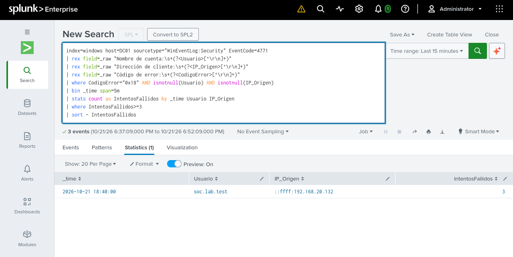

*La consulta devuelve una fila con tres intentos para soc.lab.test y la IP de WS01, en el bloque iniciado a las 18:40. El selector muestra Last 15 minutes.*

### 1.11. Creación de la alerta programada

Desde la consulta definitiva en Splunk Web se seleccionó:

Save As → Alert

Se completó el formulario con la siguiente configuración:

| Campo                                   | Configuración                                                                             |
| --------------------------------------- | ----------------------------------------------------------------------------------------- |
| Title                                   | `SOC - Multiple Failed Kerberos Authentications`                                          |
| Description                             | Detecta 3 o más errores Kerberos 4771 (0x18) por usuario e IP en intervalos de 5 minutos. |
| Permissions                             | Private                                                                                   |
| Alert Type                              | Scheduled                                                                                 |
| Schedule                                | Run on Cron Schedule                                                                      |
| Cron Expression                         | `* * * * *`                                                                               |
| Time Range                              | Últimos 10 minutos (`-10m@m` a `now`, según la configuración indicada)                    |
| Expires                                 | 24 horas                                                                                  |
| Trigger alert when                      | Number of Results                                                                         |
| Condition                               | is greater than `0`                                                                       |
| Trigger                                 | For each result                                                                           |
| Throttle                                | Habilitado                                                                                |
| Suppress results containing field value | `Usuario,IP_Origen`                                                                       |
| Suppress triggering for                 | 10 minutos                                                                                |
| Trigger Action                          | Add to Triggered Alerts                                                                   |

La expresión Cron:

```text
* * * * *
```

establece una ejecución programada cada minuto.

La búsqueda se ejecuta cada minuto sobre un intervalo de diez minutos; dentro de sus resultados, `bin` mantiene la agrupación en bloques fijos de cinco minutos. Son parámetros diferentes. La supresión se configuró para reducir las activaciones repetidas de una misma combinación de usuario e IP durante diez minutos.

**Alcance de la evidencia temporal:** el formulario muestra **Last 10 minutes** y la ejecución posterior de **View Results** abarca de **18:54 a 19:04**. Ambas capturas respaldan el intervalo de diez minutos. La expresión personalizada exacta `-10m@m` a `now` se conserva según el registro escrito y requiere una comprobación de la configuración guardada para considerarse confirmada.

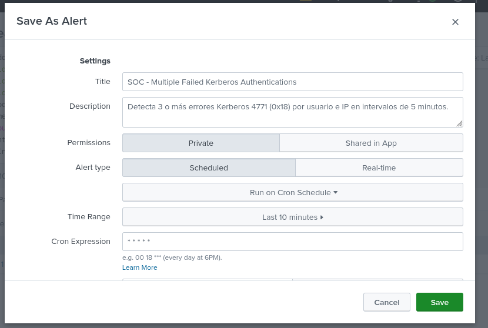

*El formulario muestra los parámetros introducidos antes del guardado. Last 10 minutes es visible; la expresión personalizada exacta no se despliega.*

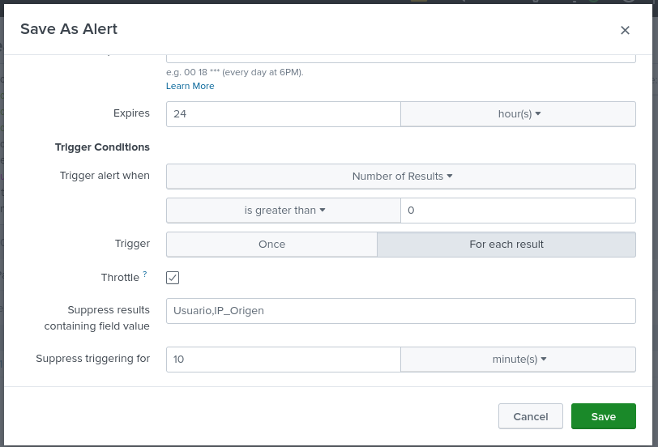

*Se observan Number of Results mayor que cero, For each result y la supresión por Usuario,IP_Origen. La condición se evalúa sobre las filas que devuelve la consulta agregada.*

**Acción requerida por Splunk**

El registro de implementación indica que, al intentar guardar sin ninguna acción, Splunk mostró:

```text
Enable at least one action.
```

Para resolverlo se seleccionó:

Trigger Actions → Add Actions → Add to Triggered Alerts

Esta acción permite conservar el historial de activaciones dentro de Splunk, sin configurar correos electrónicos ni scripts.

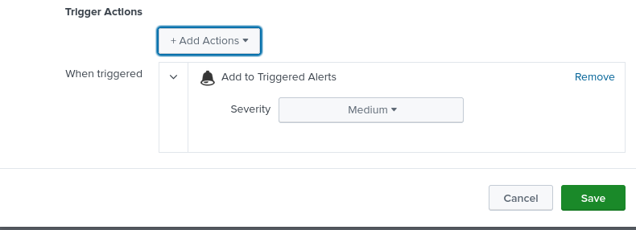

*El recorte muestra la acción elegida y severidad Medium. Complementa el formulario; no demuestra por sí solo el guardado ni una activación.*

### 1.12. Confirmación de creación

Al guardar, Splunk mostró:

```text
Alert has been saved
```

También presentó la advertencia:

```text
This scheduled search will not run after the
Splunk Enterprise Trial License expires.
```

Esto indica una limitación de licencia: la ejecución programada depende de que Splunk disponga de una licencia que permita esa funcionalidad.

Después se abrió **View Alert**.

Se verificó:

```text
Enabled: Yes
Alert Type: Scheduled. Cron Schedule.
Trigger Condition: Number of Results is > 0.
Actions: Add to Triggered Alerts.
```

Inicialmente la página mostraba:

```text
There are no fired events for this alert.
```

La alerta estaba creada y habilitada, pero todavía no se había observado ninguna activación.

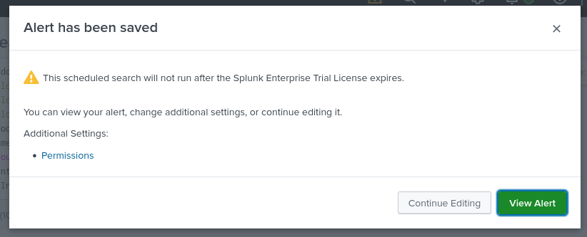

*Splunk confirma el guardado y advierte que la búsqueda programada no se ejecutará después de expirar la licencia de prueba. Guardar la alerta no equivale a haberla activado.*

### 1.13. Validación de la alerta automática

Para validar la ejecución programada, se realizó una segunda simulación controlada con la cuenta `soc.lab.test`.

Desde **WS01** se repitieron tres intentos fallidos con:

```powershell
runas /user:corp\soc.lab.test cmd
```

La captura de la segunda simulación muestra tres ejecuciones de `runas` y tres rechazos con error **1326**. No muestra horas individuales de esos intentos. Por separado, los resultados posteriores de Splunk presentan tres eventos coincidentes en un bloque temporal distinto del de la primera simulación.

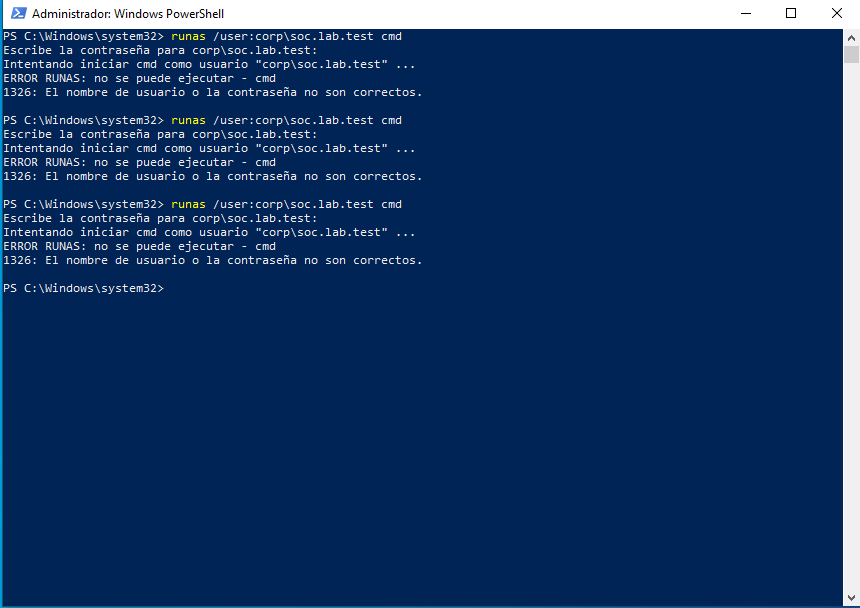

*La consola aporta evidencia de la repetición de los intentos y sus errores 1326, sin marcas temporales individuales.*

**Historial de activaciones**

En la página de la alerta apareció una entrada en Trigger History:

```text
TriggerTime: 2026-10-21 19:04:01 -03
```

Esto confirmó que la alerta programada se había activado.

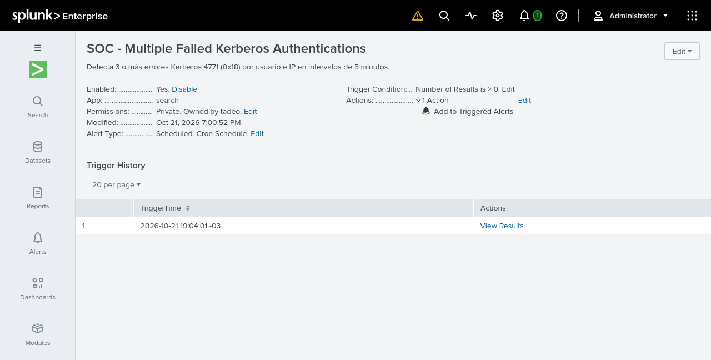

*Trigger History muestra una activación de SOC - Multiple Failed Kerberos Authentications y el enlace View Results.*

### 1.14. Verificación mediante View Results

Se seleccionó **View Results** para revisar los resultados de la búsqueda que provocó la activación.

Splunk mostró la consulta SPL definitiva y su resultado:

| \_time              | Usuario      | IP_Origen               | IntentosFallidos |
| ------------------- | ------------ | ----------------------- | ---------------- |
| 2026-10-21 19:00:00 | soc.lab.test | `::ffff:192.168.20.132` | 3                |

La búsqueda programada examinó el intervalo aproximado de 18:54 a 19:04, según la pantalla de resultados.

La marca `19:00:00` representa el inicio del bloque temporal de cinco minutos, no necesariamente la hora exacta de los tres intentos.

Esta evidencia permitió confirmar que:

- Splunk ejecutó automáticamente la búsqueda guardada.
- La búsqueda identificó tres eventos que cumplían las condiciones.
- Los eventos correspondían a `soc.lab.test` y a la IP de WS01.
- La alerta se activó y quedó registrada en el historial.

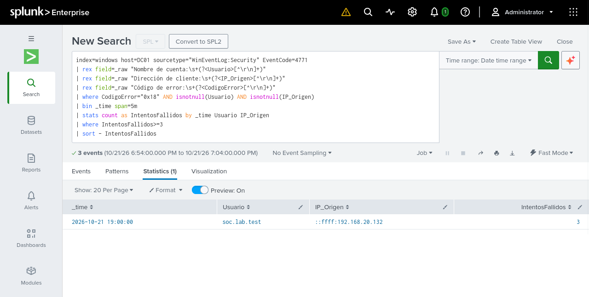

*La ejecución programada abarca 18:54–19:04 y devuelve una fila para la cuenta y la IP de WS01. El campo _time está agrupado: no muestra las horas individuales de los tres eventos.*

### 1.15. Resultado final

| Etapa                                      | Estado     |
| ------------------------------------------ | ---------- |
| Creación de cuenta de prueba               | Completada |
| Comprobación de política de bloqueo        | Completada |
| Simulación de tres fallos de autenticación | Completada |
| Recepción de eventos 4771 en Splunk        | Validada   |
| Asociación de eventos con usuario e IP     | Validada   |
| Confirmación del código `0x18`             | Validada   |
| Detección SPL manual                       | Validada   |
| Creación de alerta programada              | Completada |
| Activación automática                      | Validada   |
| Inspección de resultados de la alerta      | Validada   |

**Limitaciones identificadas**

La regla se limita a Security de DC01 y a eventos 4771 con código 0x18; no constituye una detección de todos los fallos de autenticación del dominio.

La detección actual utiliza bloques fijos de cinco minutos, no ventanas deslizantes. El umbral de tres fallos es didáctico y no permite concluir por sí solo que exista un ataque de fuerza bruta. Además, la extracción de campos depende del formato en español de los eventos de Windows, y la programación de alertas está condicionada por la licencia de Splunk.

**Conclusión de la prueba**

La Prueba 1 de la Fase 2 se completó satisfactoriamente.

Se generaron intentos de autenticación fallidos contra una cuenta de prueba del dominio `corp.local`. Los eventos fueron registrados por DC01, centralizados en Splunk y analizados mediante consultas SPL.

Posteriormente se construyó una detección que identificó tres errores Kerberos `4771`, con código `0x18`, asociados a una misma cuenta y dirección IP. Finalmente, se configuró una alerta programada que se ejecutó y registró una activación verificable.

El laboratorio pasó así de la simple recopilación de eventos, desarrollada en la Fase 1, a la detección automática de un comportamiento de seguridad controlado, cumpliendo el objetivo principal de esta primera prueba de la Fase 2.

## 2. Detección de cambios en cuentas y grupos de Active Directory

Se simularon cambios administrativos controlados en **Active Directory**, se verificó su recepción en Splunk Enterprise y se configuró una alerta programada para detectar incorporaciones al grupo global de seguridad **SOC-Lab-Security**.

La prueba comprende la creación del grupo y de la cuenta **soc.test02**, el análisis de los eventos **4727, 4720 y 4728**, y la validación de la alerta **SOC - Active Directory Group Membership Change**. Las operaciones se realizaron en DC01 y las búsquedas en Splunk Web desde Kali Purple.

### 2.1. Entorno utilizado

| Máquina     | Sistema operativo   | Dirección IP     | Función                                                      |
| ----------- | ------------------- | ---------------- | ------------------------------------------------------------ |
| DC01        | Windows Server 2022 | `192.168.20.5`   | Controlador de dominio y origen de los eventos               |
| WS01        | Windows 10          | `192.168.20.132` | Equipo del dominio; no intervino directamente en esta prueba |
| Kali Purple | Kali Purple 2026.3  | `192.168.20.134` | Servidor Splunk Enterprise 10.6.1.1                          |

El dominio utilizado fue `corp.local`.

La infraestructura de recopilación de eventos ya estaba configurada desde la Fase 1 mediante Splunk Universal Forwarder, utilizando el índice `windows`.

### 2.2. Verificación de las políticas de auditoría

**Consulta**

En PowerShell de **DC01** se ejecutó:

```powershell
auditpol /get /category:*
```

El resultado relevante fue:

```text
Administración de cuentas
  Administración de cuentas de equipo          Sin auditoría
  Administración de grupos de seguridad        Aciertos y errores
  Administración de grupos de distribución     Sin auditoría
  Administración de grupos de aplicaciones     Sin auditoría
  Otros eventos de administración de cuentas   Sin auditoría
  Administración de cuentas de usuario         Aciertos y errores
```

**Resultado**

En **DC01** se comprobó que las dos subcategorías necesarias estaban habilitadas:

| Subcategoría                          | Configuración      |
| ------------------------------------- | ------------------ |
| Administración de cuentas de usuario  | Aciertos y errores |
| Administración de grupos de seguridad | Aciertos y errores |

Esto permitió continuar sin modificar las políticas de auditoría configuradas durante la Fase 1. La salida de auditpol se conserva según el registro de implementación; no se dispone de una captura específica de esta comprobación.

### 2.3. Creación del grupo de seguridad

En **DC01** se abrió PowerShell como administrador y se importó el módulo de Active Directory:

```powershell
Import-Module ActiveDirectory
```

Se creó un grupo de seguridad exclusivo para la simulación:

```powershell
New-ADGroup `
  -Name "SOC-Lab-Security" `
  -SamAccountName "SOC-Lab-Security" `
  -GroupScope Global `
  -GroupCategory Security
```

El comando finalizó sin mostrar errores.

El grupo se creó con las siguientes características:

| Propiedad | Valor              |
| --------- | ------------------ |
| Nombre    | `SOC-Lab-Security` |
| Alcance   | Global             |
| Categoría | Security           |
| Dominio   | `corp.local`       |

Se utilizó un grupo de laboratorio para evitar modificaciones en grupos administrativos reales, como `Domain Admins`.

### 2.4. Creación de la cuenta de prueba

A continuación se creó una cuenta de usuario exclusiva para esta prueba:

```powershell
New-ADUser `
  -Name "SOC Test 02" `
  -SamAccountName "soc.test02" `
  -UserPrincipalName "soc.test02@corp.local" `
  -Enabled $true `
  -AccountPassword (Read-Host "Contraseña de laboratorio" -AsSecureString) `
  -ChangePasswordAtLogon $false
```

La contraseña se introdujo interactivamente mediante `Read-Host -AsSecureString`, sin escribirla directamente en el comando.

**Verificación del usuario**

Se ejecutó:

```powershell
Get-ADUser soc.test02 |
Select-Object Name,SamAccountName,Enabled
```

Resultado:

```text
Name        SamAccountName Enabled
----        -------------- -------
SOC Test 02 soc.test02        True
```

El resultado confirmó la existencia de la cuenta y su estado habilitado.

**Verificación del grupo**

Se ejecutó:

```powershell
Get-ADGroup SOC-Lab-Security |
Select-Object Name,GroupScope,GroupCategory
```

Resultado:

```text
Name             GroupScope GroupCategory
----             ---------- -------------
SOC-Lab-Security     Global      Security
```

Estas consultas confirmaron la existencia del usuario y del grupo, así como el alcance Global y la categoría Security del grupo.

-2026-10-21-19-20-24.png>)

*La consola muestra los comandos de creación, la cuenta habilitada y el grupo con alcance Global y categoría Security. Es evidencia local de Active Directory; la recepción de sus eventos se comprueba después en Splunk.*

### 2.5. Verificación de eventos de creación en Splunk

En **Kali Purple** se accedió a Splunk Web:

```text
http://kali:8000
```

Se abrió **Search & Reporting** y se seleccionó **Last 15 minutes**.

Se ejecutó:

```spl
index=windows host=DC01 sourcetype="WinEventLog:Security"
(EventCode=4720 OR EventCode=4727)
| table _time EventCode _raw
| sort _time
```

**Resultado obtenido**

Splunk devolvió dos eventos:

| Fecha y hora              | Event ID | Descripción                          |
| ------------------------- | -------- | ------------------------------------ |
| 21/10/2026 — 19:19:36.806 | 4727     | Se creó un grupo global de seguridad |
| 21/10/2026 — 19:19:48.526 | 4720     | Se creó una cuenta de usuario        |

**Evento 4720**

En el campo `_raw` se identificó:

```text
Message=Se creó una cuenta de usuario.
```

Los datos relevantes fueron:

```text
Sujeto:
    Nombre de cuenta: Administrador
    Dominio de cuenta: CORP

Nueva cuenta:
    Nombre de cuenta: soc.test02
    Dominio de cuenta: CORP
```

Esto confirmó que la cuenta `CORP\Administrador` creó el usuario `soc.test02`.

**Evento 4727**

En el campo `_raw` se observó:

```text
Message=Se creó un grupo global con seguridad habilitada.
```

La existencia y configuración del grupo `SOC-Lab-Security` ya habían sido verificadas mediante PowerShell.

Resultado: Splunk estaba recibiendo correctamente los eventos de administración de cuentas y grupos desde DC01.

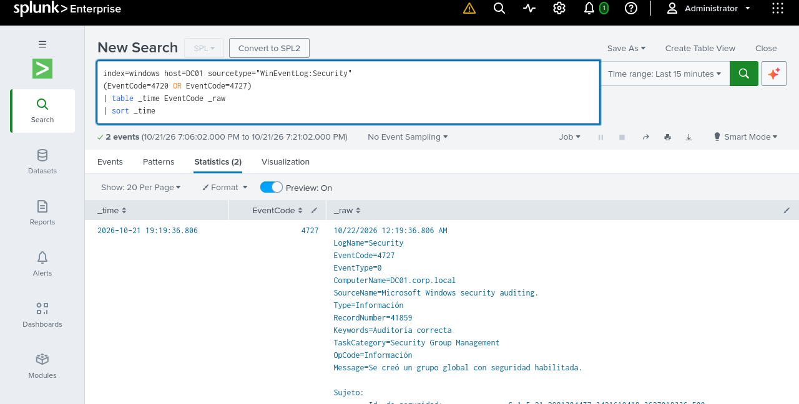

*La imagen muestra la consulta, el intervalo y el evento 4727 de creación de un grupo global de seguridad. Las horas de la tabla anterior corresponden a la columna _time de Splunk.*

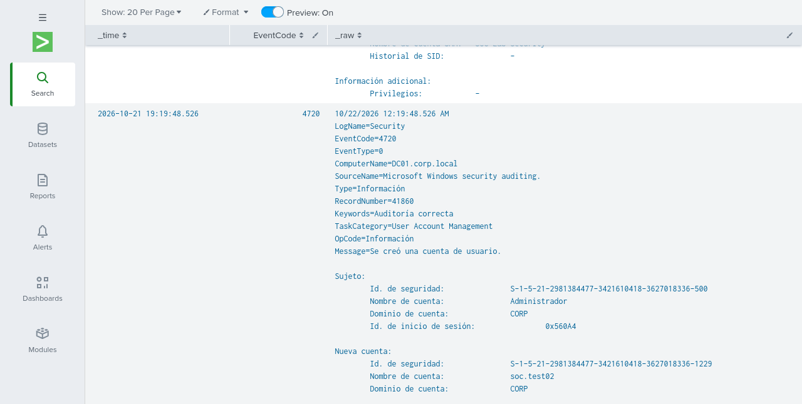

*Este recorte complementa la consulta anterior y muestra la identidad de la cuenta creada y del sujeto de la operación.*

### 2.6. Incorporación del usuario al grupo

Después de comprobar los eventos de creación, se realizó la modificación principal de esta prueba.

En PowerShell de **DC01** se ejecutó:

```powershell
Add-ADGroupMember -Identity "SOC-Lab-Security" -Members "soc.test02"
```

La finalidad era incorporar el usuario `soc.test02` al grupo global de seguridad `SOC-Lab-Security`.

El evento Windows Security **4728** se registra al incorporar un miembro a un **grupo global de seguridad** cuando está habilitada la auditoría correspondiente. En este laboratorio, la subcategoría Administración de grupos de seguridad se había comprobado previamente con Aciertos y errores.

-2026-10-21-19-22-30.png>)

*La consola muestra Add-ADGroupMember y una comprobación posterior con Get-ADGroupMember que devuelve soc.test02. Esta evidencia corresponde a la primera incorporación; no acredita los comandos de la segunda simulación.*

### 2.7. Verificación del evento 4728 en Splunk

Desde **Search & Reporting** en Kali Purple se ejecutó:

```spl
index=windows host=DC01 sourcetype="WinEventLog:Security" EventCode=4728
| table _time EventCode _raw
| sort - _time
```

Se seleccionó **Last 15 minutes**.

**Resultado obtenido**

Splunk devolvió un evento:

| Campo        | Valor                     |
| ------------ | ------------------------- |
| Fecha y hora | 21/10/2026 — 19:22:14.375 |
| Event ID     | 4728                      |
| Equipo       | `DC01.corp.local`         |
| Categoría    | Security Group Management |
| Resultado    | Auditoría correcta        |

En el campo `_raw` aparecía:

```text
Message=Se agregó un miembro a un grupo global con seguridad habilitada.
```

**Identificación del administrador**

```text
Sujeto:
    Nombre de cuenta: Administrador
    Dominio de cuenta: CORP
```

**Identificación del usuario agregado**

```text
Miembro:
    Nombre de cuenta: CN=SOC Test 02,CN=Users,DC=corp,DC=local
```

**Identificación del grupo**

```text
Grupo:
    Nombre de grupo: SOC-Lab-Security
    Dominio de grupo: CORP
```

El evento también incluía los identificadores de seguridad (SID) correspondientes al administrador, al miembro agregado y al grupo.

El resultado confirmó la recepción en Splunk del evento de modificación de pertenencia al grupo.

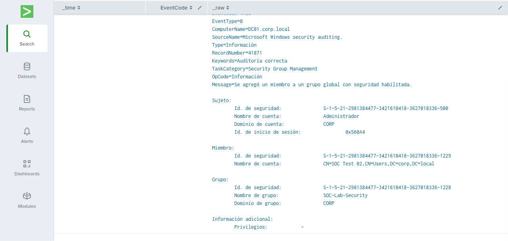

*El mensaje muestra los datos de Sujeto, Miembro y Grupo que se utilizaron para extraer campos. El recorte no contiene la barra de búsqueda ni su selector temporal.*

### 2.8. Extracción de campos mediante SPL

La información disponible en `_raw` se extrajo a campos individuales para facilitar su análisis y construir una alerta.

Se utilizaron expresiones regulares con `rex` adaptadas a las etiquetas en español de los mensajes de Windows.

Se ejecutó:

```spl
index=windows host=DC01 sourcetype="WinEventLog:Security" EventCode=4728
| rex field=_raw "Sujeto:\s+Id\. de seguridad:\s+[^\r\n]+\s+Nombre de cuenta:\s+(?<Administrador>[^\r\n]+)"
| rex field=_raw "Miembro:\s+Id\. de seguridad:\s+[^\r\n]+\s+Nombre de cuenta:\s+(?<UsuarioAgregado>[^\r\n]+)"
| rex field=_raw "Nombre de grupo:\s+(?<Grupo>[^\r\n]+)"
| table _time host EventCode Administrador UsuarioAgregado Grupo
| sort - _time
```

**Funcionamiento de la consulta**

El primer `rex` extrae el nombre de la cuenta administrativa que realizó la modificación.

El segundo `rex` extrae el nombre distinguido del usuario incorporado.

El tercer `rex` extrae el nombre del grupo de seguridad modificado.

Finalmente, `table` presenta los campos en columnas y `sort - _time` ordena los eventos desde el más reciente.

**Resultado obtenido**

| Campo             | Valor                                      |
| ----------------- | ------------------------------------------ |
| `_time`           | 2026-10-21 19:22:14.375                    |
| `host`            | DC01                                       |
| `EventCode`       | 4728                                       |
| `Administrador`   | Administrador                              |
| `UsuarioAgregado` | `CN=SOC Test 02,CN=Users,DC=corp,DC=local` |
| `Grupo`           | SOC-Lab-Security                           |

La extracción de los tres campos funcionó correctamente.

### 2.9. Construcción de la consulta SPL definitiva

Para crear una detección específica, se incorporó un filtro que limita los resultados al grupo de seguridad del laboratorio.

La consulta definitiva fue:

```spl
index=windows host=DC01 sourcetype="WinEventLog:Security" EventCode=4728
| rex field=_raw "Sujeto:\s+Id\. de seguridad:\s+[^\r\n]+\s+Nombre de cuenta:\s+(?<Administrador>[^\r\n]+)"
| rex field=_raw "Miembro:\s+Id\. de seguridad:\s+[^\r\n]+\s+Nombre de cuenta:\s+(?<UsuarioAgregado>[^\r\n]+)"
| rex field=_raw "Nombre de grupo:\s+(?<Grupo>[^\r\n]+)"
| where Grupo="SOC-Lab-Security"
| table _time host EventCode Administrador UsuarioAgregado Grupo
| sort - _time
```

**Lógica de detección**

La búsqueda identifica eventos que cumplen simultáneamente estas condiciones:

- Fueron registrados en DC01 dentro del índice `windows`.
- Corresponden al Event ID `4728`.
- Se relacionan con la incorporación de un miembro a un grupo global de seguridad.
- El grupo modificado es `SOC-Lab-Security`.

A diferencia de la Prueba 1, esta consulta no utiliza un umbral de varios eventos.

Una sola incorporación al grupo monitoreado es suficiente para que la consulta devuelva un resultado.

La búsqueda manual devolvió correctamente el evento generado durante la simulación.

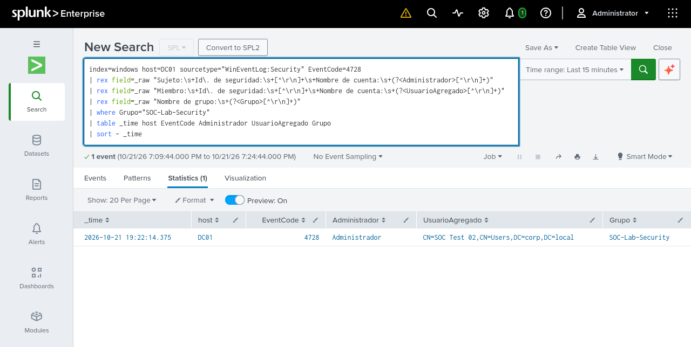

*La consulta muestra un resultado en Last 15 minutes, con el filtro específico del grupo y los tres campos extraídos. Este evento pertenece a la comprobación manual, anterior a la validación de la alerta.*

### 2.10. Creación de la alerta automática

Con la consulta definitiva validada, se seleccionó:

Save As → Alert

Se configuró la alerta con los siguientes parámetros:

| Campo                                   | Configuración                                                                         |
| --------------------------------------- | ------------------------------------------------------------------------------------- |
| Title                                   | `SOC - Active Directory Group Membership Change`                                      |
| Description                             | Detecta incorporaciones al grupo de seguridad SOC-Lab-Security mediante eventos 4728. |
| Permissions                             | Private                                                                               |
| Alert Type                              | Scheduled                                                                             |
| Schedule                                | Run on Cron Schedule                                                                  |
| Cron Expression                         | `* * * * *`                                                                           |
| Time Range                              | Last 2 minutes                                                                        |
| Expires                                 | 24 horas                                                                              |
| Trigger alert when                      | Number of Results                                                                     |
| Condition                               | is greater than `0`                                                                   |
| Trigger                                 | For each result                                                                       |
| Throttle                                | Habilitado                                                                            |
| Suppress results containing field value | `UsuarioAgregado,Grupo`                                                               |
| Suppress triggering for                 | 10 minutos                                                                            |
| Trigger Action                          | Add to Triggered Alerts                                                               |
| Severity                                | Medium                                                                                |

**Programación**

Se utilizó la expresión Cron:

```text
* * * * *
```

Esta expresión establece una ejecución programada cada minuto.

La búsqueda examina los eventos correspondientes a los últimos dos minutos.

**Condición de activación**

Se configuró:

```text
Number of Results > 0
```

De esta forma, la alerta puede activarse cuando la consulta encuentre al menos un evento que cumpla las condiciones establecidas.

**Supresión de alertas**

Se habilitó **Throttle** durante diez minutos, utilizando los campos:

```text
UsuarioAgregado,Grupo
```

Esto reduce las activaciones repetidas asociadas a una misma combinación de usuario y grupo.

**Acción de alerta**

Se seleccionó:

Add to Triggered Alerts

Con esta acción, las activaciones quedan registradas en el historial de alertas de Splunk.

La severidad configurada fue Medium.

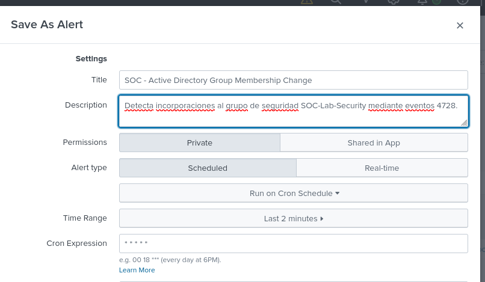

*El formulario muestra el nombre, los permisos privados y la programación introducida.*

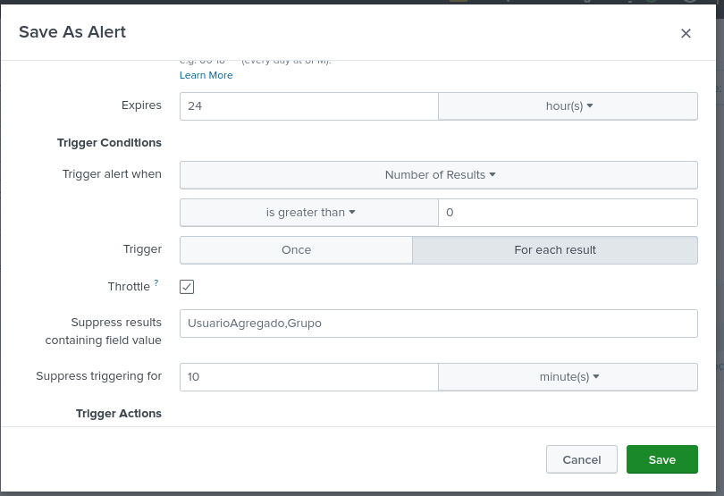

*Se observan For each result, la expiración de 24 horas y los campos de supresión. La imagen muestra la configuración del formulario, no una activación.*

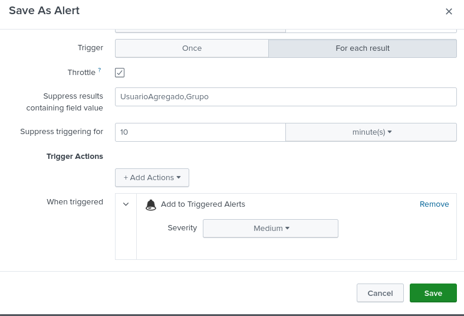

*El recorte completa la configuración de la acción y su severidad. El guardado y la activación se verifican por separado.*

### 2.11. Confirmación de la alerta guardada

Después de guardar la configuración, se abrió la página de la alerta.

Splunk mostró:

```text
SOC - Active Directory Group Membership Change
```

Los parámetros visibles confirmaron:

```text
Enabled: Yes
Alert Type: Scheduled. Cron Schedule.
Trigger Condition: Number of Results is > 0.
Actions: Add to Triggered Alerts.
```

La alerta quedó habilitada y preparada para ejecutarse automáticamente.

### 2.12. Segunda simulación para validar la alerta

Para probar la alerta programada era necesario generar un nuevo evento 4728 dentro del intervalo de búsqueda.

El procedimiento de validación utilizó nuevamente el usuario `soc.test02` y el grupo `SOC-Lab-Security`.

**Eliminación del usuario del grupo**

En DC01 se indicó ejecutar:

```powershell
Remove-ADGroupMember -Identity "SOC-Lab-Security" -Members "soc.test02" -Confirm:$false
```

La eliminación de un miembro de un grupo global de seguridad corresponde al evento **4729**. No se documentó una comprobación de ese evento en esta validación; la alerta se centró en la reincorporación.

**Reincorporación del usuario**

Posteriormente se indicó ejecutar:

```powershell
Add-ADGroupMember -Identity "SOC-Lab-Security" -Members "soc.test02"
```

La reincorporación permite generar un nuevo evento **4728** con la auditoría habilitada.

La captura posterior de Splunk confirma que se registró un nuevo evento 4728 correspondiente a la misma cuenta y grupo. No se dispone de una captura independiente de la ejecución de ambos comandos en DC01; se distinguen los comandos indicados del nuevo evento efectivamente comprobado.

### 2.13. Activación automática de la alerta

Después de la segunda simulación, se consultó nuevamente la página de la alerta.

En Trigger History apareció una activación:

```text
TriggerTime: 2026-10-21 19:29:00 -03
```

La página también confirmó que la alerta continuaba habilitada:

```text
Enabled: Yes
```

Esto demostró que la búsqueda programada se había ejecutado y había encontrado al menos un evento que cumplía las condiciones de detección.

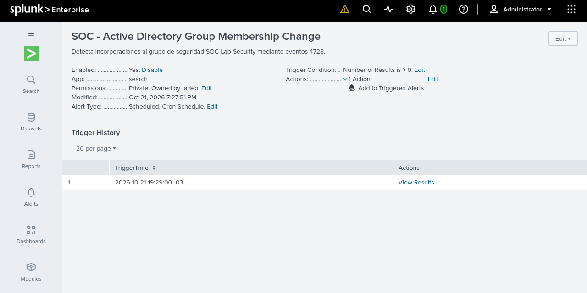

*Trigger History registra una activación y permite acceder a View Results. Esta pantalla no muestra la ejecución local de los comandos de validación.*

### 2.14. Verificación de los resultados de la alerta

Se seleccionó **View Results** desde el historial de activaciones.

Splunk mostró la consulta SPL guardada y una fila de resultados.

**Resultado confirmado**

| Campo            | Valor                                      |
| ---------------- | ------------------------------------------ |
| Fecha del evento | 21/10/2026 — 19:28:26.410                  |
| Equipo           | DC01                                       |
| Event ID         | 4728                                       |
| Administrador    | Administrador                              |
| Usuario agregado | `CN=SOC Test 02,CN=Users,DC=corp,DC=local` |
| Grupo            | SOC-Lab-Security                           |

La búsqueda programada utilizó el intervalo:

```text
21/10/2026 19:27:00 — 19:29:00
```

El evento registrado a las 19:28:26.410 estaba dentro de ese intervalo.

**Confirmaciones**

La evidencia demuestra que:

1. DC01 registró un nuevo cambio de pertenencia a un grupo de seguridad.
2. Splunk recibió el evento 4728.
3. La consulta SPL identificó al administrador, usuario y grupo involucrados.
4. El filtro `Grupo="SOC-Lab-Security"` se cumplió.
5. La búsqueda programada se ejecutó automáticamente.
6. La alerta se activó a las 19:29:00 y quedó registrada en Trigger History.

Este resultado validó el funcionamiento de la segunda alerta.

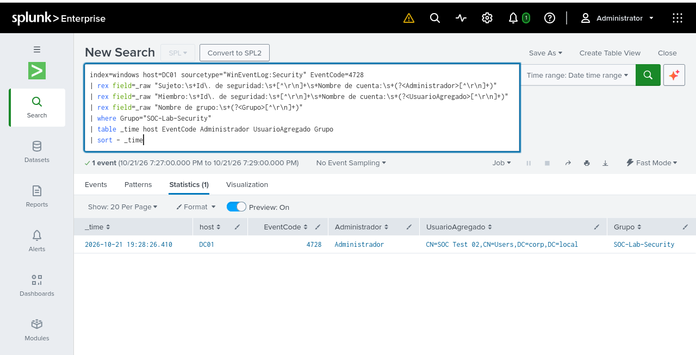

*La consulta guardada devuelve Administrador, el nombre distinguido del usuario agregado y SOC-Lab-Security. A diferencia de un recuento agregado, esta tabla conserva los campos del evento coincidente.*

### 2.15. Resultados finales de la Prueba 2

| Etapa                               | Estado               |
| ----------------------------------- | -------------------- |
| Verificación de auditoría avanzada  | Completada           |
| Creación del grupo de seguridad     | Completada           |
| Creación de cuenta de prueba        | Completada           |
| Identificación del evento 4727      | Validada             |
| Identificación del evento 4720      | Validada             |
| Incorporación de usuario al grupo   | Completada           |
| Identificación del evento 4728      | Validada             |
| Extracción de campos mediante `rex` | Validada             |
| Construcción de consulta SPL        | Validada             |
| Configuración de alerta programada  | Completada           |
| Segunda generación del evento 4728  | Confirmada en Splunk |
| Activación automática               | Validada             |
| Verificación mediante View Results  | Validada             |

### 2.16. Limitaciones de la detección

La alerta quedó validada para el escenario definido, con las siguientes limitaciones.

Actividad legítima: los cambios de pertenencia a grupos también forman parte de tareas administrativas autorizadas. El evento 4728, por sí solo, no demuestra actividad maliciosa.

Alcance restringido: solamente detecta incorporaciones al grupo `SOC-Lab-Security`. No supervisa automáticamente todos los grupos de seguridad del dominio.

Tipo de evento: utiliza exclusivamente el Event ID 4728. No detecta eliminaciones de miembros (4729), incorporaciones a grupos locales de dominio (4732) ni otros cambios administrativos.

Dependencia del idioma: las expresiones regulares están adaptadas al formato en español de los eventos recibidos desde DC01.

Ventanas superpuestas: la búsqueda se ejecuta cada minuto y analiza los últimos dos minutos, por lo que un mismo evento puede aparecer en más de una ejecución. El mecanismo de supresión reduce las activaciones duplicadas.

Severidad: el nivel Medium fue configurado manualmente para el laboratorio. No implica que todas las incorporaciones a grupos tengan necesariamente esa criticidad.

Licenciamiento: las búsquedas programadas dependen de las capacidades disponibles en la licencia de Splunk Enterprise.

**Referencia contextual a MITRE ATT&CK**

Los cambios de pertenencia a grupos pueden utilizarse en escenarios de abuso de cuentas para modificar el acceso. Esta relación se enmarca en [T1098 — Account Manipulation](https://attack.mitre.org/techniques/T1098/). En esta prueba se realizaron operaciones administrativas controladas sobre un grupo de laboratorio: no se demostró una escalada de privilegios real ni una intrusión.

### 2.17. Conclusión

La Prueba 2 de la Fase 2 se completó satisfactoriamente.

Se verificó la auditoría de administración de cuentas y grupos en Active Directory, se creó una cuenta de prueba y un grupo global de seguridad, y se generaron cambios administrativos controlados.

Los eventos 4720, 4727 y 4728 fueron recibidos correctamente por Splunk Enterprise.

Mediante consultas SPL se identificaron los datos relevantes de la modificación: la cuenta administrativa que realizó la operación, el usuario incorporado y el grupo de destino.

Finalmente, se configuró una alerta programada que detectó automáticamente un nuevo evento 4728 y registró su activación en Splunk.

Resultado principal: el laboratorio demostró la capacidad de monitorear cambios de pertenencia a grupos de seguridad en Active Directory y generar alertas automáticas ante modificaciones previamente definidas.

## 3. Detección de reconocimiento mediante PowerShell y Sysmon

### 3.1. Objetivo

Simular actividades de reconocimiento local en un endpoint Windows perteneciente al dominio Active Directory y verificar su detección mediante Splunk.

La prueba busca demostrar la capacidad del laboratorio para:

- Registrar el contenido de bloques de scripts mediante PowerShell Script Block Logging (Event ID 4104).
- Identificar procesos creados mediante Sysmon (Event ID 1).
- Centralizar los eventos en Splunk Enterprise.
- Detectar comandos asociados con reconocimiento de usuarios, grupos y configuración de red.
- Generar una alerta automática cuando se identifique dicha actividad.

Resultado final: prueba completada satisfactoriamente. Se confirmó la recepción de eventos PowerShell y Sysmon, así como la activación automática de una alerta programada en Splunk.

### 3.2. Entorno utilizado

| Componente | Función |
| --- | --- |
| WS01 — Windows 10 | Endpoint donde se ejecutaron los comandos |
| Dominio corp.local | Entorno Active Directory |
| Usuario CORP\empleado1 | Cuenta utilizada durante las pruebas |
| Sysmon | Registro de creación de procesos |
| PowerShell Script Block Logging | Registro del contenido de scripts y comandos |
| Splunk Universal Forwarder | Envío de registros del endpoint |
| Kali Purple — Splunk Enterprise 10.6.1.1 | Centralización, búsqueda y alertamiento |
| Índice windows | Almacenamiento de eventos de Windows |

### 3.3. Preparación y requisitos

Se utilizaron las configuraciones implementadas previamente durante la preparación del laboratorio:

- WS01 incorporado al dominio corp.local.
- Splunk Universal Forwarder instalado y enviando registros al servidor Splunk.
- Sysmon instalado y configurado para registrar eventos de creación de procesos.
- PowerShell Script Block Logging habilitado.
- Eventos disponibles en el índice windows.

Los registros se consultaron utilizando los siguientes sourcetypes:

PowerShell:

`XmlWinEventLog:Microsoft-Windows-PowerShell/Operational`

Sysmon:

`XmlWinEventLog:Microsoft-Windows-Sysmon/Operational`

En las búsquedas realizadas, el Event ID no estaba disponible como campo extraído automáticamente. Se utilizó `rex` para obtenerlo directamente del XML y almacenarlo en `ID_Evento`:

```spl
| rex field=_raw "<EventID[^>]*>(?<ID_Evento>\d+)</EventID>"
```

### 3.4. Simulación de reconocimiento local

Equipo: WS01

Herramienta: Windows PowerShell

Usuario: CORP\empleado1

La captura inicial utiliza `SOC-LAB-PS-TEST03`. El bloque transcrito a continuación corresponde a una ejecución posterior identificada como `SOC-LAB-PS-TEST03-RETRY`; no son la misma ejecución. Más adelante se emplearon marcadores distintos para la creación de procesos y para validar la alerta.

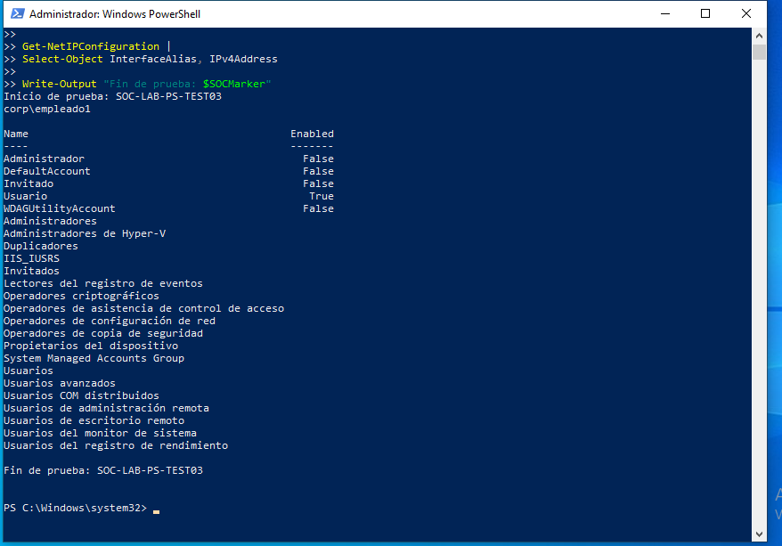

*La consola muestra la identidad devuelta, `corp\empleado1`, y resultados de enumeración de usuarios y grupos. Esta captura inicial no acredita el reintento con RETRY.*

Se ejecutaron comandos de reconocimiento local para consultar la identidad del usuario, enumerar cuentas y grupos, y obtener información de interfaces de red.

**Comandos ejecutados**

```powershell
$SOCMarker = "SOC-LAB-PS-TEST03-RETRY"

Write-Output "Inicio de prueba: $SOCMarker"

whoami
Get-LocalUser | Select-Object Name, Enabled
Get-LocalGroup | Select-Object Name
Get-NetIPConfiguration | Select-Object InterfaceAlias, IPv4Address

Write-Output "Fin de prueba: $SOCMarker"
```

**Función de cada comando**

| Comando | Finalidad |
| --- | --- |
| `whoami` | Identificar el usuario que ejecuta los comandos |
| `Get-LocalUser` | Enumerar usuarios locales y su estado |
| `Get-LocalGroup` | Enumerar grupos locales |
| `Get-NetIPConfiguration` | Consultar información de configuración de red |
| `Write-Output` | Incorporar un marcador identificativo de la prueba |

**Resultado**

El registro de implementación indica que la ejecución se completó correctamente. Las capturas de consola muestran la identidad y los resultados de enumeración de cuentas y grupos; no muestran valores de direcciones IP devueltos por la consulta de red.

La consulta `whoami` identificó al usuario:

```text
corp\empleado1
```

Se obtuvo información de cuentas locales, entre ellas Administrador, Invitado, Usuario, DefaultAccount y WDAGUtilityAccount.

También se enumeraron grupos locales como Administradores, Usuarios, Usuarios de escritorio remoto y Operadores de configuración de red.

La ejecución finalizó mostrando:

```text
Fin de prueba: SOC-LAB-PS-TEST03-RETRY
```

Observación: estas acciones son legítimas por sí mismas. Se utilizan como simulación controlada porque los mismos comandos pueden formar parte de una fase de reconocimiento durante una intrusión.

### 3.5. Verificación de PowerShell Script Block Logging — Event ID 4104

En Splunk Enterprise, dentro de Search & Reporting, se ejecutó la siguiente búsqueda.

Intervalo: Last 15 minutes.

```spl
index=windows sourcetype="XmlWinEventLog:Microsoft-Windows-PowerShell/Operational" "SOC-LAB-PS-TEST03-RETRY"
| rex field=_raw "<EventID[^>]*>(?<ID_Evento>\d+)</EventID>"
| search ID_Evento="4104"
| table _time host ID_Evento _raw
| sort - _time
```

**Resultado**

Splunk devolvió un evento coincidente.

| Campo | Valor |
| --- | --- |
| Host | WS01 |
| Event ID | 4104 |
| Fecha | 21/10/2026 |
| Hora | 20:17:19 |
| Marcador | `SOC-LAB-PS-TEST03-RETRY` |

El registro contenía un bloque de PowerShell con `whoami`, `Get-LocalUser`, `Get-LocalGroup` y `Get-NetIPConfiguration`. Su presencia en el evento 4104 acredita el contenido registrado, pero no demuestra por sí sola que todas las instrucciones se ejecutaran correctamente.

Conclusión: se confirmó que PowerShell Script Block Logging registra el contenido de la actividad y que Splunk puede consultarlo de forma centralizada.

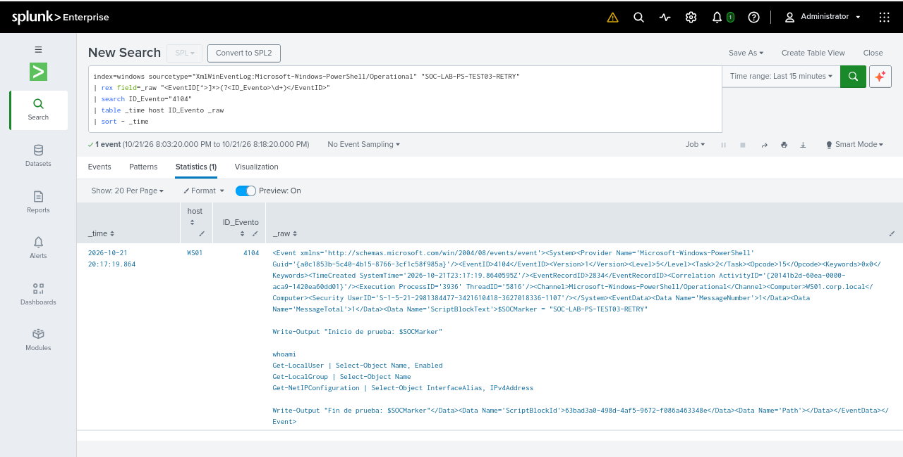

*La búsqueda devuelve un evento y muestra el XML del bloque, incluido el marcador del reintento.*

### 3.6. Verificación de Sysmon — Event ID 1

Se comprobó que Sysmon estaba enviando registros de creación de procesos al servidor Splunk.

**Consulta general**

```spl
index=windows sourcetype="XmlWinEventLog:Microsoft-Windows-Sysmon/Operational"
| rex field=_raw "<EventID[^>]*>(?<ID_Evento>\d+)</EventID>"
| search ID_Evento="1"
| search host="WS01"
| table _time host ID_Evento _raw
| sort - _time
```

**Resultado**

La búsqueda devolvió 48 eventos de creación de procesos en **Last 15 minutes**, según la captura. El recuento corresponde al conjunto de procesos coincidentes de WS01, no exclusivamente a la simulación.

Esto permitió confirmar la recepción de registros Sysmon Event ID 1 desde WS01.

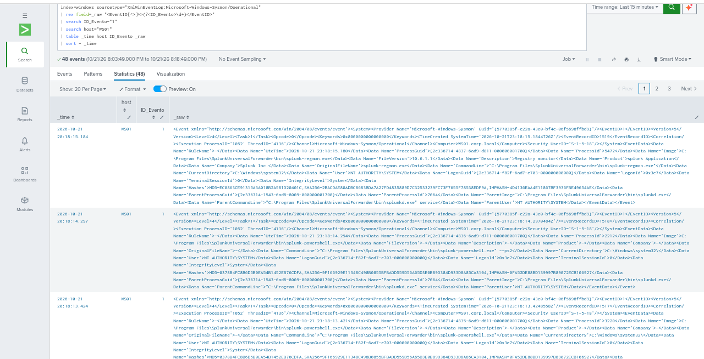

*El recuento confirma la recepción de eventos de creación de procesos; todavía no aísla el proceso generado para la prueba.*

Sin embargo, era necesario identificar específicamente un proceso PowerShell.

#### 3.6.1. Generación de un nuevo proceso PowerShell

Se ejecutó en WS01:

```powershell
powershell.exe -NoProfile -Command "Write-Output 'SOC-LAB-SYSMON-TEST03'; whoami"
```

Este comando inició una nueva instancia de PowerShell, ejecutó instrucciones inofensivas y finalizó.

Se utilizó un marcador específico para facilitar la identificación de la ejecución.

#### 3.6.2. Consulta de creación de procesos

En Splunk:

```spl
index=windows sourcetype="XmlWinEventLog:Microsoft-Windows-Sysmon/Operational" host="WS01" "powershell.exe"
| rex field=_raw "<EventID[^>]*>(?<ID_Evento>\d+)</EventID>"
| search ID_Evento="1"
| table _time host ID_Evento _raw
| sort - _time
```

Intervalo: Last 15 minutes.

**Resultado**

La búsqueda devolvió 20 eventos coincidentes. La búsqueda textual de `powershell.exe` puede coincidir también con datos del proceso padre; el total no representa 20 ejecuciones de la prueba.

Entre los resultados se identificaron los procesos asociados con la ejecución controlada:

| Campo | Valor |
| --- | --- |
| Equipo | WS01 |
| Usuario | CORP\empleado1 |
| Event ID | 1 |
| Proceso principal | `powershell.exe` |
| Proceso hijo observado | `whoami.exe` |
| Hora aproximada | 20:20:57 |

El evento correspondiente a PowerShell contenía la línea de comandos:

```powershell
powershell.exe -NoProfile -Command "Write-Output 'SOC-LAB-SYSMON-TEST03'; whoami"
```

El registro de `whoami.exe` permitió observar su relación con el proceso PowerShell mediante la información de proceso padre registrada por Sysmon.

Conclusión: Sysmon permite identificar la creación de procesos y sus relaciones padre-hijo, complementando la información proporcionada por Script Block Logging.

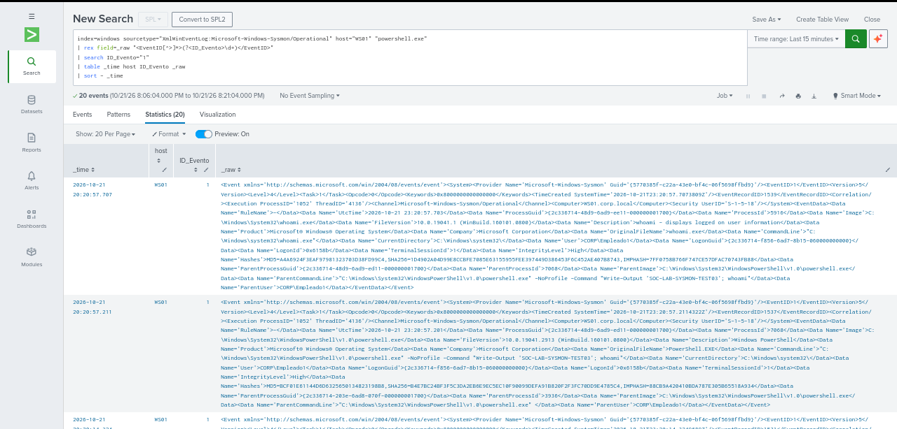

*Los registros visibles incluyen las líneas de comandos y los datos del proceso padre. Son evidencia complementaria; no intervienen en la condición de la alerta.*

### 3.7. Construcción de la búsqueda de detección

Una vez confirmada la recepción de eventos, se desarrolló una búsqueda destinada a identificar comandos de reconocimiento local.

Se seleccionaron tres comandos:

- `Get-LocalUser`.
- `Get-LocalGroup`.
- `Get-NetIPConfiguration`.

**Consulta de detección**

```spl
index=windows sourcetype="XmlWinEventLog:Microsoft-Windows-PowerShell/Operational" host="WS01"
| rex field=_raw "<EventID[^>]*>(?<ID_Evento>\d+)</EventID>"
| search ID_Evento="4104"
| where like(_raw,"%Get-LocalUser%") OR like(_raw,"%Get-LocalGroup%") OR like(_raw,"%Get-NetIPConfiguration%")
| table _time host ID_Evento _raw
| sort - _time
```

**Resultado**

Splunk identificó 4 eventos PowerShell 4104 relacionados con los comandos seleccionados.

En **Last 15 minutes**, los resultados incluyeron registros con comandos individuales de enumeración y el bloque con el marcador `SOC-LAB-PS-TEST03-RETRY`.

La condición OR requiere una coincidencia con cualquiera de los tres patrones de texto dentro de `_raw`. No realiza análisis semántico ni verifica que todos los comandos presentes en un bloque se hayan ejecutado. El resultado identifica contenido compatible con reconocimiento local, que requiere interpretación contextual.

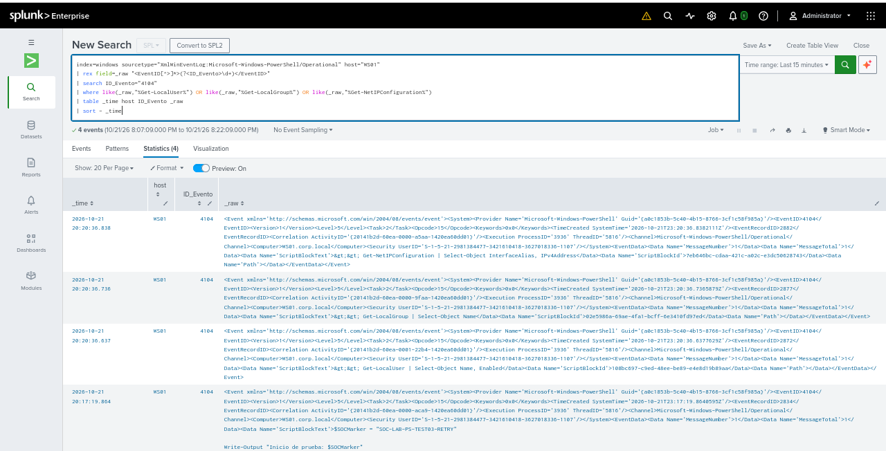

*La tabla conserva `_raw` y permite revisar el contenido de los eventos; el filtro se basa en coincidencias textuales.*

### 3.8. Creación de la alerta automática

Se creó una alerta programada para identificar este tipo de actividad sin limitar la búsqueda a un endpoint específico.

#### 3.8.1. Consulta SPL definitiva

```spl
index=windows sourcetype="XmlWinEventLog:Microsoft-Windows-PowerShell/Operational"
| rex field=_raw "<EventID[^>]*>(?<ID_Evento>\d+)</EventID>"
| search ID_Evento="4104"
| where like(_raw,"%Get-LocalUser%") OR like(_raw,"%Get-LocalGroup%") OR like(_raw,"%Get-NetIPConfiguration%")
| stats count as Eventos values(ID_Evento) as ID_Evento by host
| where Eventos > 0
```

Esta búsqueda agrupa los eventos por host y devuelve una fila por equipo con al menos un evento coincidente. Eventos cuenta los registros, mientras que values(`ID_Evento`) reúne sus identificadores. Se retiró el filtro de WS01, pero la validación documentada corresponde a ese equipo.

#### 3.8.2. Validación previa

Antes de guardar la alerta, la consulta se ejecutó con un intervalo de 15 minutos.

**Resultado:**

| Host | Eventos | `ID_Evento` |
| --- | --- | --- |
| WS01 | 4 | 4104 |

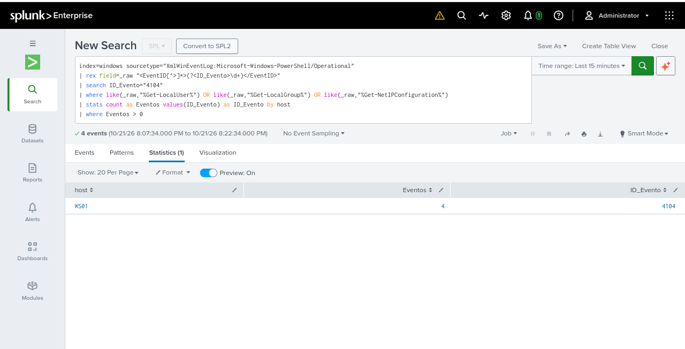

*La validación manual en Last 15 minutes agrupa cuatro eventos en una fila de host.*

#### 3.8.3. Configuración de la alerta

Desde Splunk:

Search & Reporting → Save As → Alert

Se configuraron los siguientes parámetros:

| Parámetro | Configuración |
| --- | --- |
| Title | SOC - PowerShell Reconnaissance Activity |
| Description | Detects PowerShell Script Block Logging events containing local user, group or network reconnaissance commands. |
| Permissions | Private |
| Alert Type | Scheduled |
| Schedule | Run on Cron Schedule |
| Cron Expression | `*/5 * * * *` |
| Earliest | -5m |
| Latest | now |
| Trigger alert when | Number of Results |
| Condition | Is greater than 0 |
| Trigger | Once |
| Throttle | Disabled |
| Trigger Action | Add to Triggered Alerts |
| Severity | Medium |
| Expiration | 24 hours |

La expresión Cron configura una ejecución cada cinco minutos.

El intervalo -5m a now permite analizar los eventos correspondientes a los cinco minutos anteriores a cada ejecución.

El disparador evalúa el número de filas devueltas por la consulta agregada. **Once** genera una activación por ejecución con resultados, sin activar por separado cada fila. **Throttle** quedó deshabilitado.

La severidad Medium se seleccionó porque los comandos identificados pueden corresponder tanto a reconocimiento sospechoso como a tareas administrativas legítimas.

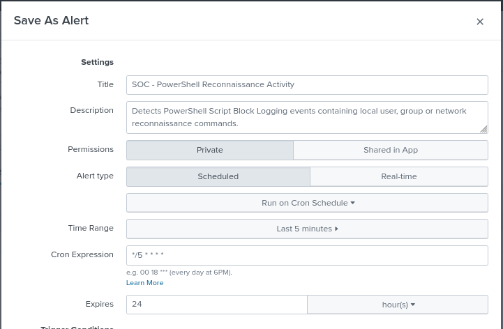

*El formulario muestra permisos Private, ejecución Scheduled, Last 5 minutes y expiración de 24 horas.*

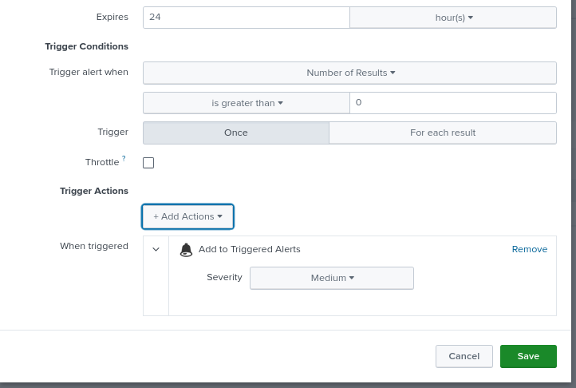

*La configuración muestra Once seleccionado y Throttle deshabilitado. Estas pantallas documentan la configuración; la activación se verifica después.*

### 3.9. Validación de la alerta

Para comprobar que la alerta funcionaba automáticamente, se realizó una nueva ejecución de reconocimiento en WS01.

**Comandos ejecutados**

```powershell
Write-Output "SOC-LAB-PS-ALERT-TEST03"
Get-LocalUser | Select-Object Name, Enabled
Get-LocalGroup | Select-Object Name
Get-NetIPConfiguration | Select-Object InterfaceAlias, IPv4Address
```

Los comandos se ejecutaron correctamente y devolvieron información de usuarios y grupos locales.

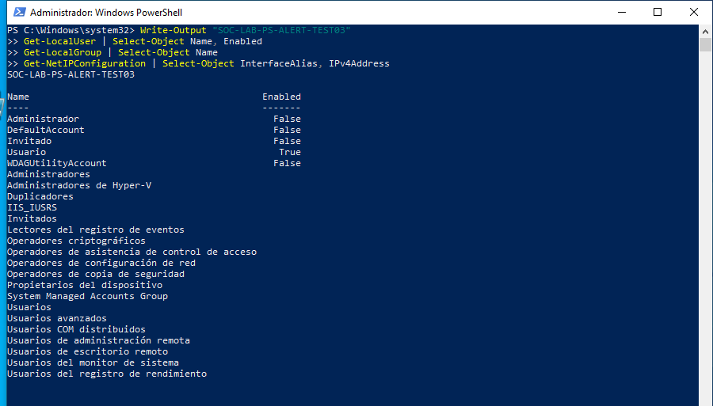

*La consola muestra el marcador de validación y resultados de usuarios y grupos. No se observan valores de direcciones IP en esta captura.*

Posteriormente, se esperó al siguiente ciclo de ejecución de la alerta programada.

#### 3.9.1. Verificación de la activación

En Splunk se consultó el historial de activaciones de:

SOC - PowerShell Reconnaissance Activity

**Resultado confirmado:**

| Campo | Resultado |
| --- | --- |
| Alerta | SOC - PowerShell Reconnaissance Activity |
| Estado | Habilitada |
| Fecha de activación | 21/10/2026 |
| Hora de activación | 20:30:00 (UTC-03) |
| Acción | Add to Triggered Alerts |
| Severidad configurada | Medium |

La alerta se activó automáticamente en el horario programado.

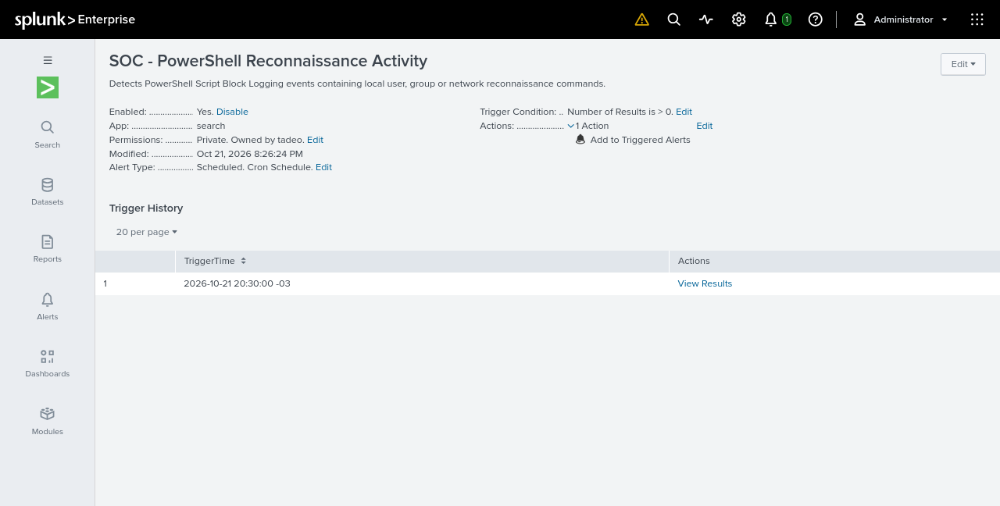

*Trigger History registra la activación y ofrece View Results; el historial no muestra el contenido del evento.*

#### 3.9.2. Verificación de los resultados

Desde el historial de la alerta se seleccionó View Results.

La búsqueda programada analizó el intervalo:

20:25:00 a 20:30:00

El resultado fue:

| Host | Eventos | `ID_Evento` |
| --- | --- | --- |
| WS01 | 1 | 4104 |

Splunk detectó un evento coincidente durante el intervalo programado y registró la activación de la alerta. La tabla agregada no conserva `_raw`, el marcador ni los comandos concretos: no permite atribuir inequívocamente ese evento al marcador `SOC-LAB-PS-ALERT-TEST03` ni afirmar que contiene las tres consultas de reconocimiento. Los cuatro eventos de la validación previa y este evento corresponden a ventanas diferentes.

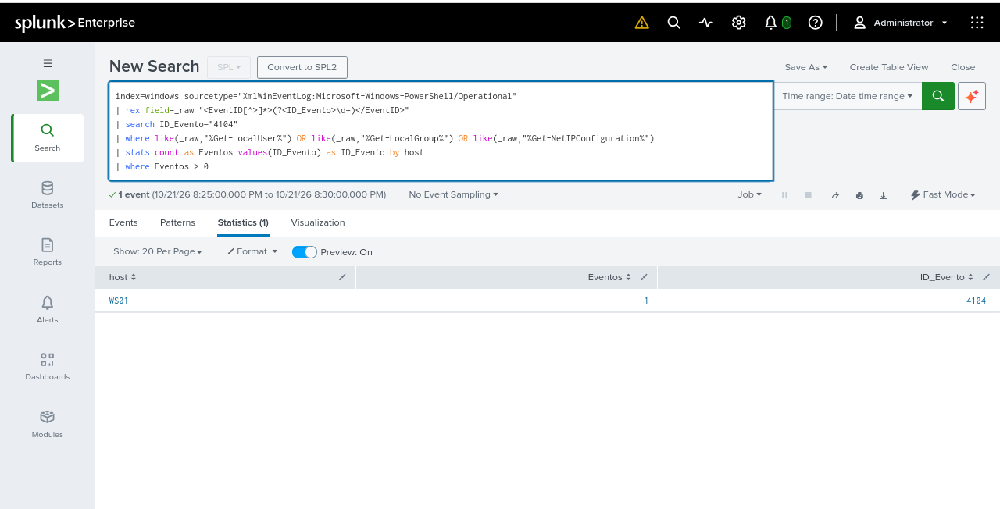

*La búsqueda guardada devuelve host WS01, Eventos 1 e `ID_Evento` 4104, sin mostrar el marcador.*

### 3.10. Evidencias recopiladas

Las siguientes evidencias respaldan la prueba:

| Evidencia | Contenido |
| --- | --- |
| E01 — PowerShell 4104 | Evento con marcador `SOC-LAB-PS-TEST03-RETRY` y contenido de los comandos |
| E02 — Sysmon ID 1 | Recepción de registros de creación de procesos |
| E03 — Proceso PowerShell | Registro de `powershell.exe` y proceso hijo `whoami.exe` |
| E04 — Detección de reconocimiento | Cuatro eventos 4104 coincidentes |
| E05 — Consulta de alerta | Resultado agrupado de WS01 con cuatro eventos |
| E06 — Historial de activación | Alerta disparada el 21/10/2026 a las 20:30 |
| E07 — Resultados de la alerta | Un evento 4104 detectado dentro de la ventana programada |

Las capturas se conservan con sus nombres originales en Image/Fase2/. Las evidencias se presentan junto a cada etapa, diferenciando la ejecución local, los eventos recibidos y los resultados agregados.

### 3.11. Análisis técnico

La prueba permitió comprobar la utilidad de combinar diferentes fuentes de telemetría.

PowerShell Script Block Logging (4104) proporciona visibilidad sobre el contenido de bloques de scripts procesados por PowerShell. Esta información resulta útil para detectar técnicas de reconocimiento y otras actividades que utilizan PowerShell.

Sysmon Process Create (1) aporta información sobre la creación de procesos, sus líneas de comandos, el usuario asociado y las relaciones padre-hijo.

Splunk Enterprise permite centralizar estos registros, aplicar búsquedas SPL y generar alertas programadas.

La detección creada se basa en coincidencias de comandos. Por lo tanto, tiene limitaciones:

- Puede generar falsos positivos por tareas administrativas legítimas.
- No identifica todas las variantes posibles de reconocimiento.
- La alerta implementada utiliza eventos 4104; los eventos Sysmon ID 1 se verificaron como fuente complementaria, pero no se incorporaron a la condición de activación.
- La consulta identifica coincidencias textuales con los comandos definidos dentro de eventos 4104 y no constituye, por sí sola, evidencia concluyente de una intrusión.

En un entorno de producción, sería recomendable enriquecer la detección con contexto de usuario, proceso padre, comportamiento habitual del endpoint y correlación con otros eventos.

**Referencias contextuales a MITRE ATT&CK**

| Técnica | Relación con la actividad documentada |
| --- | --- |
| [T1087.001 — Account Discovery: Local Account](https://attack.mitre.org/techniques/T1087/001/) | Enumeración de cuentas locales mediante `Get-LocalUser`. |
| [T1069.001 — Permission Groups Discovery: Local Groups](https://attack.mitre.org/techniques/T1069/001/) | Enumeración de grupos locales mediante `Get-LocalGroup`. |
| [T1033 — System Owner/User Discovery](https://attack.mitre.org/techniques/T1033/) | Consulta de identidad mediante `whoami`. |
| [T1016 — System Network Configuration Discovery](https://attack.mitre.org/techniques/T1016/) | Consulta de configuración de red mediante `Get-NetIPConfiguration`; no se documentan direcciones devueltas en las capturas. |
| [T1059.001 — Command and Scripting Interpreter: PowerShell](https://attack.mitre.org/techniques/T1059/001/) | Uso de PowerShell para ejecutar la simulación y creación de una nueva instancia verificada con Sysmon. |

Estas correspondencias contextualizan actividades simuladas que también pueden realizarse legítimamente. No demuestran una intrusión real ni cobertura completa de estas técnicas. La alerta busca únicamente los tres patrones definidos en eventos 4104; no tiene condiciones específicas para `whoami` ni para Sysmon ID 1.

### 3.12. Resultado final

Estado: COMPLETADA Y VALIDADA.

Se cumplieron los objetivos de la Prueba 3:

- Se ejecutaron comandos controlados de reconocimiento en WS01.
- Se registró su contenido mediante PowerShell Script Block Logging.
- Se verificó la creación de procesos mediante Sysmon.
- Se confirmó la recepción de ambas fuentes en Splunk.
- Se implementó una consulta de detección de reconocimiento local.
- Se creó una alerta programada con severidad Medium.
- Se comprobó su activación automática y se consultaron los resultados.

Conclusión general: el laboratorio demostró capacidad para detectar actividad de reconocimiento local mediante PowerShell, observar procesos relacionados a través de Sysmon y generar alertas automáticas en Splunk Enterprise.

## 4. Detección de ejecución de PowerShell con comandos codificados

### 4.1. Objetivo

Simular la ejecución de un comando PowerShell codificado en Base64 dentro de un endpoint Windows y verificar su detección mediante Sysmon, PowerShell Script Block Logging y Splunk Enterprise.

La prueba busca demostrar la capacidad del laboratorio para:

- Ejecutar una simulación controlada utilizando el parámetro `-EncodedCommand`.
- Registrar la creación del proceso mediante Sysmon Event ID 1.
- Identificar el contenido ejecutado mediante PowerShell Script Block Logging, Event ID 4104.
- Centralizar y consultar los registros en Splunk.
- Crear una alerta programada que identifique eventos relacionados con comandos codificados.
- Validar que la alerta se active automáticamente.

Resultado final: prueba completada satisfactoriamente. Se confirmó la recepción de eventos Sysmon y PowerShell, la detección de la ejecución codificada y la activación automática de una alerta en Splunk.

### 4.2. Entorno utilizado

| Componente | Función |
| --- | --- |
| WS01 — Windows 10 | Endpoint donde se ejecutó la simulación |
| Dominio corp.local | Entorno Active Directory |
| Usuario CORP\empleado1 | Cuenta asociada a la ejecución |
| Sysmon | Registro de creación de procesos |
| PowerShell Script Block Logging | Registro del contenido de los comandos |
| Splunk Universal Forwarder | Envío de eventos desde WS01 |
| Kali Purple — Splunk Enterprise 10.6.1.1 | Centralización, búsqueda y alertamiento |
| Índice windows | Almacenamiento de eventos Windows |

Se utilizaron los siguientes sourcetypes:

Sysmon:

`XmlWinEventLog:Microsoft-Windows-Sysmon/Operational`

PowerShell:

`XmlWinEventLog:Microsoft-Windows-PowerShell/Operational`

Se reutilizó la recopilación configurada en la Fase 1. Para estas búsquedas se extrajo el identificador del XML mediante `rex` y se almacenó en `ID_Evento`:

```spl
| rex field=_raw "<EventID[^>]*>(?<ID_Evento>\d+)</EventID>"
```

### 4.3. Descripción de la técnica

PowerShell permite ejecutar comandos codificados mediante el parámetro `-EncodedCommand`.

Este parámetro recibe una cadena Base64 que representa instrucciones codificadas en UTF-16LE.

Aunque esta funcionalidad puede utilizarse legítimamente para automatización y administración, también puede aparecer en actividades maliciosas destinadas a dificultar la inspección directa de las líneas de comandos.

La codificación Base64 no constituye cifrado ni garantiza que el contenido permanezca oculto.

En esta prueba se utilizó una instrucción completamente inofensiva, sin descargas, conexiones de red ni modificaciones del sistema.

**Referencia MITRE ATT&CK**

[T1059.001 — Command and Scripting Interpreter: PowerShell](https://attack.mitre.org/techniques/T1059/001/)

La simulación utiliza PowerShell como intérprete para ejecutar instrucciones.

[T1027 — Obfuscated Files or Information](https://attack.mitre.org/techniques/T1027/)

La codificación del comando representa una forma básica de ocultar su contenido legible dentro de la línea de comandos. La asociación con T1027 es contextual: el uso de Base64 por sí solo no demuestra actividad maliciosa ni intención de ocultamiento. La ejecución fue una simulación controlada, no una intrusión real.

### 4.4. Simulación inicial en WS01

Equipo: WS01

Herramienta: Windows PowerShell

Se ejecutó:

```powershell
$Comando = 'Write-Output "SOC-LAB-ENCODED-TEST04"'

$Bytes = [System.Text.Encoding]::Unicode.GetBytes($Comando)

$Codificado = [Convert]::ToBase64String($Bytes)

powershell.exe -NoProfile -EncodedCommand $Codificado
```

**Explicación**

| Instrucción | Función |
| --- | --- |
| $Comando | Define el contenido que se ejecutará |
| Encoding.Unicode.GetBytes() | Convierte el texto a UTF-16LE |
| ToBase64String() | Codifica el contenido en Base64 |
| `powershell.exe` -NoProfile | Inicia PowerShell sin cargar perfiles |
| `-EncodedCommand` | Ejecuta el comando codificado |

**Resultado observado**

La consola devolvió:

```text
SOC-LAB-ENCODED-TEST04
```

Conclusión: se confirmó que el comando fue codificado y ejecutado correctamente mediante una nueva instancia de PowerShell.

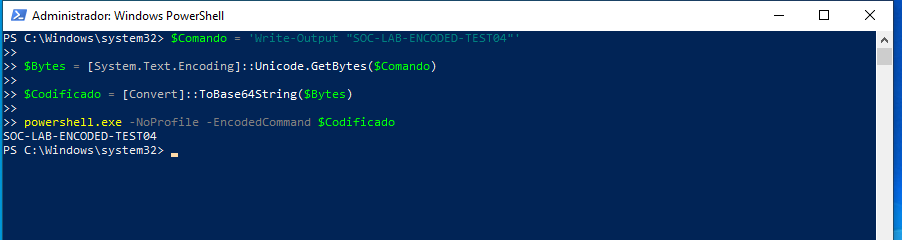

*La consola muestra la conversión a Base64, la llamada con `-EncodedCommand` y la salida de la simulación inicial.*

### 4.5. Verificación mediante Sysmon — Event ID 1

Se accedió a Splunk Enterprise → Search & Reporting.

Se seleccionó el intervalo Last 15 minutes y se ejecutó:

```spl
index=windows sourcetype="XmlWinEventLog:Microsoft-Windows-Sysmon/Operational" host="WS01" "EncodedCommand"
| rex field=_raw "<EventID[^>]*>(?<ID_Evento>\d+)</EventID>"
| search ID_Evento="1"
| table _time host ID_Evento _raw
| sort - _time
```

**Resultado**

Splunk devolvió 1 evento.

| Campo | Valor |
| --- | --- |
| Host | WS01 |
| Usuario | CORP\empleado1 |
| Event ID | 1 |
| Proceso | `powershell.exe` |
| Parámetro | `-EncodedCommand` |
| Fecha | 21/10/2026 |
| Hora | 20:40:44.576 |

El registro contenía información sobre el proceso creado, la línea de comandos, el usuario y el proceso padre.

En el campo `CommandLine` se identificó la ejecución de PowerShell con el argumento codificado en Base64.

Conclusión: Sysmon permitió identificar la ejecución de PowerShell mediante `-EncodedCommand`, aunque el contenido original no apareciera directamente en la línea de comandos.

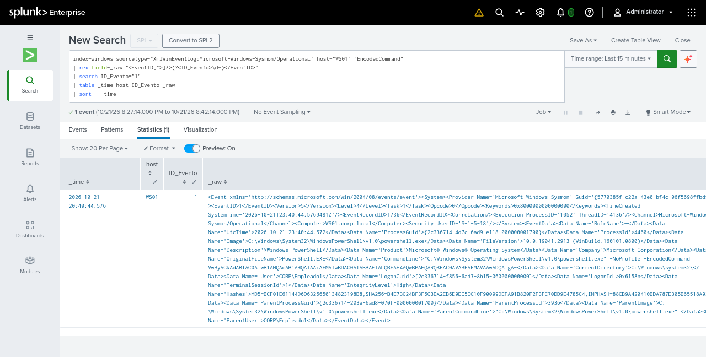

*El XML visible permite inspeccionar `Image`, `CommandLine`, el usuario y el proceso padre. Esta inspección del evento es distinta de lo que exige la consulta textual.*

### 4.6. Verificación mediante PowerShell Script Block Logging — Event ID 4104

Para comprobar si PowerShell registraba el contenido ejecutado, se realizó una búsqueda por el marcador utilizado durante la simulación.

**Consulta SPL**

```spl
index=windows sourcetype="XmlWinEventLog:Microsoft-Windows-PowerShell/Operational" host="WS01" "SOC-LAB-ENCODED-TEST04"
| rex field=_raw "<EventID[^>]*>(?<ID_Evento>\d+)</EventID>"
| search ID_Evento="4104"
| table _time host ID_Evento _raw
| sort - _time
```

Intervalo: Last 15 minutes.

**Resultado**

Splunk devolvió 2 eventos.

| Hora | Event ID | Contenido |
| --- | --- | --- |
| 20:40:44.924 | 4104 | `Write-Output "SOC-LAB-ENCODED-TEST04"` |
| 20:40:44.553 | 4104 | Script utilizado para preparar y ejecutar el comando codificado |

El primer evento registró el contenido que fue ejecutado por la nueva instancia de PowerShell.

El segundo contenía las instrucciones utilizadas para generar el Base64 y llamar a `powershell.exe` `-EncodedCommand`.

**Análisis**

La combinación de ambas fuentes permitió observar diferentes aspectos de la ejecución:

- Sysmon ID 1: identificó el proceso y el parámetro utilizado.
- PowerShell 4104: permitió observar el contenido del script ejecutado.

Conclusión: la codificación Base64 no impidió que PowerShell Script Block Logging registrara las instrucciones ejecutadas en esta simulación.

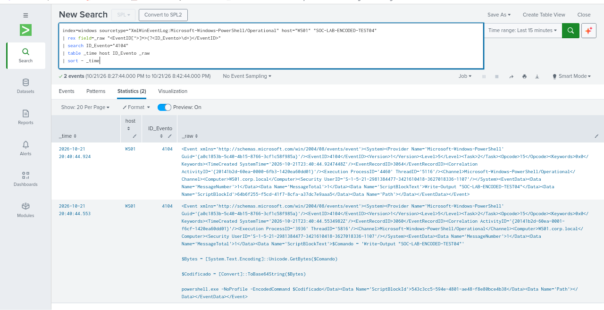

*Se observan el bloque que genera el Base64 y Write-Output con el marcador inicial. Estos eventos complementan Sysmon y no forman parte de la condición de la alerta.*

### 4.7. Desarrollo de la consulta de detección

El siguiente objetivo fue construir una consulta capaz de detectar la ejecución de comandos codificados mediante los eventos Sysmon.

#### 4.7.1. Primera consulta

Se intentó extraer los campos `Image` y `CommandLine` del XML y aplicar filtros sobre ellos.

```spl
index=windows sourcetype="XmlWinEventLog:Microsoft-Windows-Sysmon/Operational"
| rex field=_raw "<EventID[^>]*>(?<ID_Evento>\d+)</EventID>"
| search ID_Evento="1"
| rex field=_raw "<Data Name=\"Image\">(?<Proceso>[^<]+)</Data>"
| rex field=_raw "<Data Name=\"CommandLine\">(?<Comando>[^<]+)</Data>"
| where match(Proceso,"(?i)\\\\(?:powershell|pwsh)\.exe$") AND match(Comando,"(?i)-(?:EncodedCommand|enc)\b")
| table _time host ID_Evento Proceso Comando
| sort - _time
```

**Resultado**

La consulta no devolvió resultados.

El evento Sysmon ID 1 se había identificado con la búsqueda anterior, pero esta consulta, que añadía extracciones y filtros sobre `Image` y `CommandLine`, no lo devolvió. No se estableció una causa técnica definitiva: no se atribuye el resultado a un error concreto de expresiones regulares. No hay una captura específica de esta búsqueda; el resultado sin coincidencias consta en el registro de implementación.

#### 4.7.2. Consulta corregida

Para evitar depender de las extracciones adicionales, se simplificó la búsqueda utilizando directamente el texto `EncodedCommand` presente en el evento.

```spl
index=windows sourcetype="XmlWinEventLog:Microsoft-Windows-Sysmon/Operational" "EncodedCommand"
| rex field=_raw "<EventID[^>]*>(?<ID_Evento>\d+)</EventID>"
| search ID_Evento="1"
| stats count as Eventos values(ID_Evento) as ID_Evento by host
| where Eventos > 0
```

**Resultado**

Splunk devolvió:

| host | Eventos | `ID_Evento` |
| --- | --- | --- |
| WS01 | 1 | 1 |

La captura de esta comprobación utiliza **Last 60 minutes** y muestra un evento coincidente de WS01. La agrupación por host conserva el recuento y el identificador, pero no la línea de comandos ni el marcador; por sí sola no permite identificar una ejecución concreta.

Esta fue la consulta seleccionada para crear la alerta.

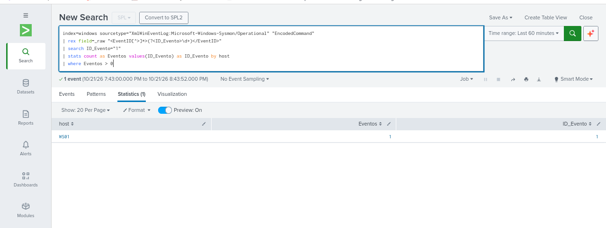

*La tabla agrupa un evento por host y no muestra `CommandLine` ni el marcador. Esta ventana es distinta de los cinco minutos utilizados por la alerta.*

**Limitación de la consulta**

La búsqueda detecta el texto `EncodedCommand` sobre el contenido de `_raw` de los eventos Sysmon ID 1. Puede coincidir con información de otros campos del evento, no solo con la línea de comandos del proceso creado.

No restringe la coincidencia exclusivamente al campo `CommandLine` ni comprueba que el ejecutable sea necesariamente PowerShell.

Por ello, la detección debe considerarse una regla inicial basada en coincidencia de texto, susceptible de mejoras para reducir falsos positivos.

### 4.8. Creación de la alerta automática

Desde Splunk se seleccionó:

Search & Reporting → Save As → Alert

**Consulta SPL definitiva**

```spl
index=windows sourcetype="XmlWinEventLog:Microsoft-Windows-Sysmon/Operational" "EncodedCommand"
| rex field=_raw "<EventID[^>]*>(?<ID_Evento>\d+)</EventID>"
| search ID_Evento="1"
| stats count as Eventos values(ID_Evento) as ID_Evento by host
| where Eventos > 0
```

**Configuración**

| Parámetro | Valor |
| --- | --- |
| Title | SOC - PowerShell Encoded Command Execution |
| Description | Detects process creation events containing the `EncodedCommand` parameter, commonly associated with encoded PowerShell execution. |
| Permissions | Private |
| Alert Type | Scheduled |
| Schedule | Run on Cron Schedule |
| Cron Expression | `*/5 * * * *` |
| Time Range | Last 5 minutes |
| Earliest | -5m |
| Latest | now |
| Trigger alert when | Number of Results |
| Condition | Is greater than 0 |
| Trigger | Once |
| Throttle | Disabled |
| Trigger Action | Add to Triggered Alerts |
| Severity | Medium |
| Expiration | 24 hours |

La alerta quedó configurada para ejecutar la consulta cada cinco minutos, analizando los últimos cinco minutos (-5m a now). La consulta devuelve una fila por host con eventos coincidentes; Number of Results > 0 evalúa esas filas, mientras que Eventos representa el recuento de registros. Once configura una activación por ejecución con resultados y Throttle quedó deshabilitado.

Se seleccionó la severidad Medium porque el uso de `-EncodedCommand` puede resultar sospechoso, pero también puede corresponder a actividades legítimas de administración.

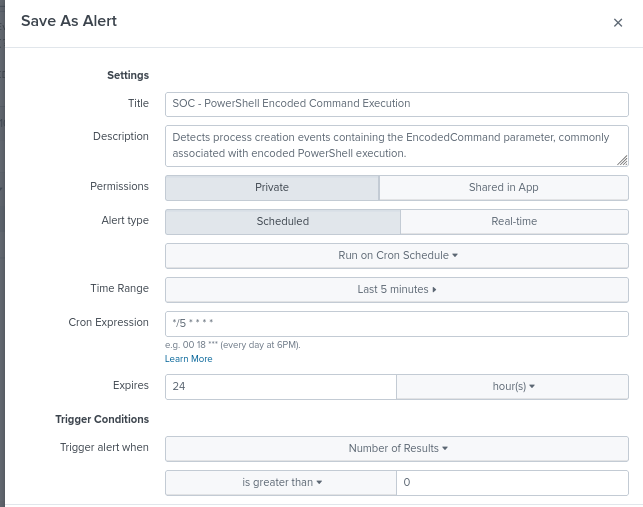

*El formulario muestra el nombre, permisos Private, programación cada cinco minutos, Last 5 minutes, expiración de 24 horas y condición de resultados mayor que cero.*

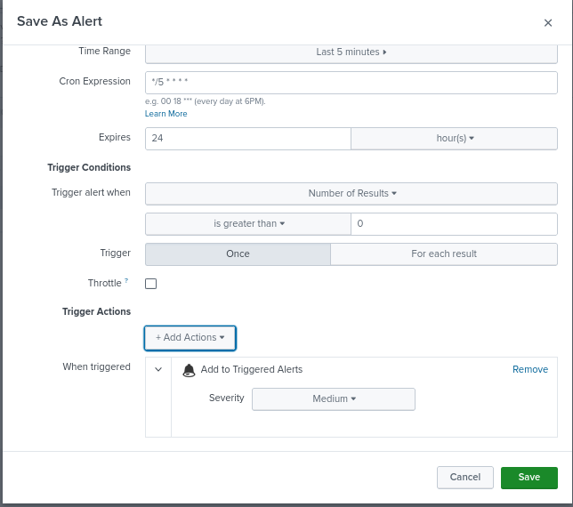

*La captura muestra Once seleccionado, Throttle deshabilitado y la acción de registro de la alerta. La activación se comprueba posteriormente.*

### 4.9. Validación de la alerta

Una vez guardada la alerta, se preparó una segunda ejecución controlada en WS01 para comprobar su funcionamiento.

**Comandos de validación**

```powershell
$Comando = 'Write-Output "SOC-LAB-ENCODED-ALERT-TEST04"'

$Codificado = [Convert]::ToBase64String(
    [System.Text.Encoding]::Unicode.GetBytes($Comando)
)

powershell.exe -NoProfile -EncodedCommand $Codificado
```

El comando utiliza un marcador diferente al de la simulación inicial, para distinguir ambas ejecuciones.

La captura de WS01 muestra los comandos de esta segunda ejecución y la salida `SOC-LAB-ENCODED-ALERT-TEST04`. Esto confirma la ejecución local con el nuevo marcador. La activación posterior y su resultado agregado se verificaron por separado en Splunk; la tabla no conserva el marcador.

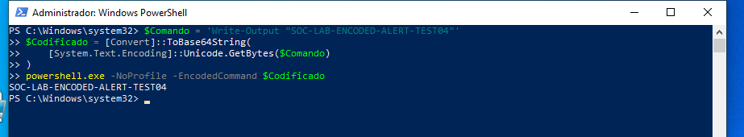

*Esta evidencia confirma el nuevo marcador en la consola, pero no lo identifica dentro de la tabla agregada de Splunk.*

#### 4.9.1. Verificación del historial

En Splunk se abrió:

SOC - PowerShell Encoded Command Execution → Trigger History

La captura mostró una activación registrada.

| Campo | Resultado |
| --- | --- |
| Alerta | SOC - PowerShell Encoded Command Execution |
| Estado | Enabled |
| Fecha de activación | 21/10/2026 |
| Hora | 20:50:00 (UTC-03) |
| Condición | Number of Results > 0 |
| Acción | Add to Triggered Alerts |

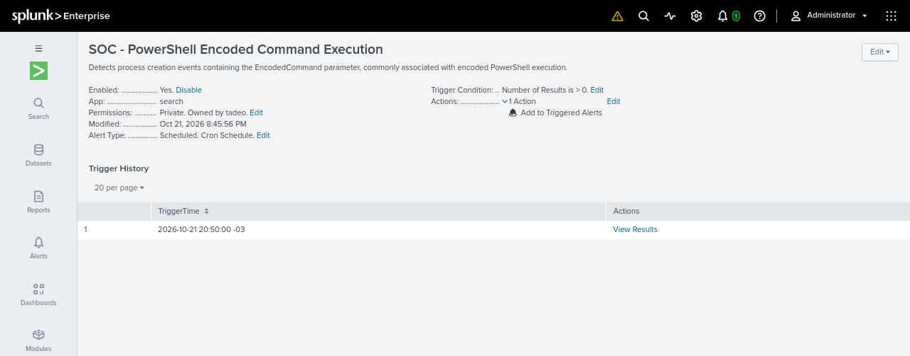

*La alerta figura habilitada y el historial registra una activación. View Results permite abrir su resultado.*

#### 4.9.2. Verificación de resultados

Se seleccionó View Results desde el historial.

La búsqueda programada analizó el intervalo:

20:45:00 a 20:50:00

El resultado fue:

| host | Eventos | `ID_Evento` |
| --- | --- | --- |
| WS01 | 1 | 1 |

Conclusión: Splunk encontró un evento Sysmon ID 1 coincidente con la regla y registró correctamente la activación automática de la alerta.

La captura de resultados confirma la coincidencia con la condición configurada. La búsqueda agregada no conserva el marcador de la segunda ejecución, por lo que no permite identificarlo directamente desde esa tabla.

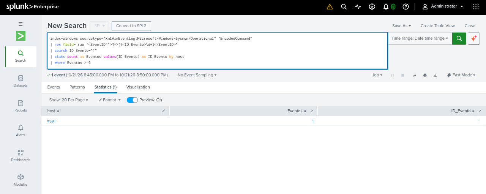

*El resultado acredita una coincidencia con la regla durante la ventana programada; no muestra la línea de comandos ni el marcador de validación.*

### 4.10. Evidencias recopiladas

Se obtuvieron las siguientes evidencias durante la prueba:

| Evidencia | Descripción |
| --- | --- |
| E01 — Ejecución codificada | Resultado de `SOC-LAB-ENCODED-TEST04` en WS01 |
| E02 — Sysmon ID 1 | Evento de creación de proceso con `-EncodedCommand` |
| E03 — PowerShell 4104 | Dos eventos que muestran la preparación y el contenido ejecutado |
| E04 — Consulta corregida | Detección de un evento Sysmon ID 1 en WS01 |
| E05 — Configuración de alerta | Parámetros generales, programación y condición de activación |
| E06 — Acción de alerta | Configuración de Add to Triggered Alerts, severidad Medium |
| E07 — Trigger History | Activación automática a las 20:50 |
| E08 — View Results | Resultado de un evento coincidente en la ventana programada |
| E09 — Ejecución de validación | Salida `SOC-LAB-ENCODED-ALERT-TEST04` en la consola de WS01 |

Las capturas seleccionadas se conservan con sus nombres originales en `Image/Fase2/` y se presentan junto a cada comprobación. La evidencia adicional de consola permite distinguir la validación posterior de la ejecución inicial.

### 4.11. Análisis técnico

La prueba permitió observar cómo una técnica de ejecución codificada puede detectarse mediante diferentes fuentes de telemetría.

**Sysmon**

El Event ID 1 registró la creación del proceso PowerShell y permitió identificar el parámetro `-EncodedCommand` dentro de su línea de comandos.

Esto proporciona visibilidad sobre el método utilizado para ejecutar el comando.

**PowerShell Script Block Logging**

El Event ID 4104 registró las instrucciones ejecutadas, incluyendo el comando original:

```powershell
Write-Output "SOC-LAB-ENCODED-TEST04"
```

Esto demuestra que, en esta simulación, la codificación Base64 no impidió observar el contenido ejecutado.

**Splunk Enterprise**

Splunk permitió centralizar los eventos, consultarlos mediante SPL y configurar una alerta programada que se activó cuando encontró una coincidencia.

**Limitaciones**

- La regla detecta el texto `EncodedCommand`, pero no todas las abreviaturas posibles del parámetro.
- La búsqueda no comprueba que la coincidencia se encuentre específicamente en el campo `CommandLine`.
- La consulta no valida que el ejecutable sea PowerShell.
- El uso de Base64 no demuestra por sí solo una actividad maliciosa.
- La alerta se basa en Sysmon ID 1; los eventos PowerShell 4104 se verificaron como fuente complementaria, pero no forman parte de la condición de activación.
- La detección puede generar falsos positivos ante herramientas legítimas que utilicen comandos codificados.

En un entorno de producción, sería recomendable mejorar la extracción de campos y enriquecer la detección con información del proceso, usuario y contexto de ejecución.

### 4.12. Resultado final

Estado: COMPLETADA Y VALIDADA.

Se cumplieron los objetivos principales:

- Se ejecutó correctamente un comando PowerShell codificado en Base64.
- Se identificó la creación del proceso mediante Sysmon ID 1.
- Se verificó el contenido del comando mediante PowerShell ID 4104.
- Se confirmó la recepción de ambos tipos de eventos en Splunk.
- Se desarrolló y validó una búsqueda SPL para detectar `EncodedCommand`.
- Se creó una alerta programada con severidad Medium.
- Se confirmó una activación automática en Trigger History.
- Se verificó el resultado correspondiente desde View Results.

El laboratorio permitió observar la ejecución controlada de PowerShell codificado, consultar su contenido mediante eventos 4104 y validar una alerta automática basada en Sysmon ID 1. La regla definitiva es una detección inicial por coincidencia de `EncodedCommand` en `_raw`: no verifica exclusivamente `CommandLine`, no exige un ejecutable PowerShell y no cubre todas las variantes o abreviaturas. Los resultados no demuestran actividad maliciosa ni una detección exhaustiva de ejecución codificada.

La prueba complementa la Prueba 3 al incorporar la detección de una técnica de ejecución, además del reconocimiento local previamente analizado.

## 5. Detección de persistencia mediante tareas programadas

### 5.1. Objetivo

Simular la creación de una tarea programada en un endpoint Windows unido a un dominio Active Directory y detectar esta actividad mediante los registros de seguridad de Windows y Splunk Enterprise.

La prueba tiene como objetivos:

- Crear una tarea programada de forma controlada en WS01.
- Verificar la generación del evento de seguridad 4698.
- Habilitar la auditoría necesaria para registrar la creación de tareas.
- Comprobar la recepción de los eventos en Splunk.
- Desarrollar una consulta SPL para detectar la creación de tareas programadas.
- Configurar una alerta automática.
- Validar su activación mediante una nueva simulación.
- Eliminar la tarea utilizada para evitar que permanezca en el sistema.

Resultado: se confirmó la creación de la tarea, el registro del evento 4698, su recepción en Splunk y la activación automática de la alerta. La limpieza se verificó posteriormente durante la preparación de la Prueba 6: dos consultas no devolvieron la tarea. No se estableció el momento exacto de su eliminación.

### 5.2. Entorno utilizado

| Componente | Función |
| --- | --- |
| WS01 — Windows 10 | Endpoint donde se ejecutó la simulación |
| Dominio corp.local | Entorno Active Directory |
| Usuario CORP\Empleado1 | Cuenta que registró la tarea |
| Windows Task Scheduler | Servicio responsable de las tareas programadas |
| Windows Security Event Log | Registro de eventos de auditoría |
| Splunk Universal Forwarder | Recolección y envío de eventos |
| Kali Purple — Splunk Enterprise 10.6.1.1 | Centralización, análisis y alertamiento |
| Índice windows | Almacenamiento de registros Windows |

El evento utilizado para la detección fue:

Event ID 4698 — Se creó una tarea programada.

En Splunk se identificó el siguiente sourcetype:

`WinEventLog:Security`

### 5.3. Técnica simulada

**MITRE ATT&CK**

[T1053.005 — Scheduled Task/Job: Scheduled Task](https://attack.mitre.org/techniques/T1053/005/)

Las tareas programadas permiten ejecutar procesos automáticamente cuando se cumple una condición, como una hora determinada, un evento del sistema o el inicio de sesión de un usuario.

Un atacante que haya obtenido acceso a un equipo puede utilizar esta funcionalidad para mantener un mecanismo de ejecución recurrente.

Sin embargo, las tareas programadas también son utilizadas legítimamente por Windows, administradores y aplicaciones.

Por lo tanto, la creación de una tarea no constituye por sí sola evidencia de actividad maliciosa.

**Alcance de la simulación**

Se creó una tarea configurada para ejecutar un comando inofensivo:

```text
cmd.exe /c echo SOC-LAB-PERSISTENCE-TEST05
```

La acción configurada únicamente imprimiría un marcador. La prueba confirmó la creación de la tarea con programación diaria; no se verificó su ejecución efectiva a las 23:00.

No se ejecutaron cargas maliciosas, no se descargaron archivos ni se establecieron conexiones externas.

### 5.4. Creación inicial de la tarea programada

Equipo: WS01

Herramienta: PowerShell ejecutado como administrador.

Se utilizó:

```powershell
$TaskName = "SOC-LAB-PERSISTENCE-TEST05"

$Action = New-ScheduledTaskAction `
    -Execute "cmd.exe" `
    -Argument '/c echo SOC-LAB-PERSISTENCE-TEST05'

$Trigger = New-ScheduledTaskTrigger -Daily -At "23:00"

Register-ScheduledTask `
    -TaskName $TaskName `
    -Action $Action `
    -Trigger $Trigger `
    -Description "Prueba controlada de deteccion SOC - Fase 2" `
    -Force
```

**Explicación**

| Comando | Función |
| --- | --- |
| New-ScheduledTaskAction | Define el programa y sus argumentos |
| New-ScheduledTaskTrigger | Establece cuándo se ejecutará la tarea |
| Register-ScheduledTask | Registra la tarea en Windows |
| -Daily -At "23:00" | Programa una ejecución diaria a las 23:00 |
| -Force | Permite reemplazar una tarea existente con el mismo nombre |

**Resultado observado**

```text
TaskPath   TaskName                    State
--------   --------                    -----
\          SOC-LAB-PERSISTENCE-TEST05  Ready
```

Conclusión: la tarea se creó correctamente y quedó registrada en Windows.

El estado `Ready` indica que la tarea estaba disponible para ejecutarse según su programación; no demuestra que su acción se haya ejecutado.

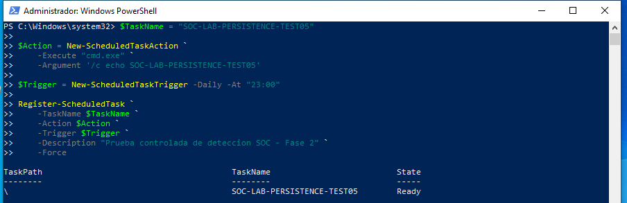

*La consola muestra la acción, el disparador diario de las 23:00 y el resultado de Register-ScheduledTask. No acredita una ejecución de la acción.*

### 5.5. Primera verificación del evento 4698

Después de crear la tarea, se intentó localizar su evento de auditoría.

**Comando**

```powershell
Get-WinEvent -FilterHashtable @{
    LogName = 'Security'
    Id = 4698
    StartTime = (Get-Date).AddMinutes(-15)
} -ErrorAction SilentlyContinue |
Where-Object {
    $_.Message -like '*SOC-LAB-PERSISTENCE-TEST05*'
} |
Select-Object TimeCreated, Id, ProviderName, Message |
Format-List
```

**Resultado**

La consulta no devolvió eventos.

Como la tarea se había registrado correctamente, se procedió a revisar la configuración de auditoría de Windows.

### 5.6. Verificación de la política de auditoría

Inicialmente se intentó consultar la subcategoría mediante su nombre en inglés:

```powershell
auditpol /get /subcategory:"Other Object Access Events"
```

Windows devolvió:

```text
Se produjo un error de tipo 0x00000057:
El parámetro no es correcto.
```

Esto ocurrió porque la instalación de Windows utiliza nombres de subcategorías localizados en español.

Para identificar el nombre correcto y su configuración se ejecutó:

```powershell
auditpol /get /category:*
```

**Resultado relevante**

Dentro de la categoría Acceso de objetos se encontró:

```text
Otros eventos de acceso a objetos       Sin auditoría
```

Conclusión: la subcategoría responsable de registrar, entre otras operaciones, la creación de tareas programadas no tenía habilitada la auditoría.

### 5.7. Habilitación de la auditoría

En WS01 se ejecutó:

```powershell
auditpol /set /subcategory:"Otros eventos de acceso a objetos" /success:enable
```

**Resultado**

El comando se ejecutó correctamente.

Posteriormente se verificó:

```powershell
auditpol /get /subcategory:"Otros eventos de acceso a objetos"
```

**Resultado**

```text
Acceso de objetos
  Otros eventos de acceso a objetos       Aciertos
```

La modificación habilitó el registro de eventos de auditoría exitosos para esa subcategoría.

El cambio se aplicó localmente en WS01 mediante `auditpol`. No constituye una modificación de una GPO del dominio ni habilita automáticamente la auditoría en otros endpoints. No se modificaron las demás categorías de auditoría ni la configuración del controlador de dominio DC01. La salida de Aciertos está documentada en el registro de implementación; no hay una captura específica entre las nueve evidencias de esta prueba.

### 5.8. Generación de un nuevo evento 4698

Como la tarea original había sido creada antes de habilitar la auditoría, fue necesario volver a registrarla.

**Comandos ejecutados**

```powershell
$TaskName = "SOC-LAB-PERSISTENCE-TEST05"

Unregister-ScheduledTask -TaskName $TaskName -Confirm:$false

$Action = New-ScheduledTaskAction `
    -Execute "cmd.exe" `
    -Argument '/c echo SOC-LAB-PERSISTENCE-TEST05'

$Trigger = New-ScheduledTaskTrigger -Daily -At "23:00"

Register-ScheduledTask `
    -TaskName $TaskName `
    -Action $Action `
    -Trigger $Trigger `
    -Description "Prueba controlada de deteccion SOC - Fase 2" `
    -Force
```

**Resultado**

Windows confirmó nuevamente:

```text
TaskPath   TaskName                    State
--------   --------                    -----
\          SOC-LAB-PERSISTENCE-TEST05  Ready
```

**Verificación del evento**

Se ejecutó:

```powershell
Get-WinEvent -FilterHashtable @{
    LogName = 'Security'
    Id = 4698
    StartTime = (Get-Date).AddMinutes(-5)
} |
Where-Object {
    $_.Message -like '*SOC-LAB-PERSISTENCE-TEST05*'
} |
Select-Object TimeCreated, Id, ProviderName, Message |
Format-List
```

**Resultado observado**

Esta vez Windows devolvió un evento:

| Campo | Valor |
| --- | --- |
| Fecha | 21/10/2026 |
| Hora | 20:59:56 |
| Event ID | 4698 |
| Provider | Microsoft-Windows-Security-Auditing |
| Mensaje | Se creó una tarea programada |
| Cuenta | CORP\Empleado1 |
| Tarea | \SOC-LAB-PERSISTENCE-TEST05 |

El registro de implementación documenta estos resultados y los siguientes fragmentos XML del evento local. No hay una captura específica de la salida completa de esta consulta local entre las evidencias de la prueba.

**Información relevante del XML**

Identificación de la tarea:

```xml
<URI>\SOC-LAB-PERSISTENCE-TEST05</URI>
```

Acción configurada:

```xml
<Actions Context="Author">
  <Exec>
    <Command>cmd.exe</Command>
    <Arguments>/c echo SOC-LAB-PERSISTENCE-TEST05</Arguments>
  </Exec>
</Actions>
```

Usuario asociado:

```xml
<Principals>
  <Principal id="Author">
    <UserId>CORP\Empleado1</UserId>
    <LogonType>InteractiveToken</LogonType>
    <RunLevel>LeastPrivilege</RunLevel>
  </Principal>
</Principals>
```

Frecuencia de ejecución:

```xml
<ScheduleByDay>
  <DaysInterval>1</DaysInterval>
</ScheduleByDay>
```

**Análisis**

El evento 4698 proporcionó visibilidad sobre:

- La identidad de la cuenta que creó la tarea.
- El nombre y la ubicación de la tarea.
- El ejecutable configurado.
- Los argumentos que recibirá el ejecutable.
- La frecuencia programada.
- El contexto de seguridad utilizado.

Conclusión: quedó confirmada la generación del evento 4698 después de habilitar la auditoría correspondiente.

### 5.9. Primera búsqueda del evento en Splunk

En Splunk Enterprise se intentó buscar el evento suponiendo que el registro Security se recibía en formato XML.

**Consulta inicial**

```spl
index=windows sourcetype="XmlWinEventLog:Security" host="WS01"
| rex field=_raw "<EventID[^>]*>(?<ID_Evento>\d+)</EventID>"
| search ID_Evento="4698"
| table _time host ID_Evento _raw
| sort - _time
```

**Resultado**

La consulta no devolvió resultados.

Dado que Windows ya había generado el evento, se realizó una búsqueda más amplia para identificar cómo se estaba almacenando en Splunk.

### 5.10. Identificación del sourcetype correcto

Se ejecutó una búsqueda por el marcador de la tarea, sin restringir el sourcetype.

**Consulta SPL**

```spl
index=windows "SOC-LAB-PERSISTENCE-TEST05"
| table _time host sourcetype source _raw
| sort - _time
```

**Resultado**

Splunk devolvió 10 eventos relacionados con el marcador utilizado, en **Last 15 minutes**, según la captura. Este total incluye distintas fuentes y no representa diez creaciones de tareas.

Entre los resultados se observaron registros de PowerShell y Windows Security.

Se identificó un evento de Windows Security con:

| Campo | Valor |
| --- | --- |
| Host | WS01 |
| Sourcetype | `WinEventLog:Security` |
| Source | `WinEventLog:Security` |
| `EventCode` | 4698 |
| Hora | 20:59:56 |

**Hallazgo**

Los eventos de Windows Security se estaban almacenando bajo:

`WinEventLog:Security`

No bajo:

`XmlWinEventLog:Security`

A diferencia de los eventos Sysmon y PowerShell analizados en pruebas anteriores, estos registros disponían del campo `EventCode`, que podía utilizarse directamente para filtrar el identificador del evento.

Conclusión: la falta de resultados de la primera consulta se debía al sourcetype incorrecto, no a un fallo de recolección.

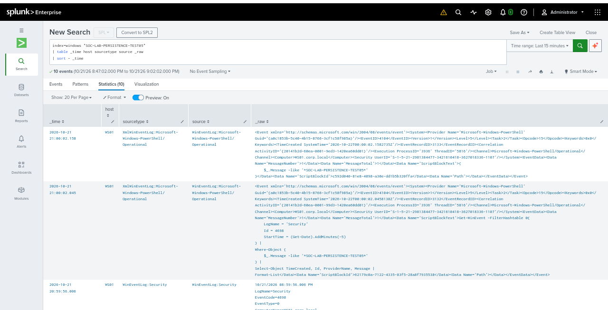

*La captura muestra registros PowerShell y Security, con source y sourcetype visibles. El recuento corresponde a coincidencias con el marcador, no exclusivamente a eventos 4698.*

### 5.11. Consulta SPL definitiva de detección

Se desarrolló la siguiente consulta:

```spl
index=windows sourcetype="WinEventLog:Security" EventCode=4698
| stats count as Eventos values(EventCode) as ID_Evento by host
| where Eventos > 0
```

**Funcionamiento**

- `index=windows`: limita la búsqueda al índice de eventos Windows.
- sourcetype="`WinEventLog:Security`": selecciona los registros Security.
- `EventCode`=4698: identifica eventos de creación de tareas programadas.
- stats count as Eventos: contabiliza las coincidencias.
- values(`EventCode`) as `ID_Evento`: conserva el identificador del evento.
- by host: agrupa los resultados por equipo.
- where Eventos > 0: conserva los equipos con al menos una coincidencia.

**Resultado observado**

| host | Eventos | `ID_Evento` |
| --- | --- | --- |
| WS01 | 1 | 4698 |

Resultado: detección confirmada en **Last 15 minutes**, según la captura. La fila de WS01 resume un evento 4698; no conserva los detalles de la tarea.

La consulta detecta eventos de creación de tareas programadas, sin depender del nombre específico utilizado durante la simulación.

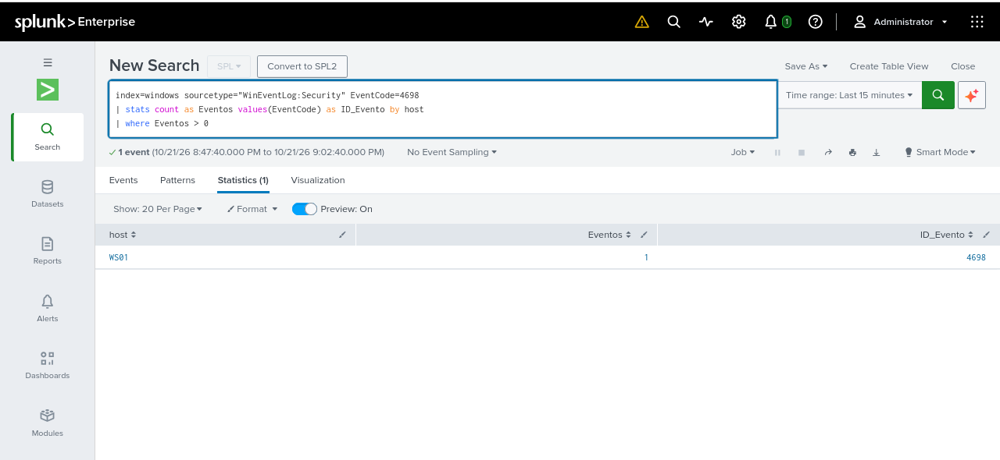

*El resultado agrupado en Last 15 minutes confirma la recepción de un evento de creación, sin mostrar el nombre ni los argumentos de la tarea.*

### 5.12. Creación de la alerta automática

Desde Splunk Enterprise se seleccionó:

Search & Reporting → Save As → Alert

**Nombre**

SOC - Scheduled Task Creation

**Descripción**

Detects scheduled task creation through Windows Security Event ID 4698.

**Consulta utilizada**

```spl
index=windows sourcetype="WinEventLog:Security" EventCode=4698
| stats count as Eventos values(EventCode) as ID_Evento by host
| where Eventos > 0
```

**Configuración**

| Parámetro | Valor |
| --- | --- |
| Permissions | Private |
| Alert Type | Scheduled |
| Schedule | Run on Cron Schedule |
| Cron Expression | `*/5 * * * *` |
| Time Range | Last 5 minutes |
| Earliest | -5m |
| Latest | now |
| Trigger alert when | Number of Results |
| Condition | Is greater than 0 |
| Trigger | Once |
| Throttle | Disabled |
| Trigger Action | Add to Triggered Alerts |
| Severity | Medium |
| Expiration | 24 hours |

Las capturas confirman la configuración general, las condiciones de activación y la acción seleccionada. La alerta ejecuta la búsqueda cada cinco minutos sobre los últimos cinco minutos. Number of Results > 0 evalúa las filas agrupadas por host, mientras que Eventos cuenta los registros coincidentes. Once configura una activación por ejecución con resultados; Throttle quedó deshabilitado.

**Justificación de severidad**

Se utilizó severidad Medium porque la creación de una tarea programada puede estar relacionada con persistencia, pero también forma parte de operaciones administrativas legítimas.

La alerta está diseñada para proporcionar visibilidad sobre la actividad, no para clasificar automáticamente toda creación de tareas como un ataque.

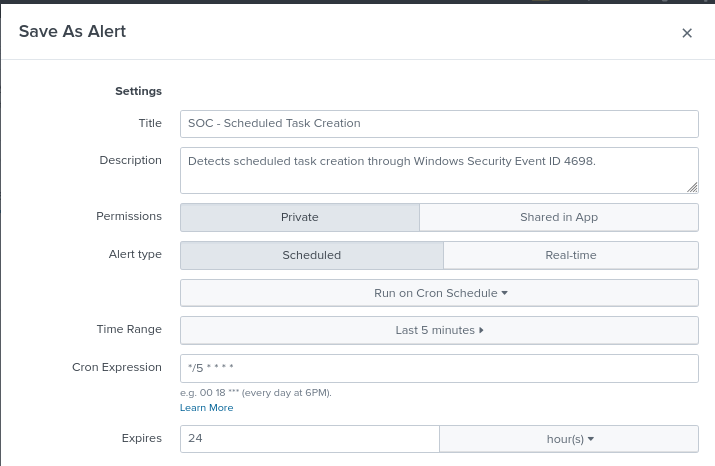

*El formulario muestra permisos Private, ejecución Scheduled cada cinco minutos, Last 5 minutes y expiración de 24 horas.*

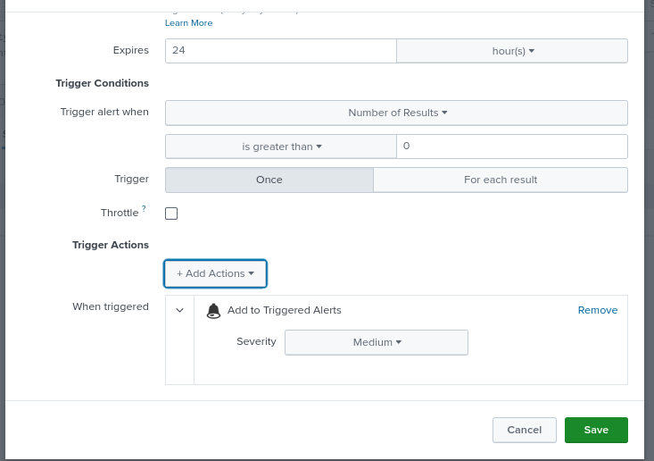

*La configuración muestra resultados mayores que cero, Once seleccionado y Throttle deshabilitado.*

### 5.13. Validación de la alerta

Después de configurar la alerta, se realizó un nuevo registro de la tarea para generar otro evento 4698.

**Comandos de validación**

```powershell
$TaskName = "SOC-LAB-PERSISTENCE-TEST05"

Unregister-ScheduledTask -TaskName $TaskName -Confirm:$false

$Action = New-ScheduledTaskAction `
    -Execute "cmd.exe" `
    -Argument '/c echo SOC-LAB-PERSISTENCE-ALERT-TEST05'

$Trigger = New-ScheduledTaskTrigger -Daily -At "23:00"

Register-ScheduledTask `
    -TaskName $TaskName `
    -Action $Action `
    -Trigger $Trigger `
    -Description "Validacion de alerta SOC - Prueba 5"
```

Se utilizó el marcador `SOC-LAB-PERSISTENCE-ALERT-TEST05` para diferenciar esta validación de la simulación inicial.

La captura de WS01 muestra los comandos de validación, el nuevo marcador en los argumentos de la acción y la tarea registrada con estado `Ready`. Esto confirma el nuevo registro, no la ejecución de la acción. Posteriormente se verificó la activación de la alerta y un evento 4698 en la ventana programada; la tabla agregada no identifica el marcador.

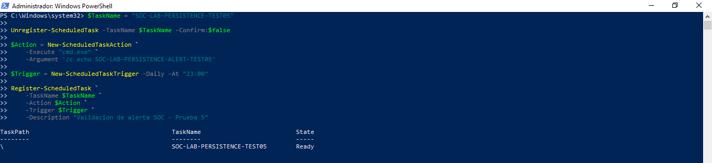

*La consola muestra la eliminación del registro anterior, los nuevos argumentos y el estado `Ready`. El marcador forma parte de la acción configurada; no es una salida de su ejecución.*

#### 5.13.1. Trigger History

Se accedió a la alerta:

SOC - Scheduled Task Creation → Trigger History

La captura mostró:

| Campo | Resultado |
| --- | --- |
| Estado | Enabled |
| Fecha | 21/10/2026 |
| Hora de activación | 21:10:00 (UTC-03) |
| Condición | Number of Results > 0 |
| Acción | Add to Triggered Alerts |

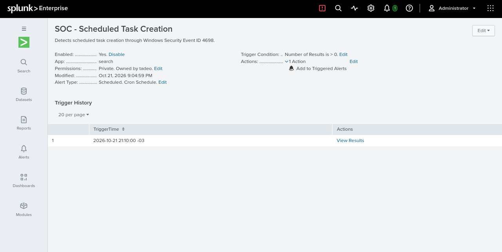

*Trigger History registra una activación de la alerta habilitada y permite abrir View Results.*

#### 5.13.2. View Results

Se seleccionó View Results para consultar los resultados de la búsqueda programada.

El intervalo analizado fue:

21:05:00 a 21:10:00 (UTC-03)

El resultado fue:

| host | Eventos | `ID_Evento` |
| --- | --- | --- |
| WS01 | 1 | 4698 |

**Interpretación**

La alerta programada encontró un evento 4698 correspondiente a WS01 y registró una activación automática.

La consulta agregada confirma la creación de una tarea programada, pero no conserva el nombre de la tarea ni sus argumentos. Por lo tanto, la tabla de resultados no permite atribuir directamente esa activación al marcador de validación sin inspeccionar el evento original.

Conclusión: la alerta quedó validada mediante una activación automática y un evento coincidente.

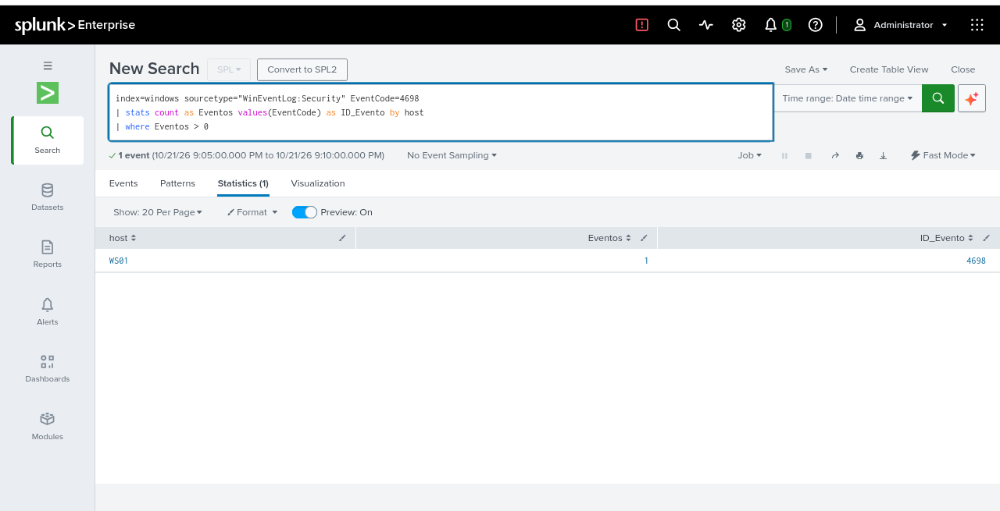

*La consulta programada devuelve host WS01, Eventos 1 e `ID_Evento` 4698. No conserva la identidad ni los argumentos de la tarea.*

### 5.14. Limpieza del laboratorio

Para evitar que la tarea permanezca configurada en WS01, se indicó su eliminación.

**Comandos**

```powershell
Unregister-ScheduledTask `
    -TaskName "SOC-LAB-PERSISTENCE-TEST05" `
    -Confirm:$false

Get-ScheduledTask -TaskName "SOC-LAB-PERSISTENCE-TEST05" `
    -ErrorAction SilentlyContinue
```

**Resultado esperado**

El segundo comando no debe devolver resultados.

La ausencia de resultados es el comportamiento esperado al consultar una tarea que ya no está registrada.

**Limpieza verificada posteriormente, durante la preparación de la Prueba 6.** Según el registro de implementación posterior, se ejecutó dos veces en WS01 el siguiente comando:

```powershell
Get-ScheduledTask -TaskName "SOC-LAB-PERSISTENCE-TEST05" -ErrorAction SilentlyContinue
```

Ambas ejecuciones finalizaron sin devolver resultados. Estas comprobaciones respaldan que la tarea ya no estaba registrada en esos momentos. No se dispone de una captura de la ejecución del comando de eliminación ni se establece la hora exacta en que se eliminó.

La eliminación de la tarea no borra automáticamente los eventos históricos almacenados en Windows o Splunk.

### 5.15. Evidencias recopiladas

| Evidencia | Descripción | Estado | Respaldo |
| --- | --- | --- | --- |
| E01 | Creación inicial de `SOC-LAB-PERSISTENCE-TEST05` | Confirmada | Evidencia visual mediante captura |
| E02 | Auditoría de acceso a objetos inicialmente deshabilitada | Confirmada | Registro del procedimiento de implementación; sin captura específica |
| E03 | Auditoría habilitada en modo Aciertos | Confirmada | Registro del procedimiento de implementación; sin captura específica |
| E04 | Evento Windows Security 4698 con definición XML | Confirmada | Registro del procedimiento de implementación; sin captura específica |
| E05 | Identificación del sourcetype `WinEventLog:Security` | Confirmada | Evidencia visual mediante captura |
| E06 | Consulta SPL con un evento 4698 en WS01 | Confirmada | Evidencia visual mediante captura |
| E07 | Configuración de alerta y condiciones de activación | Confirmada | Evidencia visual mediante captura |
| E08 | Trigger History con activación a las 21:10 | Confirmada | Evidencia visual mediante captura |
| E09 | View Results con un evento 4698 | Confirmada | Evidencia visual mediante captura |
| E10 | Ausencia de la tarea en dos consultas posteriores | Limpieza verificada posteriormente, durante la preparación de la Prueba 6 | Comprobación posterior documentada durante la preparación de la Prueba 6; sin captura específica |

Las capturas seleccionadas se conservan con sus nombres originales en `Image/Fase2/`. Las comprobaciones locales sin captura específica se documentan a partir del registro de implementación, sin presentarlas como verificaciones visuales.

### 5.16. Análisis técnico

**Visibilidad de la creación de tareas**

El evento 4698 permite detectar el registro de una tarea programada y examinar su configuración.

En esta prueba se confirmó que el evento puede incluir información sobre la cuenta responsable, el ejecutable, sus argumentos y la programación.

**Importancia de la auditoría**

La primera creación no generó un evento 4698 visible porque la subcategoría correspondiente estaba configurada como Sin auditoría.

Después de habilitar la auditoría de éxitos, la creación de la tarea quedó registrada correctamente.

Esto demuestra que la capacidad de detección depende tanto de la herramienta SIEM como de la configuración de las fuentes de telemetría.

**Centralización en Splunk**

El Universal Forwarder envió los eventos de Windows Security al índice windows.

La búsqueda inicial falló por utilizar un sourcetype incorrecto.

Una búsqueda más amplia permitió identificar el formato real de los registros y construir una consulta funcional.

**Alertamiento**

La alerta programada permitió detectar automáticamente la aparición de un evento 4698 durante una ventana de cinco minutos.

Se verificó su activación en el historial de Splunk.

**Limitaciones**

- La regla detecta creaciones de tareas programadas, no exclusivamente actividades maliciosas.
- No distingue entre tareas administrativas legítimas y posibles mecanismos de persistencia.
- No filtra por nombre de tarea, usuario, ejecutable ni argumentos.
- No comprueba que la tarea llegue a ejecutarse.
- No utiliza una correlación entre el evento 4698 y un evento Sysmon ID 1.
- La consulta agrupa resultados por host y no conserva los detalles de cada tarea.
- Su cobertura depende de que los endpoints tengan habilitada la auditoría y envíen sus registros a Splunk.

**Posibles mejoras**

Para una implementación más avanzada sería recomendable enriquecer la detección con:

- Identidad de la cuenta que creó la tarea.
- Nombre y ubicación de la tarea.
- Ejecutable y argumentos configurados.
- Rutas sospechosas o poco habituales.
- Contexto de ejecución y privilegios.
- Correlación con creación de procesos mediante Sysmon.
- Listas de exclusión para tareas administrativas conocidas.

Estas mejoras no fueron implementadas durante esta prueba y se consideran oportunidades de evolución de la detección.

### 5.17. Resultado final

Estado de la detección y el alertamiento: COMPLETADOS Y VALIDADOS.

Se confirmaron los siguientes objetivos:

- Creación controlada de una tarea programada en WS01.
- Identificación de la política de auditoría necesaria.
- Habilitación de eventos de auditoría exitosos.
- Registro del evento Windows Security 4698.
- Recepción del evento en Splunk Enterprise.
- Identificación del sourcetype correcto.
- Desarrollo de una consulta SPL funcional.
- Creación de una alerta programada.
- Activación automática confirmada mediante Trigger History.
- Validación de un evento 4698 desde View Results.

Limpieza verificada posteriormente, durante la preparación de la Prueba 6: la tarea no apareció en dos consultas. La hora exacta de eliminación no quedó establecida.

**Conclusión general**

La Prueba 5 demostró la capacidad del laboratorio para detectar la creación de tareas programadas en un endpoint Windows mediante el evento Security 4698 y generar alertas automáticas en Splunk Enterprise.

La actividad simulada representa un posible mecanismo de persistencia, aunque no demuestra una intrusión real ni persistencia maliciosa activa. Se comprobó la creación y el registro de la tarea con ejecución diaria configurada, no su ejecución efectiva a las 23:00.

La combinación de auditoría Windows, Universal Forwarder, consultas SPL y alertas programadas permitió completar satisfactoriamente el objetivo principal de detección.

## 6. Correlación de un escenario de múltiples etapas

### 6.1. Objetivo

Simular una secuencia controlada de actividades potencialmente sospechosas en un endpoint Windows unido a Active Directory y desarrollar una regla de correlación en Splunk Enterprise capaz de identificar diferentes comportamientos dentro de una misma ventana temporal.

A diferencia de las pruebas anteriores, donde se detectaban actividades individuales, esta prueba busca demostrar la capacidad de un SIEM para relacionar eventos procedentes de distintas fuentes de telemetría.

Los objetivos específicos fueron:

- Ejecutar una secuencia de reconocimiento local mediante PowerShell.
- Simular la ejecución de un comando codificado en Base64.
- Crear una tarea programada como representación de un posible mecanismo de persistencia.
- Confirmar la recepción de los eventos en Splunk.
- Identificar las tres actividades mediante consultas SPL.
- Correlacionar los eventos en un mismo equipo y dentro de una ventana temporal.
- Configurar una alerta automática de correlación.
- Verificar su activación mediante Trigger History y View Results.
- Eliminar los elementos creados durante la simulación.

Resultado final: COMPLETADO.

Se detectaron las tres actividades en WS01, se confirmó una correlación con una duración de 2,29 minutos y se verificó la activación automática de una alerta en Splunk.

### 6.2. Entorno utilizado

| Componente | Función |
| --- | --- |
| DC01 — Windows Server 2022 | Controlador de dominio Active Directory |
| Dominio corp.local | Infraestructura de autenticación y administración |
| WS01 — Windows 10 | Endpoint donde se realizó la simulación |
| Usuario CORP\empleado1 | Cuenta utilizada durante el escenario |
| Windows PowerShell | Ejecución de comandos de reconocimiento y codificados |
| Sysmon | Registro de creación de procesos |
| Windows Security Event Log | Auditoría de creación de tareas programadas |
| Splunk Universal Forwarder | Recolección y envío de registros |
| Kali Purple — Splunk Enterprise 10.6.1.1 | Análisis, correlación y alertamiento |
| Índice windows | Almacenamiento de los eventos |

**Fuentes de telemetría**

Se utilizaron tres fuentes de eventos:

| Fuente | Sourcetype | Event ID |
| --- | --- | --- |
| PowerShell Operational | XmlWinEventLog:Microsoft-Windows-PowerShell/Operational | 4104 |
| Sysmon Operational | XmlWinEventLog:Microsoft-Windows-Sysmon/Operational | 1 |
| Windows Security | WinEventLog:Security | 4698 |

Los registros de PowerShell y Sysmon se recibieron en formato XML, mientras que Windows Security utilizó un formato que permitía consultar directamente el campo `EventCode`.

### 6.3. Escenario simulado

Se diseñó una secuencia compuesta por tres actividades.

**Etapa 1 — Reconocimiento local**

Enumeración de información del endpoint, incluyendo:

- Identidad del usuario.
- Cuentas locales.
- Grupos locales.
- Configuración de red.

**Etapa 2 — Ejecución codificada**

Ejecución de un comando PowerShell mediante el argumento -EncodedCommand, utilizando una cadena Base64.

**Etapa 3 — Persistencia simulada**

Creación de una tarea programada que ejecutaría un comando inofensivo diariamente.

**Etapa 4 — Correlación SOC**

Análisis de los eventos generados para identificar la presencia de las tres actividades en el mismo equipo dentro de una ventana temporal de 15 minutos.

**Secuencia**

```text
WS01 — CORP\empleado1
        |
        v
[1] Reconocimiento local
    PowerShell — Event ID 4104
        |
        v
[2] Ejecución codificada
    Sysmon — Event ID 1
        |
        v
[3] Creación de tarea programada
    Windows Security — Event ID 4698
        |
        v
Splunk Universal Forwarder
        |
        v
Splunk Enterprise
        |
        v
Consulta SPL de correlación
        |
        v
SOC - Multi-Stage Attack Correlation
        |
        v
Alerta automática — High
```

La secuencia representa un escenario de laboratorio. No se realizó una intrusión real ni se ejecutaron cargas maliciosas. El diagrama describe el orden de la simulación; la consulta no impone ese orden como condición de correlación.

### 6.4. Relación con MITRE ATT&CK

| Técnica | Identificador | Actividad |
| --- | --- | --- |
| Account Discovery: Local Account | [T1087.001](https://attack.mitre.org/techniques/T1087/001/) | Enumeración de usuarios locales |
| Permission Groups Discovery: Local Groups | [T1069.001](https://attack.mitre.org/techniques/T1069/001/) | Enumeración de grupos locales mediante Get-LocalGroup |
| System Owner/User Discovery | [T1033](https://attack.mitre.org/techniques/T1033/) | Identificación del usuario mediante whoami |
| System Network Configuration Discovery | [T1016](https://attack.mitre.org/techniques/T1016/) | Consulta de configuración de red |
| Command and Scripting Interpreter: PowerShell | [T1059.001](https://attack.mitre.org/techniques/T1059/001/) | Ejecución de comandos PowerShell |
| Obfuscated Files or Information | [T1027](https://attack.mitre.org/techniques/T1027/) | Contexto de uso de comandos codificados |
| Scheduled Task/Job: Scheduled Task | [T1053.005](https://attack.mitre.org/techniques/T1053/005/) | Creación de una tarea programada |

Estas referencias son contextuales. Base64 es codificación, no cifrado; su uso no demuestra intención de ocultamiento. Las tareas programadas y los comandos utilizados también tienen usos legítimos. La simulación no demuestra una intrusión real ni persistencia maliciosa activa.

### 6.5. Preparación del entorno

Antes de iniciar el escenario se comprobó que la tarea programada utilizada en la Prueba 5 ya no existiera.

**Comando ejecutado en WS01**

```powershell
Get-ScheduledTask -TaskName "SOC-LAB-PERSISTENCE-TEST05" -ErrorAction SilentlyContinue
```

**Resultado**

PowerShell no devolvió información.

Se ejecutó nuevamente la consulta y se obtuvo el mismo resultado.

Las dos consultas sin resultados respaldan que la tarea de la Prueba 5 ya no estaba registrada al realizar estas comprobaciones. No establecen la hora exacta de eliminación. Este resultado consta en el registro de implementación, sin una captura específica entre las evidencias de esta prueba.

Esto permitió comenzar el escenario final sin confundir los elementos de persistencia simulada de ambas pruebas.

### 6.6. Etapa 1 — Reconocimiento local mediante PowerShell

**Objetivo**

Simular actividades de descubrimiento del sistema realizadas desde una cuenta de dominio con sesión iniciada en WS01.

**Comandos ejecutados**

```powershell
$SOCMarker = "SOC-LAB-FINAL-TEST06"

Write-Output "Inicio de reconocimiento: $SOCMarker"

whoami

Get-LocalUser | Select-Object Name, Enabled

Get-LocalGroup | Select-Object Name

Get-NetIPConfiguration | Select-Object InterfaceAlias, IPv4Address

Write-Output "Fin de reconocimiento: $SOCMarker"
```

**Explicación**

| Comando | Función |
| --- | --- |
| $SOCMarker | Define un identificador único para el escenario |
| whoami | Identifica la cuenta utilizada |
| Get-LocalUser | Enumera cuentas locales |
| Get-LocalGroup | Enumera grupos locales |
| Get-NetIPConfiguration | Consulta información de red |
| Write-Output | Imprime marcadores de inicio y finalización |

**Resultado observado**

PowerShell devolvió:

```text
Inicio de reconocimiento: SOC-LAB-FINAL-TEST06
corp\empleado1
```

Se identificaron las siguientes cuentas locales:

| Cuenta | Habilitada |
| --- | --- |
| Administrador | No |
| DefaultAccount | No |
| Invitado | No |
| Usuario | Sí |
| WDAGUtilityAccount | No |

También se enumeraron grupos locales, incluyendo:

- Administradores.
- Administradores de Hyper-V.
- Usuarios.
- Usuarios avanzados.
- Usuarios de escritorio remoto.
- Usuarios de administración remota.
- Operadores de copia de seguridad.
- Lectores del registro de eventos.
- Usuarios del registro de rendimiento.

La consulta Get-NetIPConfiguration no mostró información de red en la salida proporcionada.

Finalmente apareció:

```text
Fin de reconocimiento: SOC-LAB-FINAL-TEST06
```

**Resultado**

La actividad de reconocimiento se ejecutó correctamente desde la cuenta CORP\empleado1.

Posteriormente, Splunk identificó un evento PowerShell 4104 relacionado con el marcador del escenario.

MITRE ATT&CK: T1087.001, T1069.001, T1033, T1016 y T1059.001.


*La consola muestra la identidad, cuentas y grupos locales y los marcadores. No muestra valores de red devueltos por Get-NetIPConfiguration.*

### 6.7. Etapa 2 — Ejecución de PowerShell codificado

**Objetivo**

Simular una ejecución de PowerShell utilizando el parámetro -EncodedCommand, una técnica que puede aparecer en actividades administrativas y en comportamientos sospechosos.

**Comandos ejecutados**

```powershell
$Comando = 'Write-Output "SOC-LAB-FINAL-ENCODED-TEST06"'

$Codificado = [Convert]::ToBase64String(
    [System.Text.Encoding]::Unicode.GetBytes($Comando)
)

powershell.exe -NoProfile -EncodedCommand $Codificado
```

**Funcionamiento**

- Se define un comando PowerShell inofensivo.
- Se convierte la cadena a bytes utilizando UTF-16LE mediante Encoding.Unicode.
- Los bytes se codifican en Base64.
- Se inicia una nueva instancia de PowerShell utilizando -EncodedCommand.
- PowerShell interpreta el contenido codificado y ejecuta el comando.

**Resultado observado**

```text
SOC-LAB-FINAL-ENCODED-TEST06
```

La salida confirmó que el comando codificado fue ejecutado correctamente.


*La captura muestra la preparación Base64 y la salida del comando. El marcador visible no forma parte del filtro de ejecución codificada de la correlación.*

**Telemetría esperada**

**Sysmon Event ID 1**

Registro de creación del proceso powershell.exe, incluyendo su línea de comandos con el parámetro -EncodedCommand.

**PowerShell Event ID 4104**

Registro del contenido de los bloques de script, según la configuración de Script Block Logging.

**Resultado**

En la posterior búsqueda de Splunk se identificó un evento Sysmon ID 1 con `EncodedCommand` dentro de la ventana correspondiente al escenario.

MITRE ATT&CK: T1059.001. El uso de codificación también se relaciona con el contexto de T1027, sin que ello demuestre intención de ocultamiento.

### 6.8. Etapa 3 — Creación de una tarea programada

**Objetivo**

Simular un mecanismo de ejecución recurrente mediante Windows Task Scheduler.

**Comandos ejecutados en WS01**

```powershell
$TaskName = "SOC-LAB-FINAL-PERSISTENCE-TEST06"

$Action = New-ScheduledTaskAction `
    -Execute "cmd.exe" `
    -Argument '/c echo SOC-LAB-FINAL-PERSISTENCE-TEST06'

$Trigger = New-ScheduledTaskTrigger -Daily -At "23:00"

Register-ScheduledTask `
    -TaskName $TaskName `
    -Action $Action `
    -Trigger $Trigger `
    -Description "Escenario final de correlacion SOC - Prueba 6"
```

**Configuración**

| Parámetro | Valor |
| --- | --- |
| Nombre | `SOC-LAB-FINAL-PERSISTENCE-TEST06` |
| Ejecutable | cmd.exe |
| Argumentos | /c echo `SOC-LAB-FINAL-PERSISTENCE-TEST06` |
| Frecuencia | Diaria |
| Hora programada | 23:00 |
| Descripción | Escenario final de correlacion SOC - Prueba 6 |

**Resultado observado**

```text
TaskPath   TaskName                          State
--------   --------                          -----
\          SOC-LAB-FINAL-PERSISTENCE-TEST06  Ready
```

Conclusión: Windows registró correctamente la tarea programada.

El estado `Ready` indica que la tarea quedó disponible para su ejecución programada, pero no demuestra que el comando configurado haya llegado a ejecutarse.

**Telemetría**

Gracias a la auditoría habilitada durante la Prueba 5, la creación de la tarea generó un evento Windows Security 4698 que posteriormente fue identificado en Splunk.

MITRE ATT&CK: T1053.005.


*Se observa la acción configurada y el disparador diario de las 23:00. El resultado acredita el registro de la tarea, no su ejecución.*

### 6.9. Verificación inicial de los eventos en Splunk

**Objetivo**

Confirmar que las tres actividades estuvieran disponibles en Splunk antes de construir la regla de correlación.

**Consulta SPL**

```spl
index=windows host="WS01"
(
    sourcetype="XmlWinEventLog:Microsoft-Windows-PowerShell/Operational"
    OR sourcetype="XmlWinEventLog:Microsoft-Windows-Sysmon/Operational"
    OR sourcetype="WinEventLog:Security"
)
| rex field=_raw "<EventID[^>]*>(?<ID_XML>\d+)</EventID>"
| eval ID_Evento=coalesce(EventCode,ID_XML)
| eval Actividad=case(
    ID_Evento="4104" AND like(_raw,"%SOC-LAB-FINAL-TEST06%"),"1 - Reconocimiento",
    ID_Evento="1" AND like(_raw,"%EncodedCommand%"),"2 - PowerShell codificado",
    ID_Evento="4698" AND like(_raw,"%SOC-LAB-FINAL-PERSISTENCE-TEST06%"),"3 - Tarea programada"
)
| where isnotnull(Actividad)
| stats count as Eventos earliest(_time) as Primera_Deteccion latest(_time) as Ultima_Deteccion by host Actividad
| eval Primera_Deteccion=strftime(Primera_Deteccion,"%Y-%m-%d %H:%M:%S")
| eval Ultima_Deteccion=strftime(Ultima_Deteccion,"%Y-%m-%d %H:%M:%S")
| sort Actividad
```

**Explicación**

La consulta combina los registros de PowerShell, Sysmon y Windows Security.

Se utiliza rex para extraer el identificador de los eventos XML y coalesce para unificarlo con el campo `EventCode`, cuando está disponible.

Posteriormente, case clasifica los eventos según su identificador y contenido.

Finalmente, stats agrupa los resultados por equipo y actividad, mostrando la cantidad de eventos y sus marcas temporales.

**Resultado observado**

En la búsqueda realizada sobre los últimos 60 minutos, Splunk devolvió:

| Actividad | Eventos | Primera detección | Última detección |
| --- | --- | --- | --- |
| 1 - Reconocimiento | 1 | 21:18:12 | 21:18:12 |
| 2 - PowerShell codificado | 3 | 20:40:44 | 21:19:59 |
| 3 - Tarea programada | 1 | 21:20:29 | 21:20:29 |

Total: 5 eventos clasificados en 3 actividades.


*La categoría de ejecución codificada contiene tres eventos y comienza a las 20:40:44. El total incluye actividad anterior al escenario final.*

**Hallazgo**

La búsqueda amplia recuperó también dos eventos de la Prueba 4, según el registro de implementación. La condición de ejecución codificada busca `EncodedCommand` en `_raw` sin exigir el marcador exclusivo de la Prueba 6. La tabla agregada muestra tres coincidencias de esa categoría entre las 20:40:44 y las 21:19:59, pero no sus marcadores individuales: los cinco eventos no se atribuyen exclusivamente al escenario final.

Por ese motivo, la siguiente etapa incorporó una ventana temporal para relacionar las actividades cercanas en el tiempo.

### 6.10. Primera correlación: intervalos fijos de 15 minutos

**Objetivo**

Comprobar que las tres actividades estuvieran presentes en el mismo equipo dentro de un intervalo temporal de 15 minutos.

**Consulta SPL**

```spl
index=windows host="WS01"
(
    sourcetype="XmlWinEventLog:Microsoft-Windows-PowerShell/Operational"
    OR sourcetype="XmlWinEventLog:Microsoft-Windows-Sysmon/Operational"
    OR sourcetype="WinEventLog:Security"
)
| rex field=_raw "<EventID[^>]*>(?<ID_XML>\d+)</EventID>"
| eval ID_Evento=coalesce(EventCode,ID_XML)
| eval Actividad=case(
    ID_Evento="4104" AND like(_raw,"%SOC-LAB-FINAL-TEST06%"),"Reconocimiento",
    ID_Evento="1" AND like(_raw,"%EncodedCommand%"),"Ejecucion_Codificada",
    ID_Evento="4698" AND like(_raw,"%SOC-LAB-FINAL-PERSISTENCE-TEST06%"),"Persistencia"
)
| where isnotnull(Actividad)
| bin _time span=15m
| stats count(eval(Actividad="Reconocimiento")) as Reconocimiento
        count(eval(Actividad="Ejecucion_Codificada")) as Ejecucion_Codificada
        count(eval(Actividad="Persistencia")) as Persistencia
        by host _time
| where Reconocimiento>0 AND Ejecucion_Codificada>0 AND Persistencia>0
| eval Correlacion="Reconocimiento + PowerShell codificado + Persistencia"
| table _time host Reconocimiento Ejecucion_Codificada Persistencia Correlacion
| sort - _time
```

**Funcionamiento**

El comando:

```spl
| bin _time span=15m
```

Agrupa los eventos en intervalos fijos de 15 minutos.

Posteriormente, stats contabiliza cada actividad.

La condición:

```spl
| where Reconocimiento>0 AND Ejecucion_Codificada>0 AND Persistencia>0
```

exige que las tres actividades estén presentes para producir un resultado.

**Resultado observado**

| Intervalo | Host | Reconocimiento | Ejecución codificada | Persistencia |
| --- | --- | --- | --- | --- |
| 21:15–21:30 | WS01 | 1 | 1 | 1 |

**Interpretación**

Splunk confirmó la coexistencia de las tres actividades en WS01 dentro de un mismo intervalo de 15 minutos.

Resultado: correlación preliminar confirmada. En esta captura el selector sigue en **Last 60 minutes** y Splunk indica cinco eventos procesados. El uso de bin con span=15m agrupa esos eventos en intervalos fijos; después del filtro, permanece una fila del intervalo 21:15–21:30 con un evento de cada categoría. No debe confundirse el intervalo de agrupación con el rango total de búsqueda.


*El resultado conserva el intervalo 21:15–21:30 con contadores 1, 1 y 1, aunque la búsqueda amplia procesó cinco eventos.*

**Limitación**

Los intervalos fijos pueden dividir una secuencia entre dos bloques diferentes.

Por ejemplo, una actividad a las 21:14 y otra a las 21:16 podrían quedar en intervalos distintos, aunque solamente estén separadas por dos minutos.

Para la alerta final se utilizó una ventana de búsqueda de los últimos 15 minutos, ejecutada periódicamente.

### 6.11. Correlación definitiva: búsqueda sobre los últimos 15 minutos, ejecutada cada cinco minutos

**Objetivo**

Crear una consulta capaz de identificar las tres actividades dentro de la ventana temporal de búsqueda, agrupándolas por endpoint y calculando la duración entre el primer y el último evento.

**Consulta SPL definitiva**

```spl
index=windows host="WS01"
(
    sourcetype="XmlWinEventLog:Microsoft-Windows-PowerShell/Operational"
    OR sourcetype="XmlWinEventLog:Microsoft-Windows-Sysmon/Operational"
    OR sourcetype="WinEventLog:Security"
)
| rex field=_raw "<EventID[^>]*>(?<ID_XML>\d+)</EventID>"
| eval ID_Evento=coalesce(EventCode,ID_XML)
| eval Actividad=case(
    ID_Evento="4104" AND like(_raw,"%SOC-LAB-FINAL-TEST06%"),"Reconocimiento",
    ID_Evento="1" AND like(_raw,"%EncodedCommand%"),"Ejecucion_Codificada",
    ID_Evento="4698" AND like(_raw,"%SOC-LAB-FINAL-PERSISTENCE-TEST06%"),"Persistencia"
)
| where isnotnull(Actividad)
| stats count(eval(Actividad="Reconocimiento")) as Reconocimiento
        count(eval(Actividad="Ejecucion_Codificada")) as Ejecucion_Codificada
        count(eval(Actividad="Persistencia")) as Persistencia
        earliest(_time) as Inicio
        latest(_time) as Fin
        by host
| where Reconocimiento>0 AND Ejecucion_Codificada>0 AND Persistencia>0
| eval Duracion_Minutos=round((Fin-Inicio)/60,2)
| eval Correlacion="Reconocimiento + PowerShell codificado + Persistencia"
| table host Reconocimiento Ejecucion_Codificada Persistencia Duracion_Minutos Correlacion
```

**Explicación técnica**

**1. Selección de fuentes**

Se consultan las tres fuentes de telemetría relevantes.

**2. Normalización del identificador**

```spl
| rex field=_raw "<EventID[^>]*>(?<ID_XML>\d+)</EventID>"
| eval ID_Evento=coalesce(EventCode,ID_XML)
```

Se obtiene un campo común para comparar los Event ID.

**3. Clasificación de actividades**

case identifica reconocimiento, ejecución codificada y persistencia según el evento y el contenido registrado.

**4. Agrupación por endpoint**

stats ... by host permite reunir las actividades registradas en un mismo equipo.

**5. Condición de correlación**

Se exige que los tres contadores sean mayores que cero.

**6. Duración**

```spl
| eval Duracion_Minutos=round((Fin-Inicio)/60,2)
```

Calcula la diferencia entre el evento coincidente más antiguo y el más reciente.

**Resultado observado**

| Host | Reconocimiento | Ejecución codificada | Persistencia | Duración |
| --- | --- | --- | --- | --- |
| WS01 | 1 | 1 | 1 | 2,29 minutos |

Correlación: Reconocimiento + PowerShell codificado + Persistencia.

La búsqueda posterior utiliza **Last 15 minutes**, con el intervalo visible 21:07:46–21:22:46, y procesa tres eventos. Devuelve una fila de WS01 con un evento por categoría y `Duracion_Minutos`=2.29. La ventana de 15 minutos la define el rango temporal de la búsqueda; la consulta definitiva ya no utiliza bin.

**Interpretación**

La búsqueda encontró tres actividades diferentes en el mismo equipo, con una separación total aproximada de 2 minutos y 17 segundos.

El resultado confirma una correlación temporal de comportamientos.

La consulta correlaciona por host y coexistencia de las tres categorías dentro de la ventana de búsqueda de 15 minutos. No exige un mismo usuario, orden obligatorio, identificador de proceso compartido ni relaciones padre-hijo. Tampoco demuestra causalidad ni ejecución efectiva de la tarea programada.


*La tabla muestra una fila para WS01 con Reconocimiento=1, Ejecucion_Codificada=1 y Persistencia=1. Es una coincidencia temporal por host.*

### 6.12. Creación de la alerta automática

**Nombre**

SOC - Multi-Stage Attack Correlation

**Descripción**

Correlates PowerShell reconnaissance, encoded command execution and scheduled task creation on the same endpoint within a 15-minute window.

**Consulta**

Se utilizó la consulta SPL definitiva de la sección 6.11.

**Configuración final**

| Parámetro | Valor |
| --- | --- |
| Permissions | Private |
| Alert Type | Scheduled |
| Schedule | Run on Cron Schedule |
| Cron Expression | `*/5 * * * *` |
| Time Range | Last 15 minutes |
| Earliest | -15m |
| Latest | now |
| Trigger alert when | Number of Results |
| Condition | Is greater than 0 |
| Trigger | Once |
| Throttle | Disabled |
| Trigger Action | Add to Triggered Alerts |
| Severity | High |
| Expiration | 24 hours |

**Ajuste realizado**

Durante la configuración inicial, el formulario de Splunk mostraba:

Last 5 minutes

Ese intervalo era insuficiente para el objetivo de correlación de 15 minutos.

Antes de guardar la alerta, se modificó a:

Last 15 minutes

La captura posterior confirmó que la corrección se había aplicado.


*Esta captura documenta Once, Throttle deshabilitado y Add to Triggered Alerts con severidad High. El rango Last 5 minutes es intermedio y no corresponde a la configuración final.*


*El formulario muestra el nombre, descripción, programación cada cinco minutos y el rango corregido a 15 minutos.*

**Justificación de severidad**

Se asignó severidad High porque la detección exige la presencia conjunta de tres comportamientos potencialmente relevantes:

- Reconocimiento del sistema.
- Ejecución codificada de PowerShell.
- Creación de una tarea programada.

Esta clasificación se utilizó para el escenario controlado del laboratorio. En producción sería necesario evaluar su precisión, contexto y tasa de falsos positivos.

### 6.13. Validación de la alerta automática

**Objetivo**

Comprobar que la regla de correlación no funcionara únicamente como búsqueda manual, sino también como alerta programada.

**Primera revisión**

Después de guardar la alerta se accedió a:

SOC - Multi-Stage Attack Correlation

La página mostraba:

```text
There are no fired events for this alert.
```

En ese momento la alerta estaba habilitada, pero todavía no se había registrado ninguna activación.

No se repitió la simulación.

Se esperó a la siguiente ejecución programada.

**Segunda revisión — Trigger History**

A las 21:30, Splunk mostró una activación en el historial.

| Campo | Resultado |
| --- | --- |
| Alerta | SOC - Multi-Stage Attack Correlation |
| Estado | Enabled |
| Fecha | 21/10/2026 |
| Trigger Time | 21:30:00 (UTC-03) |
| Acción | Add to Triggered Alerts |
| Resultado | Activación registrada |

Resultado: alerta automática confirmada.


*La alerta habilitada registra una activación y permite abrir View Results. No fue necesario repetir la simulación.*

### 6.14. Verificación mediante View Results

Se seleccionó View Results desde el historial de activaciones.

La búsqueda programada analizó el siguiente intervalo:

21:15:00–21:30:00 (UTC-03)

**Resultado**

| Host | Reconocimiento | Ejecución codificada | Persistencia | Duración |
| --- | --- | --- | --- | --- |
| WS01 | 1 | 1 | 1 | 2,29 minutos |

La columna de correlación mostró:

Reconocimiento + PowerShell codificado + Persistencia

**Interpretación**

La búsqueda programada encontró los tres comportamientos dentro de su ventana temporal. Splunk muestra **tres eventos** y una fila agregada; el campo `Duracion_Minutos` conserva el valor **2.29**. Esta es la validación programada final, distinta de la comprobación manual de 15 minutos.

La condición de activación se cumplió porque la consulta devolvió una fila.

Splunk registró la alerta automáticamente y permitió consultar los resultados que provocaron su activación.


*La búsqueda abarca 21:15–21:30 y devuelve una fila con los tres contadores en 1. Los tres eventos subyacentes cumplen la condición, pero la tabla no acredita usuario común, orden ni causalidad.*

Esto confirmó el funcionamiento de:

- Recolección de eventos.
- Normalización básica de identificadores.
- Clasificación de actividades.
- Correlación temporal.
- Ejecución programada de SPL.
- Evaluación de condiciones.
- Registro de alertas activadas.

### 6.15. Limpieza del escenario

Una vez validada la alerta, se proporcionaron los siguientes comandos para eliminar y consultar la tarea utilizada en la simulación.

**Comandos proporcionados**

```powershell
Unregister-ScheduledTask `
    -TaskName "SOC-LAB-FINAL-PERSISTENCE-TEST06" `
    -Confirm:$false

Get-ScheduledTask `
    -TaskName "SOC-LAB-FINAL-PERSISTENCE-TEST06" `
    -ErrorAction SilentlyContinue
```

**Resultado**

El usuario confirmó posteriormente que había completado la limpieza.

Estado: **limpieza confirmada por el usuario**. No se proporcionó una captura independiente de la ejecución de Unregister-ScheduledTask ni del resultado final de Get-ScheduledTask; esta confirmación textual no se presenta como verificación visual independiente.

No se eliminaron los eventos históricos almacenados en Splunk.

### 6.16. Evidencias de la prueba

Las siguientes evidencias fueron verificadas durante el desarrollo:

| Evidencia | Descripción | Resultado |
| --- | --- | --- |
| E01 | Verificación de ausencia de la tarea de la Prueba 5 | Confirmada |
| E02 | Ejecución de reconocimiento local en WS01 | Confirmada |
| E03 | Ejecución de PowerShell codificado | Confirmada |
| E04 | Creación de tarea programada de la Prueba 6 | Confirmada |
| E05 | Búsqueda inicial de las tres actividades en Splunk | 5 eventos |
| E06 | Correlación por intervalos fijos de 15 minutos | 1 resultado |
| E07 | Búsqueda sobre los últimos 15 minutos, ejecutada cada cinco minutos | 1 resultado |
| E08 | Configuración de alerta de correlación | Confirmada |
| E09 | Corrección del intervalo a Last 15 minutes | Confirmada |
| E10 | Trigger History con activación a las 21:30 | Confirmada |
| E11 | View Results con las tres actividades | Confirmada |
| E12 | Limpieza de tarea programada | Confirmada por el usuario |

### 6.17. Análisis técnico

#### 6.17.1. Correlación de diferentes fuentes

El principal resultado de esta prueba fue combinar tres fuentes de telemetría distintas.

PowerShell permitió identificar actividad de reconocimiento.

Sysmon aportó visibilidad sobre la creación de un proceso con el argumento -EncodedCommand.

Windows Security permitió identificar la creación de una tarea programada.

Splunk reunió estos eventos para determinar si coexistían en el mismo endpoint durante una ventana temporal.

#### 6.17.2. Diferencia entre detección individual y correlación

En las pruebas anteriores se crearon reglas para detectar eventos específicos.

En esta prueba, la alerta solamente devuelve resultados cuando se cumplen tres condiciones simultáneas dentro de la ventana analizada.

Esto permite representar escenarios más complejos que una única actividad.

Sin embargo, no garantiza que los eventos tengan una relación causal.

#### 6.17.3. Ventana temporal

La alerta se ejecuta cada cinco minutos y analiza los últimos quince.

Por ejemplo:

```text
21:20 -> analiza 21:05–21:20
21:25 -> analiza 21:10–21:25
21:30 -> analiza 21:15–21:30
```

Las ventanas se superponen, lo que permite detectar actividades que podrían quedar separadas al utilizar intervalos fijos.

#### 6.17.4. Duración de la secuencia

La consulta calculó:

2,29 minutos

Este valor representa la diferencia entre el primer y el último evento coincidente.

No representa el tiempo total de ejecución de los procesos ni demuestra que un único actor haya realizado todas las actividades.

#### 6.17.5. Correlación y causalidad

La correlación implementada exige:

- El mismo valor de host.
- La presencia de las tres actividades.
- Coincidencia dentro de la ventana de búsqueda.

No exige:

- El mismo usuario.
- El mismo identificador de proceso.
- Una relación padre-hijo entre procesos.
- Un orden estricto de ejecución.
- Que la tarea programada llegue a ejecutarse.

Por lo tanto, se trata de una correlación temporal basada en comportamientos, no de una reconstrucción forense completa de una cadena de ataque.

### 6.18. Limitaciones de la detección

**Marcadores específicos del laboratorio**

La regla utiliza:

`SOC-LAB-FINAL-TEST06`
`SOC-LAB-FINAL-PERSISTENCE-TEST06`

Estos marcadores seleccionan contenido asociado al escenario, pero su presencia textual no demuestra por sí sola la ejecución de todos los comandos de un bloque ni una relación causal entre actividades. Además, hacen que la regla no sea directamente reutilizable en un entorno de producción.

**Detección amplia de `EncodedCommand`**

La condición utilizada fue:

```spl
ID_Evento="1" AND like(_raw,"%EncodedCommand%")
```

Esta búsqueda detecta la presencia de la cadena `EncodedCommand` en el contenido del evento Sysmon.

No verifica de forma independiente que el ejecutable sea PowerShell ni extrae exclusivamente el campo CommandLine.

Tampoco exige el marcador `SOC-LAB-FINAL-ENCODED-TEST06`.

Por ello, una ejecución codificada de otra prueba podría coincidir si aparece dentro de la ventana temporal.

**Ausencia de validación de orden**

La consulta no exige explícitamente:

```text
Reconocimiento -> Ejecución codificada -> Persistencia
```

Aunque durante la simulación las actividades se ejecutaron en ese orden, la regla también podría generar un resultado si se observaran en otro orden.

**Posibles falsos positivos**

La ejecución de PowerShell, la enumeración de cuentas y la creación de tareas programadas pueden formar parte de tareas administrativas legítimas.

La coincidencia temporal incrementa el interés analítico, pero no permite concluir automáticamente que exista una intrusión.

**Cobertura limitada**

La búsqueda se restringe a:

```spl
host="WS01"
```

Por lo tanto, la alerta solamente analiza ese endpoint.

Además, depende de la disponibilidad de los registros PowerShell, Sysmon y Windows Security.

**Ventanas superpuestas**

Como la búsqueda se ejecuta cada cinco minutos sobre los últimos quince, un mismo conjunto de eventos podría generar más de una activación mientras permanezca dentro de ventanas consecutivas.

La configuración utilizada no habilitó throttling.

### 6.19. Posibles mejoras futuras

Para transformar esta detección de laboratorio en una regla más general sería recomendable:

- Eliminar los marcadores exclusivos de la simulación.
- Extraer y normalizar campos de procesos y líneas de comandos.
- Identificar actividades de reconocimiento mediante patrones de comportamiento.
- Verificar que `EncodedCommand` corresponda a un proceso PowerShell.
- Incorporar el usuario responsable de cada actividad.
- Validar el orden temporal de la secuencia.
- Utilizar relaciones entre procesos cuando la telemetría lo permita.
- Enriquecer los eventos con información del endpoint y del usuario.
- Aplicar exclusiones para comportamientos administrativos conocidos.
- Evaluar técnicas de supresión de alertas duplicadas.
- Extender la búsqueda a múltiples endpoints.
- Incorporar investigaciones y procedimientos de respuesta.

Estas mejoras no fueron implementadas durante la Prueba 6.

### 6.20. Resultado final

Estado: COMPLETADO Y VALIDADO

Se cumplieron los objetivos principales:

- Reconocimiento local ejecutado en WS01.
- Comando PowerShell codificado ejecutado correctamente.
- Tarea programada creada.
- Tres fuentes de telemetría disponibles en Splunk.
- Clasificación de las actividades mediante SPL.
- Correlación preliminar mediante intervalos fijos.
- Correlación definitiva mediante una ventana de 15 minutos.
- Identificación de las tres actividades en WS01.
- Duración observada de 2,29 minutos.
- Alerta SOC - Multi-Stage Attack Correlation configurada.
- Activación automática confirmada a las 21:30.
- Resultados de la alerta verificados.
- Limpieza del escenario confirmada por el usuario.

**Conclusión**

La Prueba 6 permitió demostrar la capacidad del laboratorio para correlacionar actividades de reconocimiento, ejecución de PowerShell codificado y creación de tareas programadas mediante Splunk Enterprise.

Se integraron eventos procedentes de PowerShell, Sysmon y Windows Security, construyendo una detección temporal que identificó los tres comportamientos en el mismo endpoint dentro de una ventana de quince minutos.

La alerta programada se activó correctamente y mostró los resultados esperados.

La prueba demuestra una correlación por host, coexistencia de categorías y ventana de 15 minutos en un escenario controlado. No exige un mismo usuario, orden obligatorio ni relación entre procesos; no acredita causalidad, ejecución de la tarea a las 23:00 ni una intrusión real. La categoría de ejecución codificada depende de `EncodedCommand` en `_raw`, sin un marcador exclusivo de la Prueba 6.

Con esta prueba se completaron las seis pruebas de la Fase 2 y se dio por finalizada la etapa práctica del proyecto Active Directory Security Monitoring & Threat Detection with Splunk.

## Conclusión general de la Fase 2

Las seis pruebas validaron el uso de la infraestructura de la Fase 1 para centralizar y analizar eventos de Windows en Splunk Enterprise. Se observaron autenticaciones fallidas, cambios en cuentas y grupos de Active Directory, contenido de reconocimiento mediante PowerShell, creación de procesos con comandos codificados y creación de tareas programadas. El escenario final reunió tres categorías de eventos de WS01 mediante una correlación temporal.

El trabajo comprendió la inspección de registros Security y de los canales operativos de PowerShell y Sysmon, la extracción de campos desde texto y XML, y la construcción de consultas SPL. Se configuraron y validaron seis alertas programadas mediante sus historiales de activación y resultados de búsqueda. Estos resultados demuestran capacidades prácticas de recopilación, análisis y alertamiento en un laboratorio SOC/Blue Team; no implican respuesta automática a incidentes.

Las detecciones tienen un alcance definido por sus filtros y fuentes. Las coincidencias textuales pueden aparecer en actividades administrativas legítimas y generar falsos positivos; el contenido de un evento 4104 no acredita por sí solo la ejecución de todas sus instrucciones. Algunas consultas utilizan marcadores propios del laboratorio, y las agrupaciones por host no conservan todos los detalles necesarios para atribuir un resultado a una ejecución específica. El evento 4698 demuestra creación de una tarea, no su ejecución efectiva.

La correlación final verifica la coexistencia de las tres categorías en el mismo host durante los últimos 15 minutos, mediante una búsqueda ejecutada cada cinco minutos. No exige un mismo usuario, un orden obligatorio ni relaciones entre procesos, y no demuestra causalidad. Las ventanas superpuestas pueden producir nuevas activaciones sobre eventos ya analizados. Por estas razones, las alertas constituyen detecciones validadas en simulaciones controladas, no reglas listas para producción ni evidencia de intrusiones reales.

Con esta fase se completa el cierre técnico del laboratorio, compuesto exclusivamente por dos fases: implementación y centralización de eventos, seguidas de detección y correlación. Los procedimientos, resultados y limitaciones documentados delimitan las capacidades efectivamente demostradas.


---

[⬅️ Volver al README principal](../README.md)

[⬆️ Volver al inicio del documento](#fase-2--detección-y-correlación-de-eventos-de-seguridad)
